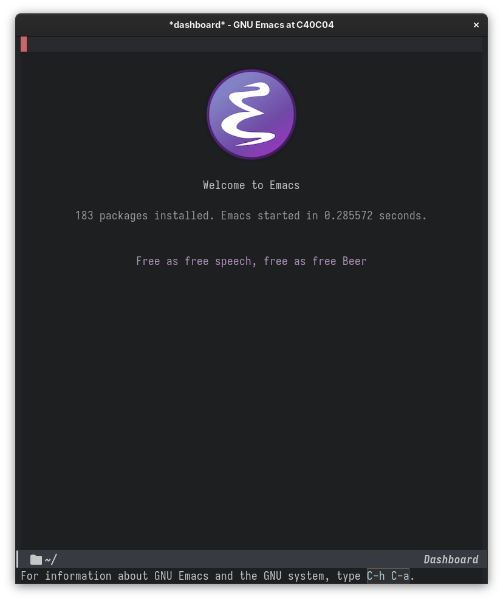
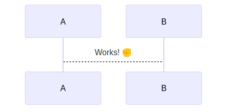

#+TITLE:Emacs configuration
#+AUTHOR: 胡雨軒 Петр
#+LANGUAGE: en
#+PROPERTY: header-args :tangle ./init.el
#+TODO: TODO FIXME | DONE

This file might be most readable in an org-mode buffer directly. You
can also read it from GitHub but it doesn't show source block options
like =:name= or =:tangle=.

The command =org-babel-tangle= (=C-c C-v t=) will write init files.

* How to use this file

These are the most important keystrokes of all. If you know these keys
keystrokes, you can get helpful information whenever you are stuck!
These keystrokes are far more helpful than Google.

- =C-h(elp) b(indings)= shows the keybindings available in the current
  buffer.
- =C-h(elp) d(ocumentation)= lets you search through all available
  documentation.
- =C-h(elp) f(unction)= displays the current list of available
  functions.
- =C-h(elp) i(nfo)= shows the info docs installed on your computer (no
  need to have a browser open just to read documentation).
- =C-h(elp) m(ode)= shows information about all the modes in the buffer.
- =C-h(elp) k(ey)= let’s you type a keystroke and find out what it does.
- =C-h(elp) v(ariable)= displays the list of available variables.

* Getting started

[[file:docs/tutorials/getting-started.org][Getting started]] installs this configuration on NixOS or on macOS:
the Emacs build, the programs it calls, the first start and the
tests.  [[file:docs/reference/dependencies.org][External dependencies]] lists every program and font it uses,
with its nixpkgs attribute, and [[file:docs/README.org][the documentation index]] lists the
other guides.

:FIXME: Don't forget the dependencies of Rust-based emacs!
https://github.com/eval-exec/neomacs

* Key bindings

[[file:docs/reference/keys.org][The key reference]] lists every key this configuration binds, with its
command.  =tests/integrity/session/run cheatsheet= generates it from
the live keymaps, and is run again after each merge; the sections below
explain keys next to the code that binds them.

* Table of contents :TOC_2_org:
- [[How to use this file][How to use this file]]
- [[Getting started][Getting started]]
- [[Key bindings][Key bindings]]
- [[Fundamental Emacs setup][Fundamental Emacs setup]]
  - [[Deploy or retrieve configuration][Deploy or retrieve configuration]]
  - [[Package manager][Package manager]]
  - [[Start-up performance benchmarking][Start-up performance benchmarking]]
  - [[Increase performance and responsiveness][Increase performance and responsiveness]]
  - [[Get autosave and backup files under control][Get autosave and backup files under control]]
  - [[User experience][User experience]]
  - [[Navigating through headlines and document elements][Navigating through headlines and document elements]]
  - [[Navigating through different windows][Navigating through different windows]]
  - [[Setting exec path as $PATH from shell][Setting exec path as $PATH from shell]]
- [[Writing text with Emacs][Writing text with Emacs]]
  - [[Editing markdown code blocks][Editing markdown code blocks]]
  - [[Multiple cursors][Multiple cursors]]
  - [[Help with delimiters][Help with delimiters]]
  - [[Navigating past states of a buffer][Navigating past states of a buffer]]
  - [[Expand or contract selected region][Expand or contract selected region]]
  - [[Reduce a wide blank to one space character][Reduce a wide blank to one space character]]
  - [[Deleting a region when typing on it][Deleting a region when typing on it]]
  - [[Writing prose][Writing prose]]
- [[Org mode][Org mode]]
  - [[Maintain up-to-date table of contents][Maintain up-to-date table of contents]]
  - [[A modern, appealing style for org documents][A modern, appealing style for org documents]]
  - [[Beautiful :TODO: tags][Beautiful :TODO: tags]]
  - [[Org task system][Org task system]]
  - [[Org capture anywhere][Org capture anywhere]]
  - [[Drawing diagrams in org-mode][Drawing diagrams in org-mode]]
  - [[=vellum= LaTeX class for Org export][=vellum= LaTeX class for Org export]]
  - [[Readable wide tables][Readable wide tables]]
- [[Working with files][Working with files]]
  - [[File manager][File manager]]
  - [[Files in a project][Files in a project]]
  - [[Respecting editorconfig][Respecting editorconfig]]
  - [[Adding a newline on save][Adding a newline on save]]
- [[Searching text in file and across files][Searching text in file and across files]]
  - [[Bulk editing search results (embark → wgrep)][Bulk editing search results (embark → wgrep)]]
- [[Git, the proper way][Git, the proper way]]
  - [[Display changes in place][Display changes in place]]
  - [[List todo items][List todo items]]
  - [[Better diff colouring][Better diff colouring]]
  - [[Interacting with GitHub, GitLab, and the likes][Interacting with GitHub, GitLab, and the likes]]
  - [[Use GPG key to sign commits][Use GPG key to sign commits]]
  - [[Performance tuning for magit][Performance tuning for magit]]
  - [[Structural diff][Structural diff]]
- [[Programming with Emacs][Programming with Emacs]]
  - [[Language server protocol][Language server protocol]]
  - [[Powerful, efficient code parsing with tree-sitter][Powerful, efficient code parsing with tree-sitter]]
  - [[Auto-completion][Auto-completion]]
  - [[Displaying line numbers][Displaying line numbers]]
  - [[Folding blocks of text][Folding blocks of text]]
  - [[Indentation level indicators][Indentation level indicators]]
  - [[Uniform formatter UI][Uniform formatter UI]]
  - [[Language specifics][Language specifics]]
- [[Spelling and language checking][Spelling and language checking]]
  - [[Multilingual spell checking (jinx)][Multilingual spell checking (jinx)]]
  - [[Grammar checking via LTeX language server][Grammar checking via LTeX language server]]
  - [[French grammar: Grammalecte][French grammar: Grammalecte]]
  - [[Chinese: input method, spacing, and fonts][Chinese: input method, spacing, and fonts]]
  - [[Reference: language checking][Reference: language checking]]
- [[Interacting with the outer world][Interacting with the outer world]]
  - [[Other emacs servers][Other emacs servers]]
  - [[Browsing documentation][Browsing documentation]]
  - [[Local language models][Local language models]]
  - [[Rest client][Rest client]]
  - [[Shell terminals][Shell terminals]]
  - [[Kubernetes][Kubernetes]]
  - [[Init system services][Init system services]]
  - [[Visualising key strokes][Visualising key strokes]]
  - [[Reading epub][Reading epub]]
  - [[Playing music][Playing music]]
  - [[World clocks][World clocks]]
  - [[Emacs MCP][Emacs MCP]]
- [[Start-up performance][Start-up performance]]
- [[Machine-local configuration][Machine-local configuration]]
- [[Ends of file][Ends of file]]
- [[Other][Other]]

* Fundamental Emacs setup

Of course Emacs can be used from scratch, even with quite a few rough
edges. This section contains fundamental configuration I'm not ready
to live without. Other things like org-mode and LSP are optional.

** Deploy or retrieve configuration

If you need it you can see [[How to use this file][how to use this file]].

#+NAME: repo-path
#+BEGIN_SRC elisp :cache yes :tangle no
(expand-file-name ".")
#+END_SRC

Pay special attention to any script or installation which would
silently modify configuration files: it these changes are needed,
replicate them here so they won't be erased.

#+BEGIN_SRC elisp
;;; package -- Summary  -*- lexical-binding: t; -*-
;;; Commentary:
;;;   Emacs configuration generated from =README.org=.
;;;
;;;   You can modify this file as you wish so, but keep in mind in the
;;;   long term it's better to keep a clean generation from the
;;;   literate documentation file.

;;; Code:
#+END_SRC

#+BEGIN_SRC elisp :tangle ./early-init.el
;;; package -- Summary  -*- lexical-binding: t; -*-
;;; Commentary:
;;;   Emacs configuration generated from =README.org=.
;;;
;;;   You can modify this file as you wish so, but keep in mind in the
;;;   long term it's better to keep a clean generation from the
;;;   literate documentation file.

;;; Code:
#+end_src

*** Modularity

If this is your main local configuration and you don't want to deviate
from it, it's more sustainable in the long run to have =~/.emacs.d= as a
directory contains links to some =*.el= files you want. This has the
benefit of keeping the =.gitignore= and the git repository clean, and
the file =straight/versions/default.el= can be versioned normally
without =git add --force= when you remember it. It makes a new install
more stable and draw a balanced line between local state and
transferable configuration.

*** Platform predicates

This configuration runs on GNU/Linux and macOS; platform guards should
test these two constants rather than =system-type=.

#+BEGIN_SRC elisp
(defconst my/macos-p (eq system-type 'darwin)
  "Non-nil when Emacs runs on macOS.")

(defconst my/linux-p (eq system-type 'gnu/linux)
  "Non-nil when Emacs runs on GNU/Linux.")
#+END_SRC

*** Personal settings

The options of this configuration, most of them machine-local values
that =local.el= sets, belong to one customization group.

#+BEGIN_SRC elisp
(defgroup my nil
  "Personal settings of this Emacs configuration."
  :group 'convenience)
#+END_SRC

*** Ignore bundled packages

Using the latest version of org-mode and no the outdated built-in one
is not trivial; better to keep this block quite high in the init file.

If issues persist, removing a package from Emacs load path might help:

#+BEGIN_SRC elisp
(defconst my/line-width 120
  "Preferred line width for both hard wrapping (fill-column) and visual wrapping.")
#+END_SRC

#+BEGIN_SRC elisp
(when-let (library (locate-library "org" nil load-path))
  (setq-default load-path (delete (substring (file-name-directory library) 0 -1)
                                  load-path)))
#+END_SRC

** Package manager
*** Preventing ~packages.el~ from loading

#+BEGIN_SRC elisp :tangle ./early-init.el
(setq package-enable-at-startup nil)
#+END_SRC

*** Avoid ~straight.el~ start-up performance hit

See [[https://github.com/radian-software/straight.el?tab=readme-ov-file#customizing-when-packages-are-built][supporting documentation]].

#+BEGIN_SRC elisp
(setq straight-check-for-modifications '(find-when-checking check-on-save))
(setq straight-cache-autoloads t)
#+END_SRC

*** Bootstraping ~straight.el~

This should hopefully be checked and refreshed manually every now and
then by looking up [[https://github.com/radian-software/straight.el#getting-started][Straight's README]].

#+NAME: straight-el-bootstraping-code
#+BEGIN_SRC elisp
(defvar bootstrap-version)
(let ((bootstrap-file
       (expand-file-name
        "straight/repos/straight.el/bootstrap.el"
        (or (bound-and-true-p straight-base-dir)
            user-emacs-directory)))
      (bootstrap-version 7))
  (unless (file-exists-p bootstrap-file)
    (with-current-buffer
        (url-retrieve-synchronously
         "https://raw.githubusercontent.com/radian-software/straight.el/develop/install.el"
         'silent 'inhibit-cookies)
      (goto-char (point-max))
      (eval-print-last-sexp)))
  (load bootstrap-file nil 'nomessage))
#+END_SRC

*** Rely on ~use-package~ to install and load packages

Emacs ships =use-package= since 29.1, and =which-key= and =editorconfig=
since 30.1.  Where Emacs ships them, straight.el treats them as
built-in, so no build of its own shadows them; nothing requires a
newer version.  A library found right after straight.el starts, before
it activates any build, is one Emacs or the system ships.  Without
them, as on an older Emacs, straight.el builds them; =use-package=
then comes from the full git coordinates below, as =package.el= is
disabled.

Other packages Emacs ships are still built by straight.el, because
packages require newer versions than older Emacs releases ship:
=transient= (0.13 for magit and forge), =seq= (2.24 for magit, cider,
flycheck and pet), =eldoc= (1.11 for lsp-mode), =project= (0.9.8 for
breadcrumb, with =xref= for =project=) and =jsonrpc= (1.0.25 for dape).
straight.el compares no versions, so it cannot tell when the shipped
one is recent enough.

#+BEGIN_SRC elisp
(dolist (package '(use-package which-key editorconfig))
  (when (locate-library (symbol-name package))
    (add-to-list 'straight-built-in-pseudo-packages package)))

(straight-use-package
 (if (memq 'use-package straight-built-in-pseudo-packages)
     'use-package
   '(use-package
      :type git
      :host github
      :repo "emacs-straight/use-package"
      :branch "master")))

(setq straight-use-package-by-default t)
(setq use-package-always-defer t)
#+END_SRC

According to [[https://github.com/jwiegley/use-package][the documentation]]:
- ~:init~ executes code before a package is loaded;
- ~:config~ executes code after a package was loaded;
- ~:custom~ defines custom variables for this package.

*** Safe package update

=C-c P u= updates every package, and keeps the update only when the
configuration still passes its fast tests:
1. refuse to start when =tests/run= under =user-emacs-directory= is
   missing or not executable, before anything changes;
2. pull every package with ~straight-pull-all~, then rebuild the
   changed ones with ~straight-check-all~;
3. run =tests/run fast= in the buffer =*Package update tests*=, while
   Emacs stays usable;
4. on success, write the new versions to the lockfile with
   ~straight-freeze-versions~; otherwise restore the lockfile versions
   with ~straight-thaw-versions~ and rebuild.

Every outcome but success restores the lockfile versions: a fetch or
merge that failed for some repositories, an error or =C-g= during the
pull or the rebuild, a test run that could not start, and a test run
that failed.  The restore names the repositories it could not check
out.  straight.el asks what to do about a repository it cannot pull or
check out; the command never discards local changes itself.  A second
=C-c P u= is refused while the tests of the first one run.  The freeze
or thaw runs from the process sentinel once the tests end: it blocks
Emacs, and Emacs inhibits =C-g= there, which is deliberate, since a
thaw stopped half way leaves the tree inconsistent.  macOS has no
private X display for the test frames, so there the tests run with
=EMACS_TEST_GUI=0=.

The fast tests include the golden tests,
=tests/scenarios/l1-golden-gui.el=: for each fixture of
=tests/golden/=, the face of every token and the result of
=indent-region= are recorded.  An update that changes them fails, and
the test buffer names the first line that differs.  To keep an
intended change, pull with =M-x straight-pull-all= and rebuild with
=M-x straight-check-all= (the test sessions load the built packages
and never rebuild them), approve the new records with
=UPDATE_GOLDEN=1 tests/run fast golden=, review and commit
=tests/golden/=, then press =C-c P u= again.  To abandon the update
instead, run =M-x straight-thaw-versions=, then =M-x
straight-check-all=.  They need a graphical frame, so macOS skips
them.

~C-c P~ is a prefix reserved for package-management commands, shown by
which-key.

#+BEGIN_SRC elisp
(defvar my/straight-safe-update-boundaries
  ;; `straight-pull-all' returns only the merge failures.
  (list :pull (lambda () (delete-dups (append (straight-fetch-all) (straight-merge-all))))
        :rebuild #'straight-check-all
        :test (lambda (runner done)
                ;; Run RUNNER fast asynchronously; call DONE with its exit
                ;; status.  Signal when it cannot start.
                (let ((default-directory user-emacs-directory)
                      (process-environment
                       (if my/macos-p
                           (cons "EMACS_TEST_GUI=0" process-environment)
                         process-environment))
                      (buffer (get-buffer-create "*Package update tests*")))
                  (with-current-buffer buffer (erase-buffer))
                  (display-buffer buffer)
                  (make-process
                   :name "package-update-tests"
                   :buffer buffer
                   :command (list runner "fast")
                   :sentinel (lambda (process _event)
                               (unless (process-live-p process)
                                 (funcall done (process-exit-status process)))))))
        :freeze #'straight-freeze-versions
        :thaw #'straight-thaw-versions)
  "The effects of `my/straight-safe-update', as a plist of functions.
:pull pulls every package and returns the recipes it could not pull;
:rebuild rebuilds the changed packages; :test takes the test runner
and a function it calls with the exit status of `RUNNER fast'; :freeze
writes the lockfile; :thaw checks out the lockfile versions and returns
the recipes it could not check out.")

(defun my/straight-safe-update ()
  "Update every package, keeping the update only if the fast tests pass.
Pull every package and rebuild the changed ones, then run `tests/run
fast'.  When the tests pass, write the new versions to the lockfile;
when a pull fails, the pull or rebuild signals or is quit, or the tests
fail or cannot start, restore the lockfile versions and rebuild."
  (interactive)
  (let* ((effect (lambda (key &rest arguments)
                   (apply (plist-get my/straight-safe-update-boundaries key) arguments)))
         (packages (lambda (recipes)
                     (mapconcat (lambda (recipe) (plist-get recipe :package)) recipes ", ")))
         (runner (expand-file-name "tests/run" user-emacs-directory))
         (restore (lambda (reason)
                    (let ((unthawed (funcall effect :thaw)))
                      (funcall effect :rebuild)
                      (if unthawed
                          (message "Package update undone: %s; %s not checked out, run M-x straight-thaw-versions"
                                   reason (funcall packages unthawed))
                        (message "Package update undone: %s; the lockfile versions are back"
                                 reason))))))
    (unless (file-executable-p runner)
      (user-error "Package update not started: %s is not an executable file" runner))
    (when (process-live-p (get-process "package-update-tests"))
      (user-error "Package update not started: the tests of the previous one still run"))
    (when-let* ((reason
                 (condition-case err
                     (if-let* ((unpulled (funcall effect :pull)))
                         (format "%s not pulled" (funcall packages unpulled))
                       (funcall effect :rebuild)
                       ;; Freeze and thaw run from the sentinel, where Emacs
                       ;; inhibits C-g: a half-done thaw is worse than a wait.
                       (funcall effect :test runner
                                (lambda (status)
                                  (if (not (eql status 0))
                                      (funcall restore (format "the tests failed (exit %s)" status))
                                    (message "Package update: the tests passed, freezing the lockfile")
                                    (funcall effect :freeze))))
                       nil)
                   ((error quit)
                    (format "the update stopped (%s)" (error-message-string err))))))
      (funcall restore reason))))

(keymap-global-set "C-c P u" #'my/straight-safe-update)
#+END_SRC

*** Test framework

The tests of this configuration, which the safe update runs, are
written with [[https://github.com/jorgenschaefer/emacs-buttercup][buttercup]].  It is declared here so that straight.el
installs it and the lockfile pins it; only a test session loads it.

#+BEGIN_SRC elisp
(use-package buttercup)
#+END_SRC

** Start-up performance benchmarking
:PROPERTIES:
:CUSTOM_ID: startup_benchmark
:END:

=benchmark-init= wraps every =require= call with timing advice so each
load is individually measured.  That instrumentation itself costs time
— enough to inflate startup noticeably when running normally.  The
package is therefore only activated when the =EMACS_PROFILE= env var is
set, and is completely absent from =features= during a normal launch:
no load cost, no per-call overhead.

#+BEGIN_SRC elisp
(use-package benchmark-init
  ;; Only activate when explicitly profiling — benchmark-init wraps every
  ;; `require' call with timing advice, which itself adds latency to each
  ;; require during normal startup.  Set the EMACS_PROFILE env variable to
  ;; opt in: EMACS_PROFILE=1 emacs
  :if (getenv "EMACS_PROFILE")
  :demand t
  :init (benchmark-init/activate)
  :hook (after-init . benchmark-init/deactivate))
#+END_SRC

To profile startup, launch with =EMACS_PROFILE=1 emacs= then call
=M-x benchmark-init/show-durations-tree=.

** Increase performance and responsiveness
:PROPERTIES:
:CUSTOM_ID: emacs_performance
:END:

Measure initialization and a usable graphical frame separately. The value
=after-init-time - before-init-time= excludes startup hooks, frame setup,
and later idle work. An =--eval= expression that immediately calls
=kill-emacs= therefore does not measure a usable editor. See the
[[https://www.gnu.org/software/emacs/manual/html_node/elisp/Startup-Summary.html][GNU startup sequence]] and the measurement report of plan 036 (2026-09-06).

*** Reproducible measurements

Run the opt-in harness from a dedicated worktree with the installed
Emacs and its existing packages. It copies mutable editor state and
uses private server sockets and disposable Git projects. As in the
tests, it reads the live packages, builds and native caches read-only:
straight.el safe mode forbids rebuilding them, and git climbs from no
package's subdirectory into its repository. =snapshot.py= copies the
package repositories, about 2.3 GiB, for =run.py --packages=; the
builds still come from the live tree.

#+begin_src bash :tangle no
python3 tests/performance/run.py --output tmp/startup-measured
python3 tests/performance/run.py --minimal --output tmp/startup-minimal
python3 tests/performance/run.py --client --output tmp/client-measured
python3 tests/performance/compare.py --daemon --output tmp/daemon-boots BEFORE AFTER
python3 tests/performance/smoke.py --output tmp/startup-smoke
python3 tests/performance/runtime.py --output tmp/editing --seconds 60
python3 tests/performance/runtime.py --output tmp/soak --seconds 1800
python3 tests/performance/analyze.py tmp/soak/runtime.jsonl --skip-samples 120
python3 tests/performance/workflows.py --output tmp/workflows
python3 tests/performance/first_use.py --output tmp/first-use --idle 3
tests/run.sh
tests/test-integration.sh
#+end_src

=compare.py= alternates the source directories it is given, each
holding an =init.el= and an =early-init.el=, reversing their order
every round; =--daemon= times daemon boots instead of framed starts.
=first_use.py= times the first =C-x g=, =C-x b=, =C-s= and =M-.= in a
client frame, each on a fresh daemon idle for =--idle= seconds, and
checks that each key showed what it opens.

Use a new output directory for every run. Startup defaults to two
warm-up launches followed by 30 measured launches. The first launch
remains in the raw data; it is not called filesystem-cold. The summary
reports the median, nearest-rank p95, maximum and failures. Manifests
record source hashes, commit, package revisions, Emacs binary, backend
and native-cache state. Frame dimensions and visibility are recorded
in every startup sample.

Frames draw on a private Xvfb display, as the test frames do, so no
measurement reaches the user's screen. That display is X11 under GTK,
not the user's Wayland: compare its numbers with each other. Every
script that starts Emacs takes =--user-display= to draw on the
inherited display instead, and needs it without Xvfb or with an Emacs
that cannot draw on X, as on macOS. There, on Linux with a Wayland display, the harness selects
=GDK_BACKEND=wayland= for its private children. =EMACS_PERF_BACKEND=x11=
explicitly tests XWayland. The ambient shell on this machine currently
forces X11, which can also break client-frame creation when the client
passes a Wayland display name. The harness does not modify shell or
system settings. macOS runtime results remain unmeasured.

The readiness command runs after window setup and forces redisplay.
Client measurements include another IPC round trip to inspect and
redisplay the created frame, so they are conservative software
measurements. Neither measures physical input-to-photon latency or
proves equality with Zed.

For attribution, add =--profile= to a startup or runtime command.
Runtime =--profile-delay 15 --seconds 45= separates the later profile
from first use. CPU and allocation profiles can be opened with
=profiler-find-profile=, or summarized with:

#+begin_src bash :tangle no
emacs --batch -Q --load tests/performance/profile-summary.el \
  tmp/editing/runtime.jsonl.cpu.el tmp/editing/runtime.jsonl.memory.el
#+end_src

Repeat acceptance timings with profiling disabled. Additional runtime
options are =--large=, =--long-lines=, =--interval .1= for denser command
sequences, and repeatable =--copy path= for disposable copies of real
files. The probes distinguish first file opening, server
initialization, editing commands plus redisplay, and command-loop gaps
between timer callbacks. A server reporting initialized is not proof
that every external index or possible workflow is ready. The scenario
integrations exercise actual navigation and formatting separately. See
[[https://www.gnu.org/software/emacs/manual/html_node/elisp/Profiling.html][GNU profiling documentation]].

*** Garbage collection policy

Automatic collection requires both the byte threshold and the percentage
of the current heap to be exceeded. Raising the threshold postpones
collection; it does not make allocation free or prevent explicit calls to
=garbage-collect=. Larger heaps can create memory pressure and longer
individual pauses. See [[https://www.gnu.org/software/emacs/manual/html_node/elisp/Garbage-Collection.html][GNU garbage collection documentation]].

The configured runtime threshold is 512 MiB. The MCP security wrapper
temporarily binds it to 1 MB during tool evaluations, then restores it.
Read runtime values through an ordinary private =emacsclient --eval=
session when profiling; an MCP observation inside that wrapper describes
the evaluation, not the editor's normal GC policy. The 32 and 64 MiB
experiments reduced resident memory but increased total GC time without
improving editing p95, so the existing threshold was retained.

*** Optimise garbage collection on startup

#+BEGIN_SRC elisp :tangle ./early-init.el
(defvar my/gc-cons-threshold (* 512 1024 1024) ; in bytes
  "My default desired value of `gc-cons-threshold'
during normal emacs operations.")

;; Automatic GC requires BOTH the byte threshold and the heap percentage
;; to be exceeded. A high startup threshold postpones automatic collection;
;; it cannot prevent a package from calling `garbage-collect' explicitly.
;; Restore a bounded runtime threshold after startup.
(setq gc-cons-threshold most-positive-fixnum
      gc-cons-percentage 1.0)

(defun my/restore-gc-threshold ()
  "Restore the runtime garbage collection thresholds after startup."
  (setq gc-cons-threshold my/gc-cons-threshold
        gc-cons-percentage 0.1))

(add-hook 'emacs-startup-hook #'my/restore-gc-threshold)
#+END_SRC

*** Better handling of compiled compiled files

#+BEGIN_SRC elisp :tangle ./early-init.el
;; Don't check outdated compiled lisp files.
(setq load-prefer-newer noninteractive)

;; Asynchronous package compilation
(setq native-comp-jit-compilation t)

;; Suppress the *Compile-Log* buffer that byte-compile would otherwise open.
(setq byte-compile-verbose nil)
#+END_SRC

*** Temporarily avoid special handling of files

We also set the ~file-name-handler-alist~ to an empty list, and reset
it after Emacs has finished initializing. No needs to match every file
loaded with a regular expression.

#+BEGIN_SRC elisp :tangle ./early-init.el
(defvar my/file-name-handler-alist file-name-handler-alist)
(setq file-name-handler-alist nil)
(defun my/restore-file-name-handlers ()
  "Restore the file name handlers that startup ran without."
  (setq file-name-handler-alist my/file-name-handler-alist))

(add-hook 'emacs-startup-hook #'my/restore-file-name-handlers)
#+end_src

*** Disable =site-run-file=
#+BEGIN_SRC elisp :tangle ./early-init.el
(setq site-run-file nil)
#+end_src

*** Only handle Git as VC backend

Emacs probes every registered backend (SVN, Mercurial, Bazaar, …) on
each file open. Limiting to Git alone saves ~20–30 ms on startup and
on every =find-file=.

#+BEGIN_SRC elisp :tangle ./early-init.el
(setq vc-handled-backends '(Git))
#+END_SRC

*** Don't compact font caches
#+BEGIN_SRC elisp :tangle ./early-init.el
(setq inhibit-compacting-font-caches t)
#+end_src

*** Startup screen and scratch buffer

=inhibit-startup-screen= stays nil, as commit =5214044= reinstated the
splash screen.  Emacs shows it only when =initial-buffer-choice= is
nil, and the [[Start-up dashboard][start-up dashboard]] sets that option, so the dashboard
is what a new frame shows.  =*scratch*= opens in =fundamental-mode=
with no message.

Emacs ignores =inhibit-startup-echo-area-message= unless the init file
sets it with a literal =setq= to the login name, or Customize does; the
login name is a host value, so =local.el.example= shows how to set it
there.

#+BEGIN_SRC elisp :tangle ./early-init.el
(setq inhibit-startup-screen nil
      ;; Open *scratch* in fundamental-mode with no welcome message —
      ;; the fastest possible startup buffer.  (lisp-interaction-mode,
      ;; the default, loads a minor amount of extra code at frame open.)
      initial-major-mode 'fundamental-mode
      initial-scratch-message nil)
#+END_SRC

*** Improve I/O

Emacs reads at most =read-process-output-max= bytes from a process at
a time; language servers send messages of several megabytes, which
then take many reads.  The value is the 4 MiB that eat's block used to
set, now from startup instead of from the first use of eat.  Emacs
also delays its reads from a process that sends little at a time
(=process-adaptive-read-buffering=), which adds latency to terminals;
it is off from startup too, for every process.

#+BEGIN_SRC elisp :tangle ./early-init.el
(setq read-process-output-max (* 4 1024 1024)
      process-adaptive-read-buffering nil)
#+end_src

*** Not wasting time on font resize

Resizing the Emacs frame can be a terribly expensive part of changing
the font. By inhibiting this, we easily halve startup times with fonts
that are larger than the system default.

#+BEGIN_SRC elisp :tangle ./early-init.el
(setq frame-inhibit-implied-resize t)
(setq default-frame-alist '((width . 95) (height . 45)))
#+END_SRC

I like the quaint splash screen!

*** Disable bidirectional text scanning

Most files never contain right-to-left text. Emacs runs an expensive
bidirectional paragraph-direction algorithm on every line of every
redisplay. Locking all buffers to left-to-right and disabling the bidi
parenthetical algorithm (BPA) cuts redisplay cost noticeably,
especially on long lines.

#+BEGIN_SRC elisp :tangle ./early-init.el
;; Default all buffers to left-to-right; restore per-buffer when editing Arabic/Hebrew.
(setq-default bidi-paragraph-direction 'left-to-right)
;; Disable the expensive bidi parenthetical algorithm.
(setq bidi-inhibit-bpa t)
#+END_SRC

*** Historical measurements

Earlier notes reported approximately 270 ms of initialization on Emacs
30.2 after deferring several packages. Those measurements ended before
all startup work finished, used only a few samples, and did not establish
filesystem cache state. They cannot substantiate a graphical readiness
claim. Older terminal/GUI figures also lacked trustworthy units and a
reproducible boundary; use the harness above for current comparisons.
Dashboard has since been reinstated as an empty startup screen.

Portable dumps and custom Emacs builds were not part of this experiment.
Compiled initialization was tested in a disposable copy and rejected when
its additional regeneration requirements did not produce a repeatable
full-readiness improvement.

For performance it's quite important to have both native JSON and
native compilation enabled, even if it tends to be quite normal as a
default these days.

#+BEGIN_SRC elisp :tangle no
(if (and (fboundp 'native-comp-available-p)
         (native-comp-available-p))
    (message "Native compilation is available")
  (message "Native complation is *not* available"))

(if (functionp 'json-serialize)
  (message "Native JSON is available")
(message "Native JSON is *not* available"))
#+END_SRC

** Get autosave and backup files under control

=no-littering= redirects all Emacs state files into organised
subdirectories of =~/.emacs.d/var/= and =~/.emacs.d/etc/=.  It
covers autosaves, backups, and =custom-file=, so we don’t need to set
those manually.

#+BEGIN_SRC elisp
(use-package no-littering
  :demand t
  :config
  (setq auto-save-file-name-transforms `((".*" ,(no-littering-expand-var-file-name "autosaves/") t))
        custom-file (no-littering-expand-etc-file-name "custom.el")
        backup-directory-alist `((".*" . ,(no-littering-expand-var-file-name "backups/"))))
  ;; Ensure target directories exist — auto-save and backup fail silently
  ;; if the directory is missing, especially on a fresh install.
  (make-directory (no-littering-expand-var-file-name "autosaves/") t)
  (make-directory (no-littering-expand-var-file-name "backups/") t)
  (when (file-exists-p custom-file)
    (load custom-file)))
#+END_SRC

** User experience

#+BEGIN_SRC elisp
(setq ;; Double-spaces after periods is morally wrong.
      sentence-end-double-space nil
      ;; Save existing clipboard text into the kill ring before replacing it.
      save-interprogram-paste-before-kill t
      ;; Prompts should go in the minibuffer, not in a GUI.
      use-dialog-box nil
      ;; accept 'y' or 'n' instead of yes/no
      use-short-answers t
      ;; compilation buffers (cargo, pytest-watch, ...) follow new output
      compilation-scroll-output t
      ;; C-\ toggles the Pinyin input method, see the Chinese section
      default-input-method "pyim"
      ;; if native-comp is having trouble, there's not very much I can do
      native-comp-async-report-warnings-errors 'silent
      ;; unicode ellipses are better
      truncate-string-ellipsis "…"
      ;; keep the point in the same place while scrolling
      scroll-preserve-screen-position t
      ;; don't keep duplicate entries in kill ring
      kill-do-not-save-duplicates t)

;; M-q and auto-fill wrap at my/line-width columns in every buffer.
;; fill-column is buffer-local: setq would change only the buffer
;; current while init runs.
(setq-default fill-column my/line-width)

;; Standard region selection keys.
;; Note: On macOS, System Settings can steal C-SPC for input source switching.
(keymap-global-set "C-SPC" #'set-mark-command)
(keymap-global-set "C-@" #'set-mark-command)
(transient-mark-mode 1)

;; Never mix tabs and spaces. Never use tabs, period.
;; We need the setq-default here because this becomes
;; a buffer-local variable when set.
(setq-default indent-tabs-mode nil)
(set-charset-priority 'unicode)
(prefer-coding-system 'utf-8-unix)

;; Defer minor-mode activations to emacs-startup-hook so they don't
;; slow down the critical init path.  All eight are cheap once Emacs
;; is up, but calling them at top-level adds latency before the frame
;; is shown for the first time.
;; Disable hl-line in every terminal / shell mode so the
;; highlight bar does not interfere with the cursor line.
(defun my/disable-hl-line ()
  "Disable `hl-line-mode' in the current buffer."
  (hl-line-mode -1))
(dolist (hook '(mistty-mode-hook
              gterm-mode-hook
              term-mode-hook
              shell-mode-hook
              eshell-mode-hook))
  (add-hook hook #'my/disable-hl-line))

(defun my/enable-global-modes ()
  "Turn on the global editing modes, once startup has finished."
  (delete-selection-mode t)
  (global-hl-line-mode)
  (column-number-mode)
  (savehist-mode)
  (save-place-mode 1)
  (setq auto-revert-avoid-polling t   ; rely on file notifications (kqueue on macOS)
        auto-revert-check-vc-info nil) ; VC info polling is expensive; magit handles it
  (global-auto-revert-mode)
  (when (fboundp 'pixel-scroll-precision-mode)
    (pixel-scroll-precision-mode 1))
  (global-so-long-mode 1))

(add-hook 'emacs-startup-hook #'my/enable-global-modes)
#+END_SRC

Disable menu bar. Put this in early init as to avoid wasting time
redrawing the frame.

#+BEGIN_SRC elisp :tangle ./early-init.el
(push '(menu-bar-lines . 0) default-frame-alist)
(push '(tool-bar-lines . 0) default-frame-alist)
(push '(vertical-scroll-bars) default-frame-alist)
#+END_SRC

#+BEGIN_SRC elisp
(use-package eval-sexp-fu
  :hook (prog-mode . turn-on-eval-sexp-fu-flash-mode))

(setq visible-bell t)
;; mouse-wheel-tilt-scroll enables horizontal scrolling via trackpad
;; tilt/swipe.  On macOS this causes the viewport to drift sideways on
;; long lines (e.g. single-line src blocks) during vertical scrolling,
;; because the trackpad reports diagonal movement.  Keep it off;
;; hscroll is still available via C-x < / C-x >.
(setq mouse-wheel-tilt-scroll nil)

(when my/macos-p
  (setq mac-function-modifier 'super)
  ;; Sometimes we need # for comments
  (setq mac-right-option-modifier 'none))

(when my/linux-p
  ;; TODO: I'd like to ignore the left control to preserve my hand.
  (define-key key-translation-map (kbd "<menu>") 'event-apply-super-modifier))

;; Wayland clipboard for terminal frames (emacs -nw, emacsclient -t).
;; Graphical PGTK frames have the native Wayland clipboard.  One daemon
;; serves both kinds of frame, so the selected frame decides at each
;; copy and paste, not the frame, if any, that exists at startup.
(when (and my/linux-p
           (getenv "WAYLAND_DISPLAY"))
  (defun my/wl-copy (text)
    "Copy TEXT to the clipboard: with wl-copy from a terminal frame."
    (if (display-graphic-p)
        (gui-select-text text)
      (let ((proc (make-process :name "wl-copy"
                                :buffer nil
                                :command '("wl-copy" "-f" "-n")
                                :connection-type 'pipe)))
        (process-send-string proc text)
        (process-send-eof proc))))
  (defun my/wl-paste ()
    "Return the clipboard text: with wl-paste from a terminal frame."
    (if (display-graphic-p)
        (gui-selection-value)
      (shell-command-to-string "wl-paste --no-newline")))
  (setq interprogram-cut-function   #'my/wl-copy
        interprogram-paste-function #'my/wl-paste))

(use-package crux
  :bind ([remap move-beginning-of-line] . crux-move-beginning-of-line))
#+END_SRC

*** Fast Scroll

Fontification is handled by jit-lock's demand-driven mode with an
input-aware deferral strategy.  The behaviour of =jit-lock-defer-time=
is determined by the C redisplay engine calling =jit-lock-function=
(=jit-lock.el:367=):

- *nil (Emacs default)*: =jit-lock-defer-timer= is never created.
  Every redisplay cycle that encounters unfontified text calls
  =jit-lock-fontify-now= synchronously — fontification is immediate but
  can block input processing in buffers with many jit-lock clients
  (font-lock, pangu-spacing, etc.).

- *0 (our setting)*: a global idle timer is created with delay 0.
  =jit-lock-function= checks =(input-pending-p)=: when no input is
  pending, text is fontified immediately (same as nil); when input IS
  pending, the region is marked =fontified='defer= and the buffer is
  added to =jit-lock-defer-buffers=.  The idle timer fires
  =jit-lock-deferred-fontify=, which resets those regions to
  =fontified=nil= and calls =(redisplay)= so the engine re-fontifies
  them normally.  Result: typing and scrolling are never blocked by
  fontification; text appears briefly unfontified during rapid input,
  then catches up in the very next idle moment.

- *N (positive seconds)*: fontification is always deferred regardless
  of input state.  =jit-lock-deferred-fontify= fires after N seconds
  idle.  This adds a fixed visual lag to every fontification event and
  is generally undesirable.

Stealth fontification pre-fontifies the rest of the buffer during
idle time so that jumping to a previously invisible region is less
likely to cause a visible pause.

Two additional C-level redisplay settings eliminate the stall that
occurs when holding down an arrow key causes the first window scroll.
=fast-but-imprecise-scrolling= tells the display engine to skip
fontification of intermediate screens during rapid scrolling.
=redisplay-skip-fontification-on-input= (Emacs 28+) goes further: when
input is already pending at the start of a command, the
=fontification_functions= hook is not called at all, letting the scroll
catch up before fontifying.

#+begin_src elisp
;; Defer fontification while input is pending (jit-lock-defer-time 0).
;; See the detailed explanation above.  This is the single most
;; effective interactive-latency improvement: it prevents font-lock,
;; pangu-spacing, and other jit-lock clients from blocking keystrokes.
(setq jit-lock-defer-time 0)
;; Stealth-fontify the rest of the buffer during idle time, reducing
;; the chance of a pause when you jump to an unfontified region.
(setq jit-lock-stealth-time 0.2
      jit-lock-stealth-nice 0.1)
;; When scrolling rapidly past unfontified regions, only fontify the
;; portion actually displayed — skip intermediate screens entirely.
(setq fast-but-imprecise-scrolling t)
;; Skip fontification_functions when input is already pending.  This
;; prevents the first window-scroll during held-down arrow keys from
;; blocking: without it, the C redisplay engine calls jit-lock on the
;; entire newly visible region synchronously before reading the next
;; input event.  With it, that fontification is skipped when Emacs is
;; behind on input, letting the scroll catch up first.
(setq redisplay-skip-fontification-on-input t)
;; Auto vertical scroll computes margins on every scroll event — disable it.
(setq auto-window-vscroll nil)
#+end_src

Package [[https://github.com/ahungry/fast-scroll][fast-scroll]] "works by temporarily disabling font-lock and
switching to a barebones mode-line, until you stop scrolling (at which
point it re-enables)". It only does this when scrolling super fast, to
keep everything responsive.

#+begin_src emacs-lisp :tangle no
(use-package fast-scroll
  :defer 1
  :hook
  (fast-scroll-start . (lambda () (flycheck-mode -1)))
  (fast-scroll-end . (lambda () (flycheck-mode 1)))
  :config
  (fast-scroll-config)
  (fast-scroll-mode 1))
#+end_src

*** Discoverable key bindings

Name prefix menus by their purpose.  A key means one thing wherever it
is bound, so the label of a prefix is the same in every buffer: =C-c d=
is the debugger, in Python and Java buffers, and =C-c k= the test
runner, in Python and Clojure buffers.  =C-c C-t= and =C-c TAB= are
prefixes of Python buffers only, so only Python buffers name them.
Labels do not change bindings.

#+BEGIN_SRC elisp
(use-package which-key
  :hook (emacs-startup . which-key-mode)
  :custom
  (which-key-popup-type 'side-window)
  (which-key-side-window-location 'bottom)
  (which-key-side-window-max-height 0.5)
  (which-key-max-display-columns 2)
  (which-key-show-docstrings t)
  (which-key-max-description-length 0.42)
  :config
  (which-key-add-key-based-replacements
    "C-c d"   "Debug"
    "C-c k"   "Run tests"
    "C-c C"   "Cargo"
    "C-c F"   "File tree"
    "C-c g"   "Change hunks"
    "C-c n"   "Nix"
    "C-c P"   "Manage Emacs packages"
    "C-c s"   "Search files"
    "C-c v"   "View"
    "C-c z"   "Fold code"
    "C-c &"   "Snippets"
    "C-x a"   "Abbreviations"
    "C-x n"   "Narrow view"
    "C-x p"   "Project"
    "C-x r"   "Registers and rectangles"
    "C-x t"   "Tabs"
    "C-x w"   "Window layout"
    "C-x x"   "Buffer actions"
    "C-x 8"   "Insert Unicode"
    "C-x RET" "Encoding"
    "C-x C-a" "Debug"
    "C-x 4"   "Other window"
    "C-x 5"   "Other frame"
    "C-x C-k" "Keyboard macros"
    "C-x v"   "Version control")
  ;; which-key matches a major mode exactly: python-mode runs without
  ;; the python grammar.
  (dolist (mode '(python-mode python-ts-mode))
    (which-key-add-major-mode-key-based-replacements mode
      "C-c C-t" "Insert Python templates"
      "C-c TAB" "Manage Python imports")))
#+END_SRC

*** Load colour theme

#+BEGIN_SRC elisp
(setq custom-safe-themes t)
#+END_SRC

#+BEGIN_SRC elisp :tangle no
(use-package zenburn-theme
  :commands load-theme
  :init
  (load-theme 'zenburn t))

(use-package catppuccin-theme
  :config
  (load-theme 'catppuccin t)
#+END_SRC

#+BEGIN_SRC elisp
(use-package color-theme-sanityinc-tomorrow
  :init
  ;; Pre-load only the night theme, for the frames shown before auto-dark
  ;; starts; auto-dark loads the day theme once it starts, from
  ;; `auto-dark-themes'.  Loading both eagerly here adds ~100 ms with no
  ;; benefit since only one is active at startup.
  (load-theme 'sanityinc-tomorrow-night t nil))

(defun my/auto-dark ()
  "Enable auto-dark-mode and set theme hooks."
  (auto-dark-mode t))

(use-package auto-dark
  :custom
  ;; The themes of the dark appearance, then those of the light one.
  ;; auto-dark enables exactly one list when the appearance changes.
  (auto-dark-themes '((sanityinc-tomorrow-night) (sanityinc-tomorrow-day)))
  :hook (;; Defer auto-dark activation to an idle timer so it
         ;; doesn't add latency before the first frame is shown. 0.5 s is
         ;; enough for the OS dark-mode query (dbus on Linux, AppleScript on
         ;; macOS) to complete without blocking the user.
         (emacs-startup . my/auto-dark)))
#+END_SRC

*** Fonts

**** Primary face (=Iosevka Nerd Font Mono=)

When =btop= or other similar system monitors that offer expensive TUI,
having a fixed-width font with a character coverage wide enough is
quite important. Unfortunately Fira Code doesn't cover Braille
patterns. If you want to quickly figure out how a font handles Braille,
these two lines should have the exact same visual length:

#+BEGIN_QUOTE
⠁⠂⠃⠄⠅⠆⠇⠈⠉⠊⠋⠌⠍⠎⠏
123456789012345
#+END_QUOTE

When a font doesn't have a glyph for a character, it is very hard to
get the fallback font to have exactly the same visual width, so I
looked at the monospace fonts that covered Braille extensively:

#+BEGIN_SRC zsh :tangle no
fc-match -s monospace:charset=2801
#+END_SRC

Even that wasn't enough to get =btop= properly displayed. I guess it
makes use of any pattern, and not only the Braille patterns used for
texts.

https://github.com/aristocratos/btop?tab=readme-ov-file#prerequisites

=Iosevka Nerd Font Mono= (=ttf-iosevka-nerd= on Arch; =font-iosevka-nerd-font= via
Homebrew on macOS) is the right choice: it is Iosevka Term with every Nerd Font
icon glyph patched in at calibrated metrics, so terminal-prompt icons (Powerline
separators, Material Design Icons, Font Awesome …) render at exactly the same
cell size as the surrounding text.  Braille patterns (U+2800–U+28FF) are covered
natively — no separate =Symbols Nerd Font Mono= fallback is needed.

#+BEGIN_SRC elisp
(defun my/first-installed-font (families)
  "Return the first installed font family in FAMILIES.
FAMILIES is a list of font family names (strings)."
  (catch 'found
    (dolist (family families)
      (when (and (stringp family)
                 (find-font (font-spec :family family)))
        (throw 'found family)))
    nil))

(defun my/apply-default-font (&optional frame)
  "Apply a sane default monospaced font if available on FRAME.
FRAME defaults to the selected frame."
  (with-selected-frame (or frame (selected-frame))
    (when (display-graphic-p)
      (when-let ((family (my/first-installed-font
                          (cond
                           (my/macos-p
                            '("Iosevka Nerd Font Mono" "Iosevka Term" "Iosevka Term NFM" "Iosevka" "JetBrains Mono" "Menlo"))
                           (t
                            '("Iosevka Nerd Font Mono" "Iosevka Term" "Iosevka" "JetBrains Mono" "DejaVu Sans Mono"))))))
        (set-face-attribute 'default nil
                            :family family
                            :weight 'regular
                            :height 140
                            :width 'normal)))))

;; Apply fonts for the initial frame and any later GUI frames.
(my/apply-default-font)

(add-hook 'after-make-frame-functions #'my/apply-default-font)
#+END_SRC

**** Fringe width

Use the standard 8-pixel fringes for diagnostics and Git change markers.
Fold indicators are disabled, and bitmap scaling is unnecessary at this
width. This saves 16 horizontal pixels compared with two 16-pixel fringes.

#+BEGIN_SRC elisp
(use-package fringe
  :straight nil
  :demand t
  :config
  (fringe-mode 8))
#+END_SRC

**** Ligatures

It turns out that Iosevka uses advanced typographic tools like
OpenType that Emacs doesn't support yet. I could use an AUR package
and generate the font from a config file, but for now I choose the
easy way and just use the =ligature= package.

References:
- https://github.com/be5invis/Iosevka/blob/main/doc/custom-build.md#compatibility-ligatures
- https://gist.github.com/mrkgnao/49c7480e1df42405a36b7ab09fe87f3d#file-setup-ligatures-el
- https://yiming.dev/blog/2018/03/05/use_prettify-symbols-mode_to_enable_iosevka_ligatures_for_gnu_emacs/
- https://github.com/be5invis/Iosevka/blob/main/doc/PACKAGE-LIST.md

The package =unicode-fonts= helps Emacs use the full range of unicode
characters provided by most fonts. However, it breaks =my/btop=
(gterm TUI rendering) so I don't use it.

#+BEGIN_SRC elisp :tangle no
(use-package persistent-soft
  :demand t)

(use-package unicode-fonts
  :demand t
  :after persistent-soft
  :config (unicode-fonts-setup))
#+END_SRC

Enable font ligature with:

#+BEGIN_SRC elisp
;; If you use `emacs-mac' Mac port then ligatures are handled for you.
(if (fboundp 'mac-auto-operator-composition-mode)
    (mac-auto-operator-composition-mode)

  (defconst my/known-ligatures
    '("www" "-->" "//" "/**" "/*" "*/" "<!--" ":=" "->>" "<<-" "->" "<-"
      "<=>" "==" "!=" "<=" ">=" "=:=" "!==" "&&" "||" "..." ".."
      "|||" "///" "&&&" "===" "++" "--" "=>" "|>" "<|" "||>" "<||"
      "|||>" "<|||" ">>" "<<" "::=" "|]" "[|" "{|" "|}"
      "[<" ">]" ":?>" ":?" "/=" "[||]" "!!" "?:" "?." "::"
      "+++" "??" "###" "##" ":::" "####" ".?" "?=" "=!=" "<|>"
      "<:" ":<" ":>" ">:" "<>" "***" ";;" "/==" ".=" ".-" "__"
      "=/=" "<-<" "<<<" ">>>" "<=<" "<<=" "<==" "<==>" "==>" "=>>"
      ">=>" ">>=" ">>-" ">-" "<~>" "-<" "-<<" "=<<" "---" "<-|"
      "<=|" "/\\" "\\/" "|=>" "|~>" "<~~" "<~" "~~" "~~>" "~>"
      "<$>" "<$" "$>" "<+>" "<+" "+>" "<*>" "<*" "*>" "</>" "</" "/>"
      "<->" "..<" "~=" "~-" "-~" "~@" "^=" "-|" "_|_" "|-" "||-"
      "|=" "||=" "#{" "#[" "]#" "#(" "#?" "#_" "#_(" "#:" "#!" "#="
      "&="))

  (use-package ligature
    :config
    (ligature-set-ligatures 'prog-mode my/known-ligatures)

    (ligature-set-ligatures 'text-mode my/known-ligatures)
    (ligature-set-ligatures 'special-mode my/known-ligatures)
    ;; Enables ligature checks globally in all buffers. You can also
    ;; do it per mode with `ligature-mode'.
    :hook (emacs-startup . global-ligature-mode)))
#+END_SRC

**** Comments in italic

Make comments in italic, in both themes.  Enabling or disabling a
theme recomputes every face from the enabled themes, which drops an
attribute set earlier, so the attribute is set again after each theme
change, whatever makes it: auto-dark, or =M-x load-theme=.

#+BEGIN_SRC elisp
(defun my/italic-comments (&rest _)
  "Show comments in a light italic, whichever theme is enabled."
  (set-face-attribute 'font-lock-comment-face nil
                      :weight 'light
                      :slant 'italic))

(add-hook 'enable-theme-functions #'my/italic-comments)
(add-hook 'disable-theme-functions #'my/italic-comments)
#+END_SRC

**** Font fallbacks

#+BEGIN_SRC elisp
;; Braille patterns (U+2800–U+28FF): prepend Iosevka Nerd Font Mono so it stays
;; authoritative.  Iosevka covers Braille natively; the explicit entry prevents
;; any other font from grabbing these codepoints (e.g. a fallback serif font).
(defun my/prefer-iosevka-for-braille ()
  "Draw Braille patterns with Iosevka Nerd Font Mono first."
  (set-fontset-font t '(#x2800 . #x28ff)
                    (font-spec :family "Iosevka Nerd Font Mono") nil 'prepend))

(add-hook 'emacs-startup-hook #'my/prefer-iosevka-for-braille)
#+END_SRC

CJK Han fallback (Noto Sans CJK) is configured alongside =pangu-spacing= in the
[[Chinese: input method, spacing, and fonts][Chinese]] language section.

*** Typing completion framework

Modern completion stack: =vertico= for vertical UI, =orderless= for
fuzzy matching, =marginalia= for annotations, =consult= for enhanced
commands, and =embark= to act on candidates.

=C-x b= (=consult-buffer=) lists buffers, recent files and bookmarks
together; a key then a space narrows the list: =b= buffers, =f=
files, =m= bookmarks.

#+BEGIN_SRC elisp
;; Vertical completion UI
(use-package vertico
  :hook (emacs-startup . vertico-mode)
  :custom
  (vertico-cycle t)
  (vertico-count 15))

;; Orderless matching: space-separated patterns
(use-package orderless
  ;; Completion styles must register before the first in-buffer popup.
  :demand t
  :custom
  (completion-styles '(orderless basic))
  (completion-category-overrides
   '((file (styles basic partial-completion))
     ;; lsp-mode installs a buffer-local passthrough default. An explicit
     ;; category override keeps substring and out-of-order matching available
     ;; in Corfu, while the language server still supplies the candidates.
     (lsp-capf (styles orderless)))))

;; Rich annotations in minibuffer
(use-package marginalia
  :hook (emacs-startup . marginalia-mode))

;; Kind icons in the minibuffer (consult-lsp-file-symbols,
;; consult-imenu, M-x, file pickers, …).  Mirrors what
;; `nerd-icons-corfu' does in the in-buffer popup: same source of truth
;; (`marginalia' annotations + LSP `SymbolKind'), same nerd-icons
;; glyphs.  Requires fonts from `M-x nerd-icons-install-fonts'.
(use-package nerd-icons-completion
  ;; Turned on and off with marginalia-mode, whichever loads first.
  :hook (marginalia-mode . nerd-icons-completion-marginalia-setup))

;; Enhanced search/navigation commands
(use-package consult
  :bind (("M-y"     . consult-yank-pop)
         ("C-x b"   . consult-buffer)         ;; buffers + recent files + bookmarks
         ("C-x B"   . consult-project-buffer) ;; project-scoped buffer list
         ("C-x f"   . consult-recent-file)
         ("C-x k"   . kill-buffer)
         ("C-s"     . consult-line)
         ("C-c s r" . consult-ripgrep)        ;; ripgrep (fast, project-wide)
         ("C-c s g" . consult-grep)           ;; grep (slower, supports -C context)
         ("C-c s G" . consult-git-grep)       ;; git grep
         ("C-c s f" . consult-find)
         ("M-g i"   . consult-imenu)))

;; Act on completion candidates
(use-package embark
  :bind (("C-."   . embark-act)
         ("C-;"   . embark-dwim)
         ;; Export candidates to a buffer (grep, occur, …) from minibuffer.
         ;; In a consult search: C-c e → embark-export → wgrep to bulk-edit.
         :map minibuffer-local-map
         ("C-c e" . embark-export)))

(use-package embark-consult
  :after (embark consult)
  :hook (embark-collect-mode . consult-preview-at-point-mode))

;; Edit grep/ripgrep results in-place (works with embark exports and consult-ripgrep)
(use-package wgrep
  :custom (wgrep-auto-save-buffer t))
#+END_SRC

*** Display icons

#+BEGIN_SRC elisp
(use-package nerd-icons)
#+END_SRC

You need to install fonts the first time with =nerd-icons-install-fonts=.

=doom-modeline= renders a dense, icon-rich status bar using nerd-icons.
At a glance it shows: buffer name + modification state, cursor
position, git branch with ±diff counts, flymake/flycheck error and
warning counts (with icons), LSP status, major-mode icon + name,
coding system when non-UTF-8, and environment version (Python, Node,
Ruby...).

=minions= collapses minor modes into a single clickable menu icon
inside doom-modeline's mode segment.

#+BEGIN_SRC elisp
(use-package doom-modeline
  :hook (window-setup . doom-modeline-mode)
  :custom
  (doom-modeline-height 28)
  (doom-modeline-bar-width 3)
  ;; Icons in every frame, a daemon's client frames included: a daemon
  ;; starts without a graphical frame, so a test of the frame when this
  ;; loads would turn them off.  The icons need a Nerd Font.
  (doom-modeline-icon t)
  (doom-modeline-major-mode-icon t)
  (doom-modeline-major-mode-color-icon t)
  ;; Truncate file path relative to the project root.
  (doom-modeline-buffer-file-name-style 'relative-from-project)
  ;; Show minor modes collapsed by minions.
  (doom-modeline-minor-modes t)
  ;; Only show encoding when it differs from UTF-8-unix.
  (doom-modeline-buffer-encoding 'nondefault)
  ;; Git branch + diff stats (±lines).
  (doom-modeline-vcs-max-length 25)
  ;; Show LSP connection status (lsp-mode).
  (doom-modeline-lsp t)
  ;; Use built-in project.el for project name.
  (doom-modeline-project-detection 'project)
  ;; Show language environment version (e.g. Python 3.12, Node 20).
  (doom-modeline-env-version t)
  ;; Don't show the clock — the system bar already has it.
  (doom-modeline-time nil))

(use-package minions
  :hook (window-setup . minions-mode))
#+END_SRC

*** Display an analog clock and time around the world

You may disable the cursor blinking with =blink-cursor-mode= and
toggle the analog clock as a side display when you want a
distraction-free reading layout.

#+BEGIN_SRC elisp
(use-package svg-clock)
#+END_SRC

*** Start-up dashboard

=initial-buffer-choice= opens Dashboard for new client frames as well
as standalone startup: it builds the dashboard once for each frame
that shows it.  A daemon also calls it at startup, for its initial
frame, which no one sees: that frame gets =*scratch*= instead.
=dashboard-setup-startup-hook= is not called: its =after-init-hook=
and =emacs-startup-hook= built the dashboard once more.  Its third
hook is kept: a window size change re-renders the dashboard, so the
content stays centred when the frame is resized.  The 036 performance experiment kept those hooks, as removing the
extra render measured slower full-readiness medians on this
installation (see the comparison in the report of plan 036); 084 CF-18 removes the duplicate
builds regardless.  The eager load stays.

#+begin_src elisp
(defun my/initial-buffer ()
  "Return the buffer a new frame shows first: the dashboard, built for it.
A daemon's initial frame, which no one sees, gets *scratch* instead."
  (if (and (daemonp) (eq (selected-frame) terminal-frame))
      (get-scratch-buffer-create)
    (dashboard-open)))

(use-package dashboard
  :demand t
  :custom
  (initial-buffer-choice #'my/initial-buffer)
  (dashboard-items nil)
  (dashboard-startup-banner 'logo)
  (dashboard-banner-logo-title "Welcome to Emacs")
  (dashboard-center-content t)
  :config
  (add-hook 'window-size-change-functions #'dashboard-resize-on-hook 100))
#+end_src

** Navigating through headlines and document elements

The command =org-goto= (bound to =C-c C-j=) displays an outline of
the current Org file and allows quick navigation. Use =M-g i=
(=consult-imenu=) to browse through document elements in any buffer.

** Navigating through different windows

Use ~winner-mode~ to restore different configuration of windows.

#+BEGIN_SRC elisp
(add-hook 'emacs-startup-hook #'winner-mode)

(defun my/other-window-reverse ()
  "Switch to the previous window."
  (interactive)
  (other-window -1))

(keymap-set global-map "C-x O" #'my/other-window-reverse)

(use-package ace-window
  :bind ("M-o" . ace-window)
  :custom
  (aw-keys '(?a ?s ?d ?f ?g ?h ?j ?k ?l))
  (aw-ignored-buffers '("*Calc Trail*" " *LV*" "*Ilist*" "*symbols-outline*")))
#+END_SRC

Side windows (imenu-list, symbols-outline) skip the
normal ~C-x o~ / ~M-o~ window cycle. The ~other-window~ skip relies
on the ~no-other-windows~ window parameter set via
~display-buffer-alist~.

=<f8>= toggles Treemacs's file tree on the left. On the first use of
an empty workspace, Treemacs asks for a root directory, which project
follow, below, soon replaces with the current buffer's project. =<f9>= toggles
the LSP Treemacs symbol tree, on the left too, or Imenu's list, on the
right, in a buffer without LSP.
Press either key again to hide its tree, including from inside the tree.

The tree selects the current file, and shows the project of the
current buffer, once Emacs has been idle a moment.  Project follow
keeps that one project in the workspace, dropping the others, and
Treemacs saves the reduced workspace.  The tree shows a chain of
directories that each hold a single directory as one node, as
IntelliJ shows Java packages; Treemacs finds chains with a Python 3
script, so without =python3= on the =PATH= each directory is a node.

The other Treemacs commands live under =C-c F=: =C-c F d= shows only
the directory it asks for, until the next buffer change, and =C-c F s=
selects the tree window.  The vanilla =C-x t= tab keys and the digit
argument =M-0= stay as Emacs binds them.

#+BEGIN_SRC elisp
(defun my/symbol-outline-toggle ()
  "Toggle the source-symbol tree in the current frame.
Use LSP Treemacs for managed buffers, or Imenu otherwise.
The tree contains source symbols, not runtime variable values."
  (interactive)
  (if-let* ((window (get-buffer-window "*LSP Symbols List*" (selected-frame))))
      (delete-window window)
    (if (bound-and-true-p lsp-managed-mode)
        (lsp-treemacs-symbols)
      (imenu-list-smart-toggle))))

(global-set-key (kbd "<f8>") #'treemacs)
(global-set-key (kbd "<f9>") #'my/symbol-outline-toggle)
#+END_SRC

#+BEGIN_SRC elisp
(use-package treemacs
  :bind (("C-c F F" . treemacs)
         ("C-c F s" . treemacs-select-window)
         ("C-c F 1" . treemacs-delete-other-windows)
         ("C-c F d" . treemacs-select-directory)
         ("C-c F b" . treemacs-bookmark)
         ("C-c F f" . treemacs-find-file)
         ("C-c F t" . treemacs-find-tag))
  :config
  ;; Show a chain of directories that each hold one directory as one
  ;; node, as IntelliJ shows a Java package: five levels cover
  ;; src/main/java/com/example/app.  Treemacs sets 3 when it loads, so
  ;; :custom, which runs before, would be overwritten.
  (setq treemacs-collapse-dirs 5)
  ;; Select the current file in the tree, and show the project of the
  ;; current buffer.  Treemacs turns the first on when it loads.
  (treemacs-follow-mode 1)
  (treemacs-project-follow-mode 1))

;; Refresh the tree's git colours after magit changes the repository.
;; :demand loads it once both treemacs and magit have loaded.
(use-package treemacs-magit
  :after (treemacs magit)
  :demand t)
#+END_SRC

** Setting exec path as $PATH from shell

=exec-path-from-shell= synchronises Emacs' =exec-path= and =PATH= with
the login shell's environment.  In a graphical Emacs or a daemon, it
runs during init, before the first file buffer and the first language
server: a file =emacsclient= opens right after startup gets the login
shell's =PATH= in its major mode hooks.  A terminal Emacs keeps the
=PATH= of the shell that started it.  The shell is a login shell but not an interactive one, which
starts in a few milliseconds; its profile must set =PATH=.

=envrc= (=direnv= integration for per-directory =.envrc= files) was
previously loaded here but has been removed: it hooked into
=after-init-hook=, adding its own load cost on every startup even in
projects that do not use a =.envrc=.  Per-directory tool version
management will be replaced by =mise.el= (see plan 044), which
only activates in projects that have a =.tool-versions= or
=mise.toml= file.

#+BEGIN_SRC elisp
(use-package exec-path-from-shell
  :demand t
  :config
  (customize-set-variable
   'exec-path-from-shell-arguments
   (remove "-i" exec-path-from-shell-arguments))
  ;; A terminal Emacs keeps the PATH of the shell that started it.
  (when (or (memq window-system '(mac ns x pgtk)) (daemonp))
    (exec-path-from-shell-initialize)))
#+END_SRC

* Writing text with Emacs
:PROPERTIES:
:CUSTOM_ID: writing-text-with-emacs
:END:

=markdown-mode= enables =visual-line-mode= for soft-wrapped lines
at the buffer edge.

=markdown-mode= is configured with =visual-line-mode= enabled
automatically, which in turn activates =visual-fill-column-mode= for
centred, soft-wrapped text at =my/line-width= columns — the same
treatment given to org-mode prose.

#+BEGIN_SRC elisp
(use-package markdown-mode
  :hook (markdown-mode . visual-line-mode))

(use-package markdown-toc)
#+END_SRC

** Editing markdown code blocks

https://github.com/Fanael/edit-indirect

#+BEGIN_SRC elisp
(use-package edit-indirect)
#+END_SRC

** Multiple cursors

The binding is on < and >, not on the arrow keys.

#+BEGIN_SRC elisp
(use-package multiple-cursors
  :bind (("C-<" . mc/mark-previous-like-this)
         ("C->" . mc/mark-next-like-this)
         ("C-c C-<" . mc/mark-all-like-this)
         ("C-S-c C-S-c" . mc/edit-lines))
  :custom ((mc/always-run-for-all t)))
#+END_SRC

** Help with delimiters

*** Manipulating delimiters and keep them balanced

Enabling paredit in the minibuffer and non-lisp mode brings in a weird
behaviour for "RET" key, which is disabled here. However, enforcing
paredit in the minibuffer, including when passwords are typed, is not
really bright, so leaving it disabled

Paredit's keys exist only where paredit is on, in Lisp buffers:
elsewhere =C-<right>= and =C-<left>= move by word.  Paredit itself binds
=C-<right>= to slurp and =C-<left>= to barf; the =C-s-= keys below add
splicing and the backward slurp and barf.

#+BEGIN_SRC elisp
(use-package paredit
  :straight (paredit :host github :repo "emacsmirror/paredit")
  :hook ((emacs-lisp-mode) . paredit-mode)
  :bind (:map paredit-mode-map
         ("C-s-s" . paredit-splice-sexp)
         ("C-s-<up>" . paredit-splice-sexp-killing-backward)
         ("C-s-<down>" . paredit-splice-sexp-killing-forward)
         ("C-s-<left>" . paredit-backward-slurp-sexp) ;; Also ESC C-<left>
         ("C-s-<right>" . paredit-backward-barf-sexp) ;; Also ESC C-<right>
         ("RET" . nil))
  :config
  (put 'paredit-forward-delete 'delete-selection 'supersede)
  (put 'paredit-backward-delete 'delete-selection 'supersede)
  ;; (put 'paredit-newline 'delete-selection t)
  )
#+END_SRC

*** Rainbow delimiters

It is very tempting to enable rainbow delimiters in the minibuffer
with =(eval-expression-minibuffer-setup . rainbow-delimiters-mode)= but
it doesn't seem to be possible ([[https://github.com/Fanael/rainbow-delimiters/issues/57#issuecomment-740675869][supporting documentation]]).

#+BEGIN_SRC elisp
(use-package rainbow-delimiters
  :defer 1 ;; load before org buffers render so depth faces are available for heading inheritance
  :hook ((prog-mode . rainbow-delimiters-mode)))
#+END_SRC

** Navigating past states of a buffer

https://github.com/casouri/vundo

=vundo= provides a visual undo tree without disk history or external
processes.

#+BEGIN_SRC elisp
(use-package vundo
  :bind ([remap undo] . vundo)
  :custom
  (vundo-glyph-alist vundo-unicode-symbols))
#+END_SRC

** Expand or contract selected region

This uses tree-sitter for fine language parsing. See [[https://elpa.gnu.org/packages/expreg.html][supporting
documentation]] as well as below configuration for tree sitter.

#+BEGIN_SRC elisp
(use-package expreg
  ;; C-- stays the negative argument.
  :bind (("C-=" . expreg-expand)
         ("C-M-=" . expreg-contract)))
#+END_SRC

** Reduce a wide blank to one space character

On an external keyboard the contextual menu key is synonymous with the
special key.

#+BEGIN_SRC elisp
(global-set-key (kbd "s-SPC") 'cycle-spacing)
#+END_SRC

** Deleting a region when typing on it

Enabled globally via =(delete-selection-mode t)= in the user experience block above.

** Writing prose

You may centre text horizontally with =visual-fill-column-mode=.

#+BEGIN_SRC elisp
(use-package writeroom-mode)

(use-package visual-fill-column
  :custom
  ((visual-fill-column-center-text 1)
   (visual-fill-column-width my/line-width)))
#+END_SRC

* Org mode

#+BEGIN_SRC elisp
(defalias 'zsh-mode 'shell-script-mode)

(defun my/org-follow-codex-link (path _argument)
  "Open the Codex link at PATH through the standard URL dispatcher."
  (browse-url (concat "codex:" path)))

(use-package org
  :hook ((org-mode . auto-fill-mode))
  :custom
  ;; Enable standard Shift+arrow region selection in Org buffers.
  (org-support-shift-select t)
  (org-src-preserve-indentation nil)
  (org-src-content-indentation 0)
  (org-cycle-global-at-bob t)
  ;; org-modules defaults to a large set that loads many rarely-used
  ;; libraries at startup.  Keep only the ones actually used here.
  (org-modules '(ol-doi ol-info))
  (org-export-in-background t)
  ;; Emphasis / entities
  (org-hide-emphasis-markers t)   ;; hidden by default, shown by org-appear
  (org-pretty-entities nil)
  (org-ellipsis " ▾")
  ;; Tags and headings
  (org-auto-align-tags nil)
  (org-tags-column 0)
  (org-fold-catch-invisible-edits 'show)
  (org-special-ctrl-a/e t)
  (org-insert-heading-respect-content t)
  :custom-face
  ;; Inherit foreground from rainbow-delimiters so heading colours and
  ;; parenthesis depth colours form a single, consistent palette.
  (org-level-1 ((t (:inherit rainbow-delimiters-depth-1-face :height 1.35 :weight bold))))
  (org-level-2 ((t (:inherit rainbow-delimiters-depth-2-face :height 1.2  :weight bold))))
  (org-level-3 ((t (:inherit rainbow-delimiters-depth-3-face :height 1.1  :weight semi-bold))))
  (org-level-4 ((t (:inherit rainbow-delimiters-depth-4-face :height 1.05 :weight semi-bold))))
  (org-level-5 ((t (:inherit rainbow-delimiters-depth-5-face :height 1.0  :weight normal))))
  (org-level-6 ((t (:inherit rainbow-delimiters-depth-6-face :height 1.0  :weight normal))))
  (org-level-7 ((t (:inherit rainbow-delimiters-depth-7-face :height 1.0  :weight normal))))
  (org-level-8 ((t (:inherit rainbow-delimiters-depth-8-face :height 1.0  :weight normal))))
  :config
  ;; So I can execute shell code from org-mode babel.
  (org-babel-do-load-languages
   'org-babel-load-languages
   '((shell . t)
     (mermaid . t)))
  (org-link-set-parameters "codex" :follow #'my/org-follow-codex-link))
#+END_SRC

** Maintain up-to-date table of contents

#+BEGIN_SRC elisp
(use-package toc-org
  :straight (toc-org :host github :repo "snosov1/toc-org")
  :hook ((org-mode . toc-org-enable)))
#+END_SRC

** A modern, appealing style for org documents

https://github.com/minad/org-modern — replaces heading stars, block
delimiters, TODO tags, and table lines with unicode equivalents.
=org-appear= reveals emphasis markers (=*bold*=, =/italic/=, etc.) only
when the cursor is on them, keeping the buffer clean otherwise.
=breadcrumb= adds the current heading path to the header line.

#+BEGIN_SRC elisp
(use-package org-modern
  :hook ((org-mode . org-modern-mode)
         (org-agenda-finalize . org-modern-agenda))
  :custom
  ;; Leave heading stars as plain *** — the star count is the clearest
  ;; possible depth indicator and needs no decoration.
  (org-modern-star nil)
  (org-modern-block-fringe t)
  (org-modern-table t)
  (org-modern-keyword "‣ "))

;; Show emphasis markers only when cursor is inside the delimiters
(use-package org-appear
  :hook (org-mode . org-appear-mode)
  :custom
  (org-appear-autolinks t)
  (org-appear-autosubmarkers t)
  (org-appear-autoentities t))

;; Show current heading breadcrumb in the header line
(use-package breadcrumb
  :hook (org-mode . breadcrumb-local-mode))
#+END_SRC

*** Org folding backend

Org 9.6 introduced a text-properties folding backend that was faster
than overlays on Emacs < 29.  Starting with Org 9.7 / Emacs 29+ the
default was reverted to ~overlays~ because the text-properties backend
causes compatibility issues with third-party packages (notably
org-appear, which crashes with "org-link is not a valid folding spec"
on every =post-command-hook= call when ~text-properties~ is forced).
We therefore leave the default in place — ~overlays~ on Emacs >= 29,
~text-properties~ on older builds.

#+BEGIN_SRC elisp :tangle no
;; REMOVED: forcing text-properties is incompatible with org-appear on
;; Org 10 / Emacs 30.  The Org-maintained default is correct.
;; (setq org-fold-core-style 'text-properties)
#+END_SRC

** Beautiful :TODO: tags

#+BEGIN_SRC elisp
;; svg-tag-mode renders SVG images inside font-lock, enables
;; cursor-sensor-mode (post-command-hook), and advises org-fontify on
;; every fontification cycle.  That is too expensive to run by default
;; in every org and prog buffer.  Keep it available as M-x svg-tag-mode
;; for the rare buffers that benefit from it.
(use-package svg-tag-mode
  :commands svg-tag-mode
  :config
  (setq svg-tag-tags '((":TODO:" . ((lambda (tag) (svg-tag-make "TODO" :face 'org-todo :inverse t :margin 0))))
                       (":FIXME:" . ((lambda (tag) (svg-tag-make "FIXME"  :face 'org-todo :inverse t :margin 0)))))))
#+END_SRC

** Org task system

A small Org task layer over explicit =todo.org= files.  Each
participating repository owns its commitments; notes, transcripts,
READMEs, and archives stay outside the agenda.
The personal file still contains its journal, but only headings with a
task keyword enter task views.

For a workflow guide aimed at users (cheatsheet and daily routines),
see [[file:docs/how-to/org-tasks.org][Working with Org tasks]].  This section
is the elisp source plus implementation notes; the user-facing how-to
lives in that companion doc.

*** Agenda sources and display names

The source list is explicit: =my/gtd-file= first, then
=my/org-agenda-source-files=.  Missing files are ignored so the same
configuration works on machines that do not check out every project.
Repository names provide source labels; aliases exist only where the
raw repository name is a poor label.

=org-agenda-files= is computed from that list once init has finished,
from =after-init-hook=: =local.el= loads at the end of =init.el=, so the
values it sets reach the agenda, refiling and the task dashboard.

#+BEGIN_SRC elisp
(require 'seq)

(defcustom my/gtd-file (expand-file-name "~/org/todo.org")
  "Path to the personal task and journal file."
  :type 'file
  :group 'my)

(defcustom my/org-agenda-source-files
  (list (expand-file-name "todo.org" user-emacs-directory))
  "Canonical Org task files after `my/gtd-file', in portfolio display order.
The default is this configuration's own task file; `local.el' lists
the repositories of the machine."
  :type '(repeat file)
  :group 'my)

(defcustom my/org-source-label-alist
  '(("org" . "Personal")
    (".emacs.d" . "Emacs"))
  "Optional display aliases keyed by repository directory name."
  :type '(alist :key-type string :value-type string)
  :group 'my)

(defun my/org-set-agenda-files ()
  "Set `org-agenda-files' to the existing canonical task files.
They are `my/gtd-file', then `my/org-agenda-source-files', as
absolute paths."
  (setq org-agenda-files
        (seq-filter #'file-exists-p
                    (delete-dups (mapcar #'expand-file-name
                                         (cons my/gtd-file my/org-agenda-source-files))))))

(defun my/org-source-label (file)
  "Return the repository-derived display label for FILE."
  (let* ((directory (file-name-directory (file-truename file)))
         (root (or (locate-dominating-file directory ".git") directory))
         (name (file-name-nondirectory (directory-file-name root))))
    (or (cdr (assoc name my/org-source-label-alist)) name)))

(defun my/org-agenda-file-p (file)
  "Return non-nil when FILE is one of `org-agenda-files'."
  (and file
       (seq-some (lambda (candidate)
                   (and (file-exists-p candidate)
                        (file-equal-p file candidate)))
                 org-agenda-files)))

(defun my/org-set-source-category ()
  "Set the current agenda file's category from its repository name."
  (when (my/org-agenda-file-p buffer-file-name)
    (setq-local org-category (my/org-source-label buffer-file-name))
    (org-refresh-category-properties)))

(add-hook 'after-init-hook #'my/org-set-agenda-files)
(add-hook 'org-mode-hook #'my/org-set-source-category)
#+END_SRC

*** Task states and archives

The complete state flow is =TODO → NEXT → WAIT → DONE/CANCELLED=.
=TODO= is backlog, =NEXT= is deliberately selected work, and =WAIT=
means an external dependency.  An unscheduled =TODO= already covers
paused work, so there is no separate =HOLD= state.

Cookie syntax in the keyword definitions:
- =(t)= / =(n)= / etc — single-letter quick-pick when cycling state.
- =@= — prompt for a multi-line note on entry to the state.
- =!= — stamp a timestamp on entry.
- =@/!= — note on entry, just timestamp on exit.

So =WAIT(w@/!)= reads as "press =w= to set =WAIT=, record what is
being awaited, and log when the wait ends".  =CANCELLED= asks for a
reason.  Terminal work can be moved to the source file's sibling
=todo.org_archive=.

#+BEGIN_SRC elisp
(with-eval-after-load 'org
  (setq org-todo-keywords
        '((sequence "TODO(t)" "NEXT(n)" "WAIT(w@/!)"
                    "|" "DONE(d!)" "CANCELLED(c@)"))
        org-log-into-drawer t
        org-log-done 'time
        org-archive-location "%s_archive::"))
#+END_SRC

*** Today's-heading helper

Journal captures land under today's =** <YYYY-MM-DD Day>= heading
inside =* Journal=.  =my/gtd-today-heading= guarantees that anchor
exists and positions point on it.  Quick tasks do not use this helper;
they go to =* Inbox= instead.

Two subtle pieces:

1. The =\\s-*$= regex matches up to end-of-line; =re-search-forward=
   leaves point at /end of match/, which on a =^...$= regex is the
   start of the /next/ line.  =goto-char (match-beginning 0)= snaps
   back to the heading itself.
2. Don't wrap the body in =org-with-wide-buffer= — that macro
   restores point on exit, which is exactly what capture does NOT
   want (the whole point is to leave point in place for the caller).

#+BEGIN_SRC elisp
(defun my/gtd-today-heading ()
  "Position point on today's `** <date>' heading inside `* Journal'.
Create the journal anchor and today's subheading when missing.  Used
by the journal capture template with a `file+function' target.

NOTE: do not wrap the body in `org-with-wide-buffer' — that macro
restores point on exit, which defeats the whole point of positioning
it for the caller."
  ;; `file+function' targets already enter the file's buffer before
  ;; calling us; the `set-buffer' here is for direct callers (tests,
  ;; manual invocations).
  (set-buffer (find-file-noselect my/gtd-file))
  (widen)
  (goto-char (point-min))
  (unless (re-search-forward "^\\* Journal\\s-*$" nil t)
    ;; No anchor yet. Create `* Journal' at end of file with a blank
    ;; line above (if there's any content) and one below.
    (goto-char (point-max))
    (unless (bolp) (insert "\n"))
    (unless (or (bobp) (save-excursion (forward-line -1) (looking-at-p "^\\s-*$")))
      (insert "\n"))
    (insert "* Journal\n\n"))
  (org-back-to-heading t)
  (let* ((journal-position (point))
         (journal-end (save-excursion (org-end-of-subtree t t) (point)))
         (today (format-time-string "<%Y-%m-%d %a>"))
         (heading (concat "** " today)))
    (if (re-search-forward
         (concat "^" (regexp-quote heading) "\\s-*$") journal-end t)
        ;; Existing heading — re-search-forward leaves point at end of
        ;; match (which on a `^...$' regexp is the start of the *next*
        ;; line); use match-beginning to land back on the heading itself.
        (goto-char (match-beginning 0))
      ;; Missing. Append at the end of `* Journal' with one blank line
      ;; before and after, then land on the new heading line.
      (goto-char journal-position)
      (org-end-of-subtree t t)
      ;; Ensure exactly one blank line between previous content and the
      ;; new heading.
      (unless (bolp) (insert "\n"))
      (unless (save-excursion (forward-line -1) (looking-at-p "^\\s-*$"))
        (insert "\n"))
      (insert heading "\n\n")
      (forward-line -2))))
#+END_SRC

*** Capture templates

There are two capture choices.  =t= records an unscheduled task in the
personal inbox.  =n= records a dated journal note.  Capturing requires
no estimate, tag, priority, or classification decision.

#+BEGIN_SRC elisp
(with-eval-after-load 'org-capture
  (setq org-default-notes-file my/gtd-file)
  (setq org-capture-templates
        `(("t" "Quick task" entry
           (file+headline ,my/gtd-file "Inbox")
           "* TODO %?\n%a"
           :empty-lines 1)
          ("n" "Journal note" entry
           (file+function ,my/gtd-file my/gtd-today-heading)
           "* %?\n/Entered on/ %U\n"
           :empty-lines 1))))
#+END_SRC

*** Custom agenda commands

The =C-c a g= overview answers four questions: what is dated today,
what is selected next, what is waiting on someone else, and what
closed today.  Source labels and outline breadcrumbs provide
context without task properties.

#+BEGIN_SRC elisp
(defun my/org-agenda-skip-non-task ()
  "Skip the current Agenda entry when its heading has no task state."
  (unless (org-get-todo-state)
    (save-excursion
      (or (outline-next-heading) (point-max)))))

(with-eval-after-load 'org-agenda
  (setq org-agenda-prefix-format
        '((agenda . "  %-16:c%?-12t% s %b")
          (todo . "  %-16:c %b")
          (search . "  %-16:c %b")
          (tags . "  %-16:c %b"))
        org-agenda-custom-commands
        '(("g" "Daily task overview"
           ((agenda "" ((org-agenda-span 'day)
                        (org-agenda-overriding-header "Today")
                        (org-agenda-skip-function #'my/org-agenda-skip-non-task)
                        (org-deadline-warning-days 0)))
            (todo "NEXT"
                  ((org-agenda-overriding-header "Next actions")))
            (todo "WAIT"
                  ((org-agenda-overriding-header "Waiting on others")))
            (tags "CLOSED>=\"<today>\""
                  ((org-agenda-overriding-header "Closed today"))))))))
#+END_SRC

*** Refile

Refile targets every canonical task source, which makes the personal
inbox the one low-friction capture point.  The =:after= advice saves
all affected agenda buffers.

#+BEGIN_SRC elisp
(with-eval-after-load 'org-refile
  (setq org-refile-targets '((org-agenda-files :maxlevel . 2))
        org-refile-use-outline-path 'file
        org-outline-path-complete-in-steps nil
        org-refile-allow-creating-parent-nodes 'confirm))

(defun my/gtd-save-buffers (&rest _)
  "Save buffers visiting `org-agenda-files' (used as :after advice on `org-refile')."
  (save-some-buffers t (lambda ()
                         (my/org-agenda-file-p buffer-file-name))))
(advice-add 'org-refile :after #'my/gtd-save-buffers)
#+END_SRC

*** Keybindings

=C-c c= and =C-c a= are the standard org-mode dispatchers.  =C-c i=
is a fast path for the quick task template.

#+BEGIN_SRC elisp
(defun my/org-capture-quick-task ()
  "Capture an unscheduled task in the personal inbox."
  (interactive)
  (org-capture nil "t"))

(define-key global-map (kbd "C-c c") #'org-capture)
(define-key global-map (kbd "C-c a") #'org-agenda)
(define-key global-map (kbd "C-c i") #'my/org-capture-quick-task)
#+END_SRC

*** Minimal task semantics

Task files need no workflow header or property schema.  A plain
heading is an area, a task heading with task descendants is a project,
and a leaf task heading is an action.  Project titles state their
finish line.  Tags remain available as standard Org syntax when a real
query needs one, but this workflow requires none.

*** Local task dashboard

The dashboard is a read-only projection of the same active headings
used by Agenda.  Emacs exports generated JSON; a loopback-only Python
server serves the static board and lets a card open its source heading
through =emacsclient=.  The browser never parses or writes Org files.

No persistent Org IDs are required.  Export-time identifiers only join
the displayed card to the file and line in the same generated payload.
The server accepts an identifier, resolves it itself, and invokes
=emacsclient= without a shell.

#+BEGIN_SRC elisp
(defcustom my/org-dashboard-directory
  (expand-file-name "org-dashboard/" user-emacs-directory)
  "Directory containing the local task dashboard assets."
  :type 'directory
  :group 'my)

(defcustom my/org-dashboard-data-file
  (expand-file-name "tmp/org-dashboard/tasks.json" user-emacs-directory)
  "Generated task data read by the local dashboard."
  :type 'file
  :group 'my)

(defcustom my/org-dashboard-port 8765
  "Loopback port used by the local task dashboard."
  :type 'integer
  :group 'my)

(defconst my/org-dashboard-active-states '("TODO" "NEXT" "WAIT")
  "Task states exported to the local dashboard.")

(defvar my/org-dashboard-process nil
  "Process serving the local task dashboard.")

(defun my/org-dashboard--entry-timestamp ()
  "Return the first active timestamp in the current entry body.
Planning and closing timestamps are returned through their dedicated
fields instead."
  (save-excursion
    (let ((end (org-entry-end-position))
          found)
      (beginning-of-line)
      (while (and (not found)
                  (re-search-forward org-ts-regexp-both end t))
        (let ((value (match-string-no-properties 0)))
          (unless (or (string-prefix-p "[" value)
                      (save-excursion
                        (goto-char (match-beginning 0))
                        (beginning-of-line)
                        (looking-at-p
                         "[[:space:]]*\\(?:SCHEDULED\\|DEADLINE\\|CLOSED\\):")))
            (setq found value))))
      found)))

(defun my/org-dashboard--collect-tasks (generation)
  "Return active task records for export GENERATION.
Generation-scoped identifiers make stale browser cards fail closed."
  (require 'org)
  (let ((counter 0)
        tasks)
    (dolist (file org-agenda-files)
      (with-current-buffer (find-file-noselect file)
        (org-with-wide-buffer
         (org-map-entries
          (lambda ()
            (let ((state (org-get-todo-state)))
              (when (and (member state my/org-dashboard-active-states)
                         (not (org-in-archived-heading-p))
                         (not (org-in-commented-heading-p)))
                (setq counter (1+ counter))
                (push `((id . ,(format "%s-%d" generation counter))
                        (title . ,(org-get-heading t t t t))
                        (state . ,state)
                        (source . ,(my/org-source-label file))
                        (file . ,(file-truename file))
                        (line . ,(line-number-at-pos))
                        (breadcrumbs . ,(vconcat (org-get-outline-path)))
                        (scheduled . ,(or (org-entry-get nil "SCHEDULED") :null))
                        (deadline . ,(or (org-entry-get nil "DEADLINE") :null))
                        (timestamp . ,(or (my/org-dashboard--entry-timestamp) :null)))
                      tasks))))
          nil 'file))))
    (nreverse tasks)))

(defun my/org-dashboard-export ()
  "Atomically export active Org tasks for the local dashboard.
Return `my/org-dashboard-data-file'."
  (interactive)
  (let* ((target (expand-file-name my/org-dashboard-data-file))
         (directory (file-name-directory target))
         (generation
          (substring
           (secure-hash 'sha256
                        (format "%s:%s:%s" (current-time) (emacs-pid) (random)))
           0 16))
         (payload `((schemaVersion . 1)
                    (generation . ,generation)
                    (generatedAt . ,(format-time-string "%Y-%m-%dT%H:%M:%S%z"))
                    (tasks . ,(vconcat (my/org-dashboard--collect-tasks generation)))))
         temporary)
    (make-directory directory t)
    (setq temporary (make-temp-file (expand-file-name ".tasks-" directory)))
    (unwind-protect
        (progn
          (with-temp-file temporary
            (insert (json-serialize payload)))
          (rename-file temporary target t)
          (setq temporary nil))
      (when (and temporary (file-exists-p temporary))
        (delete-file temporary)))
    (when (called-interactively-p 'interactive)
      (message "Exported Org tasks to %s" target))
    target))

(defun my/org-dashboard--start-server ()
  "Start the loopback dashboard server unless it is already running."
  (unless (process-live-p my/org-dashboard-process)
    (let* ((python (or (executable-find "python3")
                       (user-error "The Org dashboard requires python3")))
           (script (expand-file-name "server.py" my/org-dashboard-directory)))
      (unless (file-readable-p script)
        (user-error "Dashboard server not found: %s" script))
      (setq my/org-dashboard-process
            (make-process
             :name "org-dashboard"
             :buffer "*Org dashboard*"
             :command (list python script
                            "--data" (expand-file-name my/org-dashboard-data-file)
                            "--port" (number-to-string my/org-dashboard-port))
             :connection-type 'pipe
             :noquery t))))
  my/org-dashboard-process)

(defun my/org-dashboard-open ()
  "Export current tasks and open the local dashboard in a browser."
  (interactive)
  (my/org-dashboard-export)
  (let ((already-running (process-live-p my/org-dashboard-process))
        (url (format "http://127.0.0.1:%d/" my/org-dashboard-port)))
    (my/org-dashboard--start-server)
    (if already-running
        (browse-url url)
      (run-at-time 0.3 nil #'browse-url url))))
#+END_SRC

** Org capture anywhere

#+BEGIN_SRC elisp :tangle no
(use-package noflet
  :commands noflet)

(defun timu-func-make-capture-frame ()
  "Create a new frame and run `org-capture'."
  (interactive)
  (make-frame '((name . "capture")
                (top . 300)
                (left . 700)
                (width . 80)
                (height . 25)))
  (select-frame-by-name "capture")
  (delete-other-windows)
  (message (concat "in the capture: " (frame-parameter nil 'name)))
  (noflet ((switch-to-buffer-other-window (buf) (switch-to-buffer buf)))
          (condition-case-unless-debug error
              (org-capture)
            ((user-error (if (equal (car (cdr err)) "Abort")
                             (do-something)
                           (do-something-else)))))))

(defadvice org-capture-finalize
    (after delete-capture-frame activate)
  "Advise capture-finalize to close the frame."
  (message (concat "in finalize: " (frame-parameter nil 'name)))
  (if (equal "capture" (frame-parameter nil 'name))
      (delete-frame)))

(defadvice org-capture-destroy
    (after delete-capture-frame activate)
  "Advise capture-destroy to close the frame."
  (message (concat "in destroy: " (frame-parameter nil 'name)))
  (if (equal "capture" (frame-parameter nil 'name))
      (delete-frame)))
#+END_SRC

** Drawing diagrams in org-mode

Using =aur/mermaid-cli= on GNU / Linux systems, or [[https://github.com/mermaid-js/mermaid-cli][mermaid-cli]] on
macOS laptops.

#+BEGIN_SRC elisp
(use-package ob-mermaid
  :custom
  ;; mmdc is installed cross-platform by home/base.nix of the Nix
  ;; configuration.  It lives in the Home Manager profile
  ;; (~/.nix-profile/bin or /etc/profiles/...), so let exec-path
  ;; resolve it instead of hardcoding absolute paths.
  (ob-mermaid-cli-path "mmdc"))
#+END_SRC

You can then invoke =org-babel-execute-src-block= on the code block
below, before redisplaying the inline images with function
=org-redisplay-inline-images=, bound to =C-c C-x C-M-v=.

#+begin_src mermaid :file ./example-mermaid-diagram.png :tangle no
sequenceDiagram
 A-->B: Works! ✊
#+end_src

#+RESULTS:

Also, it seems that Azure DevOps Wiki Editor ([[https://github.com/bendalby82/ado-aws-mermaid][source]]) has diagram
support, that may be helpful.

Finally, also see diagrams as Python code here:
https://github.com/mingrammer/diagrams.

*** Syntax highlighting for mermaid

#+BEGIN_SRC elisp :tangle no
(use-package mermaid-ts-mode
  :defer t
  :straight (:type git :host github :repo "JonathanHope/mermaid-ts-mode" :branch "main" :files ("mermaid-ts-mode.el")))
#+END_SRC

The remaining work is tracked in =todo.org=, under "Enable highlighted
Mermaid source blocks".

** =vellum= LaTeX class for Org export

=vellum= is installed on some machines only, for example under
=~/texmf/tex/latex/vellum=, so =local.el= names its directory in
=my/vellum-directory=.  Its setup file gives each Org document the
shared class, LuaLaTeX compiler, and preamble through one line:

#+begin_example
#+SETUPFILE: ~/texmf/tex/latex/vellum/vellum-setup.org
#+end_example

The directory also holds the Emacs exporter.  Defer it until
=ox-latex= loads so normal startup does not pay for the LaTeX backend,
while the class is registered before an export runs.  Without a
directory, Org exports LaTeX with its own classes.

#+BEGIN_SRC elisp
(defcustom my/vellum-directory nil
  "Directory of the vellum LaTeX class and its exporter, or nil.
Set it in `local.el' on a machine where vellum is installed."
  :type '(choice (const :tag "Not installed" nil) directory)
  :group 'my)

(with-eval-after-load 'ox-latex
  (when my/vellum-directory
    (add-to-list 'load-path (expand-file-name my/vellum-directory))
    (require 'vellum)))
#+END_SRC

** Readable wide tables

A table wider than the window is hard to read: Org truncates its
lines and Markdown wraps them.  The source buffers keep their
wrapping, so that prose wraps as before (decision D15 in
=docs/work/README.org=).  Two tools make wide tables readable; the
[[file:docs/how-to/wide-tables.org][how-to]] shows how to use them.

In Org, width cookies such as =<20>= narrow columns, and =M-x
org-table-header-line-mode= shows the header row on the top line of
the window once it has scrolled off.  The mode stays off by default:
Org runs it after every command, with a =redisplay= each time, and its
loop over rule rows never ends when the table at the top of the window
holds only rules up to an end of buffer without a final newline, as
when typing =|-= in a new file.  =C-g= cannot stop it.

For Org and Markdown alike, =C-c v t= opens the table at point in a
read-only =tabulated-list-mode= view: a box with a border around every
cell, every cell in full, sortable columns, and =RET= to go back to the
cell in the source.  The columns fit the window: when the table is
wider, its widest columns narrow to a common width, never below
=my/table-view-min-width=, and their cells wrap onto as many lines as
they need, between words.  A table still too wide scrolls sideways.
=g= fits the view again after its window changed size, and =}= and ={=
widen or narrow the column at point, so its cells wrap less or more.
Org tables are read by =org-table-to-lisp=, Markdown pipe tables by
the small parser below.  The first row is the header when a rule
follows it, else the columns are named =$1=, =$2= and so on, as Org
references them.  Rows of Org width and alignment cookies, =<>= included, are hidden,
as Org export hides them (=org-export-table-row-is-special-p=).

In Emacs 31 the header line of a tabulated list stays in place when
its rows scroll horizontally.  The view computes its own header line
from =window-hscroll=, and sets it again after every command, because
sorting and the column-width commands set the tabulated-list one.
=C-x <= (=scroll-left=) is a disabled command in vanilla Emacs; it is
enabled here, in every buffer and on purpose, since scrolling sideways
is how the view is read.

The Org header overlay belongs to the buffer, not to a window, and Org
puts it on the line at the top of the selected window even when point
is on that line: typing there edits a row the header hides, and
another window showing that line shows the header in its place.  The
how-to lists this under Limits.

#+BEGIN_SRC elisp
(put 'scroll-left 'disabled nil)

(defun my/table-view-org-rows ()
  "Return the rows of the Org table at point, or nil when there is none.
A row is `hline' for a rule, or for a row of width and alignment
cookies such as <20> or <>, which Org export hides too.  Any other row is
\(MARKER . CELLS): a marker at the start of its line, and its cells
as `org-table-to-lisp' reads them, without text properties."
  (when (org-at-table-p)
    (save-excursion
      (goto-char (org-table-begin))
      ;; `org-table-to-lisp' reads one row per line from the beginning.
      (mapcar (lambda (row)
                (prog1 (if (or (eq row 'hline)
                               (and (seq-every-p (lambda (cell)
                                                   (string-match-p
                                                    "\\`\\(?:<[lrc]?[0-9]*>\\)?\\'" cell))
                                                 row)
                                    (seq-some (lambda (cell) (string-prefix-p "<" cell))
                                              row)))
                           'hline
                         (cons (copy-marker (point)) (mapcar #'substring-no-properties row)))
                  (forward-line)))
              (org-table-to-lisp)))))

(defun my/table-view-markdown-rows ()
  "Return the rows of the Markdown pipe table at point, or nil.
The table is the run of lines that start with a pipe, after any
indentation.  A row is `hline' for the alignment row, such as |:--|--:|,
which is the second line: dashes on any other line are data.
Any other row is (MARKER . CELLS): a marker at the start of its line,
and its cells, trimmed.  A pipe after a backslash belongs to its cell,
without the backslash; the pipe that ends a line is optional."
  (save-excursion
    (beginning-of-line)
    (when (looking-at-p "[ \t]*|")
      ;; The table starts after the closest line above that is not a
      ;; table line: a blank line, or one starting with another character.
      (goto-char (if (re-search-backward "^[ \t]*[^| \t]" nil t) (pos-bol 2) (point-min)))
      (let ((rows nil))
        (while (looking-at "[ \t]*|")
          (let ((start (match-end 0))
                (cells nil))
            (goto-char start)
            (while (search-forward "|" (pos-eol) t)
              (unless (eq (char-before (1- (point))) ?\\)
                (push (buffer-substring-no-properties start (1- (point))) cells)
                (setq start (point))))
            (push (buffer-substring-no-properties start (pos-eol)) cells)
            (setq cells (mapcar (lambda (cell) (string-replace "\\|" "|" (string-trim cell)))
                                (nreverse (if (string-blank-p (car cells)) (cdr cells) cells))))
            (push (if (and cells
                           (length= rows 1)
                           (seq-every-p (lambda (cell) (string-match-p "\\`:?-+:?\\'" cell))
                                        cells))
                      'hline
                    (cons (copy-marker (pos-bol)) cells))
                  rows))
          (forward-line))
        (nreverse rows)))))

(defcustom my/table-view-min-width 10
  "Narrowest width, in columns, to which the table view fits a column.
A table wider than its window even with its columns this narrow
scrolls sideways."
  :type 'natural
  :group 'my)

(defvar-local my/table-view--natural-widths nil
  "Natural width of each column of the table view: its widest cell or label.")

(defun my/table-view-widths ()
  "Return the widths of the columns of the table view, each at least 2.
Below 2 columns a wide character could not fit, and cells and borders
would no longer line up."
  (mapcar (lambda (column) (max 2 (cadr column))) tabulated-list-format))

(defun my/table-view-wrap (text width)
  "Return the lines of TEXT broken between words, at most WIDTH columns wide.
WIDTH is at least 2, the width of the widest character.  Runs of blanks
become one space.  A word wider than WIDTH is cut into pieces of WIDTH
columns.  An empty TEXT gives one empty line."
  (let ((lines nil)
        (line nil))
    (dolist (word (split-string text "[ \t]+" t))
      (if (and line (<= (+ (string-width line) 1 (string-width word)) width))
          (setq line (concat line " " word))
        (when line
          (push line lines))
        (while (> (string-width word) width)
          (let ((head (truncate-string-to-width word width)))
            (push head lines)
            (setq word (substring word (length head)))))
        (setq line word)))
    (nreverse (cons (or line "") lines))))

(defun my/table-view-rule (widths names left middle right)
  "Return a horizontal rule of the table view, with its newline.
WIDTHS and NAMES are those of the columns; LEFT, MIDDLE and RIGHT are
the characters at the left edge, between two columns and at the right
edge.  The part of each column carries its name, as its cells do, so
that sorting and moving by column also work on a rule."
  (concat
   (cl-loop for width in widths
            for name in names
            for edge = left then middle
            concat (propertize (concat edge (make-string (+ width 2) ?─))
                               'tabulated-list-column-name name 'face 'shadow))
   (propertize right 'tabulated-list-column-name (car (last names)) 'face 'shadow)
   "\n"))

(defun my/table-view-print-entry (id cells)
  "Insert the row ID of CELLS as lines of a box, under the rule above it.
This is the `tabulated-list-printer' of `my/table-view-mode'.  Each
cell wraps to the width of its column, so a row is as tall as its
tallest cell.  A row ends the table with the bottom rule, which the
next row turns into the rule between the two.  Every line of the row,
the rule above it included, carries the row's id and cells; each
column's part of a line, its left border included, carries the
column's name.  Padding aligns each border with `:align-to', so the
borders stay in line whatever the width of the glyphs."
  (let* ((widths (my/table-view-widths))
         (names (mapcar #'car tabulated-list-format))
         (pieces (seq-mapn #'my/table-view-wrap cells widths))
         (next-borders (let ((x 0))
                         (mapcar (lambda (width) (setq x (+ x width 3))) widths)))
         (first (bobp))
         (start (if first (point) (pos-bol 0))))
    (delete-region start (point))
    (insert (my/table-view-rule widths names
                                (if first "┌" "├") (if first "┬" "┼") (if first "┐" "┤")))
    (dotimes (line (apply #'max (mapcar #'length pieces)))
      (insert (cl-loop for name in names
                       for column in pieces
                       for border in next-borders
                       concat (propertize
                               (concat (propertize "│" 'face 'shadow) " "
                                       (or (nth line column) "")
                                       (propertize " " 'display `(space :align-to ,border)))
                               'tabulated-list-column-name name))
              (propertize "│" 'face 'shadow 'tabulated-list-column-name (car (last names)))
              "\n"))
    (add-text-properties start (point)
                         `(tabulated-list-id ,id tabulated-list-entry ,cells))
    (insert (my/table-view-rule widths names "└" "┴" "┘"))))

(defun my/table-view-header-line ()
  "Return the header line of the table view: the labels, between bars.
Each label is drawn with `:align-to' where the cells of its column
start, so that later labels stay above their cells whatever the width
of the glyphs, and shifts left with `window-hscroll'; the part of a
label left of the window is cut off.  A label wider than its column
ends with an ellipsis.  The header line is a mode-line construct, so a
% in a label is escaped."
  (let* ((hscroll (window-hscroll))
         (widths (my/table-view-widths))
         (bar (propertize "│" 'face 'shadow))
         (x 0)
         (borders (mapcar (lambda (width) (prog1 x (setq x (+ x width 3)))) widths)))
    (cl-flet ((at (column)
                (propertize " " 'display `(space :align-to (+ header-line-indent-width
                                                              ,(max 0 (- column hscroll)))))))
      (concat
       (cl-loop for width in widths
                for border in borders
                for column across tabulated-list-format
                concat (concat
                        (when (>= border hscroll)
                          (concat (at border) bar))
                        (at (+ border 2))
                        (string-replace
                         "%" "%%"
                         (truncate-string-to-width
                          (truncate-string-to-width (car column) width nil nil t)
                          width (max 0 (- hscroll border 2))))))
       (when (>= x hscroll)
         (concat (at x) bar))))))

(defconst my/table-view-header-line-format '(:eval (my/table-view-header-line))
  "Header line format of `my/table-view-mode'.")

(defun my/table-view-fit ()
  "Fit the columns of the table view to the width of the selected window.
When the natural widths, those of the widest cell or label of each
column, fit, the columns keep them.  Otherwise the widest columns
narrow to the largest common width that fits, but not below
`my/table-view-min-width', and their cells wrap; a table wider still
scrolls sideways."
  (let* ((naturals my/table-view--natural-widths)
         (available (- (window-body-width) 2 (* 3 (length naturals))))
         (limit (apply #'max naturals)))
    (while (and (> limit my/table-view-min-width)
                (> (apply #'+ (mapcar (lambda (natural) (min natural limit)) naturals))
                   available))
      (setq limit (1- limit)))
    (cl-loop for column across tabulated-list-format
             for natural in naturals
             do (setf (cadr column) (min natural limit)))))

(define-derived-mode my/table-view-mode tabulated-list-mode "Table"
  "Major mode viewing an Org or Markdown table as a box of wrapped cells.
Every cell is shown in full, wrapped to the width of its column; the
columns fit the window when they can.  The view is read-only: edit the
table in its source.  The header line follows horizontal scrolling.

\\{my/table-view-mode-map}"
  (setq-local tabulated-list-printer #'my/table-view-print-entry)
  (setq header-line-format my/table-view-header-line-format)
  ;; `revert-buffer' (g) fits the columns to a window that changed size.
  (add-hook 'tabulated-list-revert-hook #'my/table-view-fit nil t)
  ;; Sorting and the column-width commands set the header line of
  ;; `tabulated-list-init-header', which does not scroll horizontally.
  (add-hook 'post-command-hook
            (lambda () (setq header-line-format my/table-view-header-line-format))
            nil t))

(defun my/table-view ()
  "Show the Org or Markdown table at point in a read-only box of cells.
Each row of the table is a row of the box, with every cell in full,
wrapped to fit the window.
\\<my/table-view-mode-map>In the box, \\[tabulated-list-sort] sorts by the column at point,
and \\[my/table-view-goto-source] goes back to the cell in the table."
  (interactive)
  (let* ((rows (seq-drop-while
                (lambda (row) (eq row 'hline))
                (or (cond ((derived-mode-p 'org-mode) (my/table-view-org-rows))
                          ((derived-mode-p 'markdown-mode) (my/table-view-markdown-rows)))
                    (user-error "No Org or Markdown table at point"))))
         (header (and (eq (cadr rows) 'hline) (cdar rows)))
         (data (seq-remove (lambda (row) (eq row 'hline)) (if header (cddr rows) rows)))
         (count (apply #'max (length header) (mapcar (lambda (row) (length (cdr row))) data)))
         (entries (mapcar (lambda (row)
                            (list (car row)
                                  (vconcat (cdr row)
                                           (make-list (- count (length (cdr row))) ""))))
                          data)))
    (when (zerop count)
      (user-error "No row in the table at point"))
    (with-current-buffer (get-buffer-create (format "*Table: %s*" (buffer-name)))
      (my/table-view-mode)
      (setq tabulated-list-entries entries
            tabulated-list-format
            (vconcat
             (mapcar (lambda (column)
                       ;; Sorting finds a column by its label: make labels unique.
                       (let ((label (or (nth column header) "")))
                         (when (or (string-empty-p label)
                                   (member label (cdr (member label header))))
                           (setq label (format "$%d" (1+ column))))
                         (list label
                               (apply #'max (string-width label)
                                      (mapcar (lambda (entry)
                                                (string-width (aref (cadr entry) column)))
                                              entries))
                               t)))
                     (number-sequence 0 (1- count))))
            my/table-view--natural-widths (mapcar #'cadr tabulated-list-format))
      (my/table-view-fit)
      (tabulated-list-print)
      (pop-to-buffer-same-window (current-buffer)))))

(defun my/table-view-goto-source ()
  "Go to the cell at point in the source table."
  (interactive)
  (let ((line (tabulated-list-get-id))
        (column (seq-position (mapcar #'car tabulated-list-format)
                              ;; At the end of a line, the last cell.
                              (or (get-text-property (point) 'tabulated-list-column-name)
                                  (get-text-property (max (pos-bol) (1- (point)))
                                                     'tabulated-list-column-name)))))
    (unless (and line (buffer-live-p (marker-buffer line)))
      (user-error "No row of a live table at point"))
    (pop-to-buffer-same-window (marker-buffer line))
    (goto-char line)
    (if (derived-mode-p 'org-mode)
        (org-table-goto-column (1+ (or column 0)))
      (markdown-table-goto-column (1+ (or column 0))))))

(keymap-global-set "C-c v t" #'my/table-view)
(keymap-set my/table-view-mode-map "RET" #'my/table-view-goto-source)
#+END_SRC

* Working with files

=recentf= remembers the files you visit, from the first command on;
=C-x f= (=consult-recent-file=) opens one of them.

#+BEGIN_SRC elisp
(use-package recentf
  :init
  ;; Activate recentf lazily on the very first interactive command rather
  ;; than at startup.  Loading recentf reads var/recentf from disk; there is
  ;; no reason to pay that cost before the user presses a key.  Using
  ;; `pre-command-hook' (rather than a :before advice on `find-file') ensures
  ;; that commands like `consult-recent-file' also see recentf as active on
  ;; their first invocation.  The hook removes itself after one call so there
  ;; is zero per-command overhead afterwards.
  (defun my/recentf-enable-once ()
    "Enable `recentf-mode' before the first interactive command, then remove self."
    (remove-hook 'pre-command-hook #'my/recentf-enable-once)
    (let ((inhibit-message t))
      (recentf-mode 1)))
  (add-hook 'pre-command-hook #'my/recentf-enable-once)
  :custom
  (recentf-max-saved-items 200))
#+END_SRC

** File manager

[[https://github.com/alexluigit/dirvish][dirvish]] is a polished layer on top of =dired= that adds:

- A *three-pane layout*: parent directory on the left, current directory
  in the middle, file preview on the right. Toggle it with =M-t=.
- File-type icons (nerd-icons), git status, timestamps, and sizes as
  column attributes.  These are the only icons of Dired buffers:
  treemacs-icons-dired would draw a second icon on each line, so
  Treemacs keeps its icons to its own buffer.
- =dirvish-fd= (=C-c f=) for interactive fuzzy file search via =fd=.
- Files dropped from other programs land in the listed directory.
  Dragging files out of Dired works only where Emacs can start a drag,
  in the macOS and X11 builds; the pgtk build cannot.
- Quick operations: yank menu (=y=), mark menu (=M-m=), sort menu (=s=),
  vc menu (=v=).

The default layout shows *one parent directory* on the left and a *preview
pane* on the right (55% of the frame). Press =M-t= to toggle between
it and a single window, =M-T= to go through the layouts of
=dirvish-layout-recipes=, and =M-s= for an interactive setup menu
that persists for the session. Directories are always sorted first
(=--group-directories-first=); =.= and =..= are hidden (=-A=).

[[https://github.com/alexluigit/dirvish][dirvish]] overrides =dired= completely — any call to =C-x d= or
=find-file= on a directory opens dirvish.

Loading strategy is deliberately decoupled from =transient=.  Previously
=use-package dirvish :after transient= deferred *everything* until
=transient= was loaded, including the =dirvish-override-dired-mode=
call that lives inside =with-eval-after-load 'dirvish=.  If any
code-path opened a dired buffer before =transient= loaded, the user
saw plain dired instead of dirvish — a non-deterministic outcome
depending on load ordering.

The new strategy:

- =use-package dirvish= has no =:after=.  Dirvish itself =(require
  'transient)= at top-level so it pulls transient in when first
  loaded.
- =emacs-startup-hook= loads dirvish and activates
  =dirvish-override-dired-mode= eagerly, immediately after init
  completes.  Previous attempts to defer the override via a one-shot
  =dired-mode-hook= had a fatal race: =dired-mode-hook= fires /during/
  =dired-noselect='s setup of the buffer being constructed, after the
  buffer has already been built without the override advice.  A
  code path like =C-x C-f <some-dir>= → =find-file-noselect= →
  =dired-noselect= would produce a plain dired buffer; the override
  only kicked in for /subsequent/ dired operations, leaving stranded
  plain-dired buffers.  The eager activation is unconditional and
  costs ~25 ms at startup — the same load that used to be paid on
  the first dired action, just shifted earlier.
- =dirvish-fd= is autoloaded by dirvish, so =C-c f= works before any
  dired activity.

Dired's own settings live in a block of their own, so that removing
dirvish never changes them: deleted files go to the trash, files can
be dragged out of Dired, and selected text out of any buffer, to other
programs where the build can start a drag, and the listing shows
directories first.

#+BEGIN_SRC elisp
(use-package dired
  :straight nil
  :custom
  (delete-by-moving-to-trash t)
  (dired-mouse-drag-files t)
  (mouse-drag-and-drop-region-cross-program t)
  ;; Directories first, no . or .. entries (-A), long format required by dired.
  (dired-listing-switches "-l -A --group-directories-first"))
#+END_SRC

#+BEGIN_SRC elisp
(use-package transient)

(use-package dirvish
  :custom
  (dirvish-mode-line-format '(:left (sort symlink) :right (omit yank index)))
  (dirvish-attributes '(nerd-icons file-time file-size collapse subtree-state vc-state git-msg))
  ;; Three-pane layout: 1 parent dir | current | preview (55% width).
  ;; Format: (depth max-parent-width preview-width), widths as frame ratios.
  (dirvish-default-layout '(1 0.11 0.55))
  ;; Full-frame layouts that M-T (dirvish-layout-switch) goes through, in
  ;; order.  M-t (dirvish-layout-toggle) leaves them for a single window.
  (dirvish-layout-recipes
   '((0 0.11 0.55)   ;; preview pane only
     (1 0.11 0.55))) ;; parent + preview (default)
  ;; dirvish-preview-dispatchers is left at its built-in default
  ;; (video image gif audio epub archive font pdf).
  ;; 'default, 'tramp, 'pdf-preface are not valid symbols and cause errors.
  (dirvish-emerge-groups
   '(("Directories" (predicate . directories))
     ("JVM"         (extensions "java" "kt" "clj" "cljs" "cljc"))
     ("Web"         (extensions "ts" "tsx" "js" "jsx" "css" "html"))
     ("Data"        (extensions "json" "yaml" "yml" "edn" "sql"))
     ("Docs"        (extensions "org" "md" "rst" "txt"))
     ("Config"      (extensions "toml" "ini" "properties" "conf"))
     ("Tests"       (regex ".*[Tt]est.*"))
     ("Build"       (extensions "xml" "gradle" "nix" "lock"))))
  :bind
  (("C-c f" . dirvish-fd)))

;; Eager activation at emacs-startup-hook.  The previous one-shot
;; dired-mode-hook approach had a race: dired-mode-hook fires /during/
;; dired-noselect's setup of the buffer being constructed, so the
;; first dired buffer was always built without the override advice.
;; Activating before the user's first dired action eliminates the race
;; entirely; the cost is one require + one mode activation at the end
;; of startup (~25 ms — the load that the first dired action used to
;; pay, now paid earlier).
(add-hook 'emacs-startup-hook
          (lambda ()
            (require 'dirvish)
            (unless (bound-and-true-p dirvish-override-dired-mode)
              (dirvish-override-dired-mode 1))))
#+END_SRC

The collapse path separator uses a nerd-icons chevron; it is set after
=dirvish-collapse= loads (the module providing the attribute) so
=nerd-icons= is guaranteed available.

#+BEGIN_SRC elisp
(with-eval-after-load 'dirvish-collapse
  (require 'nerd-icons)
  (setq dirvish-collapse-separator
        (concat (nerd-icons-codicon "nf-cod-chevron_right") " ")))
#+END_SRC

**** Collapsed chains

The =collapse= attribute shows a chain of directories that each hold
a single entry on the line of its first directory, as IntelliJ does
for Java packages: =src › main › java › App.java=.  Only the line's
display changes; its text, which =dired-get-filename= reads, is still
the first directory.

Upstream counts every entry, so a hidden =.gitkeep= or =.DS_Store=
ends a chain, and =TAB= expands only the first directory.  Here one
rule, =my/dirvish-collapse-chain=, decides what a chain is, ignoring
dotfiles and the entries =dired-omit-mode= hides, and never starting
at the =.= and =..= lines that =M-l= can show.  It matches the omit
regexp with the buffer's =case-fold-search=, as upstream's subtree
does, not with =dired-omit-case-fold-p=: on a case-sensitive file
system an upper-case =X.ELC= that the listing shows ends no chain.  Where the attribute
draws chains (=my/dirvish-collapse-shown-p=: =collapse= is on in =M-s=,
and the listing is local and not an fd result), three places use it:
- the =collapse= attribute draws it;
- =TAB= (=my/dirvish-subtree-toggle-chain=) expands every level of
  it, down to the contents of its last directory;
- =RET= (=my/dirvish-collapse-find-entry=) visits its last entry,
  through =dired--find-possibly-alternative-file=, the internal of
  =dired-find-file= that takes a file name; a scenario visits a chain
  from the full-frame layout.

The attribute's rule lives in the private =dirvish-collapse--cache=,
which an =:override= advice replaces.  Like the subtree helpers below,
it depends on dirvish internals: =tests/file-manager-test.el= is a
canary that fails as soon as any of them changes upstream.

#+BEGIN_SRC elisp
(defun my/dirvish-collapse-chain (dir)
  "Return the chain of single visible entries under DIR, top first.
A directory continues the chain when it holds exactly one visible
entry: not a dotfile, and not hidden by `dired-omit-mode' when it is
on in the current buffer.  The chain ends at a file, at a directory
with no or several visible entries, before an entry it already went
through, as in a link to a parent, and before a link that does not
resolve, as in a link to itself.  It is nil when DIR is not a
directory holding exactly one visible entry, and for the . and ..
entries of a listing, as upstream: they name the current directory
and its parent, not a chain."
  (when (and (file-directory-p dir)
             (not (member (file-name-nondirectory (directory-file-name dir))
                          '("." ".."))))
    (let ((omit (let ((regexp (and (bound-and-true-p dired-omit-mode)
                                   (dired-omit-regexp))))
                  (if (seq-empty-p regexp) regexp-unmatchable regexp)))
          (seen (list (file-truename dir)))
          (chain nil))
      ;; `directory-files' fails on a file or a link loop: the chain ends.
      (while-let ((entries (seq-remove (lambda (name)
                                         (or (string-prefix-p "." name)
                                             (string-match-p omit name)))
                                       (ignore-errors (directory-files dir))))
                  ((null (cdr entries)))
                  ;; Not `expand-file-name', which reads an entry named
                  ;; ~ as the home directory.
                  (next (concat (file-name-as-directory dir) (car entries)))
                  (truename (ignore-errors (file-truename next)))
                  ((not (member truename seen))))
        (push truename seen)
        (push next chain)
        (setq dir next))
      (nreverse chain))))

(with-eval-after-load 'dirvish-collapse
  (define-advice dirvish-collapse--cache (:override (f-name) my/visible-chain)
    "Describe the chain `my/dirvish-collapse-chain' finds under F-NAME.
Return what upstream returns: (HEAD . TAIL) for a chain, where TAIL
is its last entry and HEAD the separators and directories before it;
\(empty . t) for an empty directory; (nil . nil) otherwise."
    (dirvish-attribute-cache f-name
        (if (bound-and-true-p dired-omit-mode) :my/collapse-omit :collapse)
      (let* ((chain (my/dirvish-collapse-chain f-name))
             (names (mapcar #'file-name-nondirectory chain))
             (head (apply #'concat dirvish-collapse-separator
                          (mapcar (lambda (name) (concat name dirvish-collapse-separator))
                                  (butlast names))))
             (tail (car (last names))))
        (cond (chain
               (add-face-text-property 0 (length head) 'dirvish-collapse-dir-face nil head)
               (add-face-text-property 0 (length tail)
                                       (if (file-directory-p (car (last chain)))
                                           'dirvish-collapse-dir-face
                                         'dirvish-collapse-file-face)
                                       nil tail)
               (cons head tail))
              ((ignore-errors (directory-empty-p f-name)) (cons 'empty t))
              (t (cons nil nil)))))))

(defun my/dirvish-collapse-shown-p ()
  "Non-nil when the current dirvish buffer draws the `collapse' attribute.
dirvish draws it while it is among the session's attributes, which
\\[dirvish-setup-menu] changes, in a local listing that is not an fd
result, as the attribute's `:when' says."
  (and (assq 'collapse (dirvish-prop :attrs))
       (not (dirvish-prop :fd-info))
       (not (dirvish-prop :remote))))

(defun my/dirvish-subtree-toggle-chain ()
  "Expand or collapse the directory at point, a collapsed chain at once.
On a directory whose line shows a chain, as `my/dirvish-collapse-chain'
finds it, expand every level of the chain, down to the contents of
its last directory.  Elsewhere, and to collapse, act as
`dirvish-subtree-toggle'."
  (interactive)
  (let* ((file (dired-get-filename nil t))
         (chain (and file (not (dirvish-subtree--expanded-p))
                     (my/dirvish-collapse-shown-p)
                     (my/dirvish-collapse-chain file)))
         (end (car (last chain))))
    (if (not chain)
        (dirvish-subtree-toggle)
      (save-excursion
        (dirvish-subtree-expand-to end)
        (when (file-directory-p end)
          (dirvish-subtree-toggle))))))

(defun my/dirvish-collapse-find-entry ()
  "Visit the file or directory at point, or the end of its collapsed chain.
On a directory whose line shows a chain, as `my/dirvish-collapse-chain'
finds it, visit the chain's last entry, the one its line shows last, as
`dired-find-file' visits the entry at point: through dirvish, which
leaves its full-frame layout for a file.  When that entry does not
exist, a dangling link, act as `dired-find-file'."
  (interactive)
  (if-let* ((file (dired-get-filename nil t))
            ((my/dirvish-collapse-shown-p))
            (end (car (last (my/dirvish-collapse-chain file))))
            ((file-exists-p end)))
      (dired--find-possibly-alternative-file end)
    (call-interactively #'dired-find-file)))
#+END_SRC

**** Subtree helpers

Three interactive commands operating on the subtree under point:
- =my/dirvish-subtree-expand-all-children= :: expand a directory and every
  nested sub-directory inside it recursively.
- =my/dirvish-subtree-collapse-all= :: collapse every expanded subtree in the
  buffer (snapshot the overlay list first so iteration is stable).
- =my/dirvish-subtree-toggle-all= :: collapse if the directory at point is
  expanded; otherwise delegate to =expand-all-children=.  Bound to =<S-TAB>=.

#+BEGIN_SRC elisp
(with-eval-after-load 'dirvish
  ;; Expand the directory at point and all its nested sub-directories.
  ;; Guard with when-let: dired-get-filename returns nil on blank/header lines.
  (defun my/dirvish-subtree-expand-all-children ()
    "Expand directory at point and every nested sub-directory within it."
    (interactive)
    (when-let ((file (dired-get-filename nil t)))
      (when (file-directory-p file)
        (unless (dirvish-subtree--expanded-p)
          (dirvish-subtree-toggle))
        (save-excursion
          (forward-line 1)
          (while (and (not (eobp)) (dirvish-subtree--parent))
            (when-let ((f (dired-get-filename nil t)))
              (when (and (file-directory-p f)
                         (not (dirvish-subtree--expanded-p)))
                (dirvish-subtree-toggle)))
            (forward-line 1))))))
  ;; copy-sequence snapshots the overlay list so toggling doesn't corrupt iteration.
  (defun my/dirvish-subtree-collapse-all ()
    "Collapse every expanded subtree in the buffer."
    (interactive)
    (save-excursion
      (dolist (ov (copy-sequence dirvish-subtree--overlays))
        (when (overlay-buffer ov)
          (goto-char (max (point-min) (1- (overlay-start ov))))
          (beginning-of-line)
          (dirvish-subtree-toggle)))))
  (defun my/dirvish-subtree-toggle-all ()
    "Collapse directory at point if expanded; otherwise expand it and all children."
    (interactive)
    (when-let ((file (dired-get-filename nil t)))
      (when (file-directory-p file)
        (if (dirvish-subtree--expanded-p)
            (dirvish-subtree-toggle)
          (my/dirvish-subtree-expand-all-children))))))
#+END_SRC

**** Key bindings

All =dirvish-mode-map= bindings are set after load so the keymap exists.
The =C-c f= binding opens Dirvish search; F8 belongs to Treemacs.

#+BEGIN_SRC elisp
(with-eval-after-load 'dirvish
  (define-key dirvish-mode-map (kbd "a")         #'dirvish-quick-access)
  (define-key dirvish-mode-map (kbd "f")         #'dirvish-file-info-menu)
  (define-key dirvish-mode-map (kbd "y")         #'dirvish-yank-menu)
  (define-key dirvish-mode-map (kbd "N")         #'dirvish-narrow)
  (define-key dirvish-mode-map (kbd "b")         #'dired-up-directory)
  (define-key dirvish-mode-map (kbd "H")         #'dirvish-history-jump)
  (define-key dirvish-mode-map (kbd "s")         #'dirvish-quicksort)
  (define-key dirvish-mode-map (kbd "v")         #'dirvish-vc-menu)
  (define-key dirvish-mode-map (kbd "<tab>")     #'my/dirvish-subtree-toggle-chain)
  (define-key dirvish-mode-map (kbd "TAB")       #'my/dirvish-subtree-toggle-chain)
  (define-key dirvish-mode-map (kbd "<backtab>") #'my/dirvish-subtree-toggle-all)
  (define-key dirvish-mode-map (kbd "RET")       #'my/dirvish-collapse-find-entry)
  (define-key dirvish-mode-map (kbd "M-f")       #'dirvish-history-go-forward)
  (define-key dirvish-mode-map (kbd "M-b")       #'dirvish-history-go-backward)
  (define-key dirvish-mode-map (kbd "M-l")       #'dirvish-ls-switches-menu)
  (define-key dirvish-mode-map (kbd "M-m")       #'dirvish-mark-menu)
  (define-key dirvish-mode-map (kbd "M-t")       #'dirvish-layout-toggle)
  (define-key dirvish-mode-map (kbd "M-T")       #'dirvish-layout-switch)
  (define-key dirvish-mode-map (kbd "M-s")       #'dirvish-setup-menu)
  (define-key dirvish-mode-map (kbd "M-e")       #'dirvish-emerge-menu))
#+END_SRC

** Files in a project

Using the built-in =project.el=. The =s-p= super-key prefix mirrors
the old projectile muscle memory. Consult integrates with =project.el=
natively.

#+BEGIN_SRC elisp
(use-package project
  :straight nil
  :bind-keymap ("s-p" . project-prefix-map)
  :custom
  (project-switch-commands
   '((project-find-file "Find file" "f")
     (consult-ripgrep "Ripgrep" "r")
     (project-find-dir "Find dir" "d")
     (magit-project-status "Magit" "g")
     (eat-project "Eat" ?e))))
#+END_SRC

*** Source symbols (LSP Treemacs / Imenu)
:PROPERTIES:
:CUSTOM_ID: symbol-outline
:END:

Press =<f9>= to toggle LSP Treemacs on the left. It renders the server's
=documentSymbol= tree, including the module variables, classes, methods,
and nested definitions that the server supplies. =C-c l s f= offers the
same source through a searchable minibuffer. F9 falls back to Imenu's
list, on the right, for buffers without an attached LSP server.

| Key in LSP Treemacs | Action                                   |
|---------------------+------------------------------------------|
| =TAB=                 | Expand or collapse a node                |
| =RET=                 | Visit the symbol in its source buffer    |
| =n= / =p=               | Move between entries                     |
| =q=                   | Quit the tree window; F9 opens it again  |
| =C-h m=               | Inspect all commands in this tree's mode |

The tree describes source code. It cannot show the current values of
locals or globals. In the tested BasedPyright version, the tree
includes module variables, instance attributes, and local assignments
nested under methods. Use the Python REPL for introspection, or Dape's
scope buffers at a breakpoint for actual runtime values. See [[#python-learning][Learning
Python through navigation and inspection]].

#+BEGIN_SRC elisp
(use-package imenu-list
  :custom
  (imenu-list-auto-resize t)
  (imenu-list-focus-after-activation t)
  (imenu-list-size 0.25))
#+END_SRC

*** Current position breadcrumb
:PROPERTIES:
:CUSTOM_ID: current-position-breadcrumb
:END:

=lsp-headerline-breadcrumb-mode= renders =project › file › symbol
path= in the header line of every LSP-managed buffer, populated from
=textDocument/documentSymbol=. =mouse-1= on a segment jumps to the
matching symbol.

The mode is enabled in the lsp-mode block via =:hook (lsp-mode .
lsp-headerline-breadcrumb-mode)=. Non-LSP buffers stay without a
breadcrumb so =doom-modeline= remains the single project / file path
indicator.

** Respecting editorconfig

#+BEGIN_SRC elisp
(use-package editorconfig
  ;; On before the first file buffer, which command-line files and
  ;; emacsclient open once init has finished.
  :hook (after-init . editorconfig-mode))
#+END_SRC

** Adding a newline on save

#+BEGIN_SRC elisp
(setq mode-require-final-newline t)
#+END_SRC

* Searching text in file and across files

Search is provided by =consult= (configured in the completion framework
section) with =embark= and =wgrep= for bulk editing of results.

| Key     | Command          | Description                                |
|---------+------------------+--------------------------------------------|
| =C-s=     | consult-line     | Live line search in current buffer         |
| =C-c s r= | consult-ripgrep  | Ripgrep across project (fast, recommended) |
| =C-c s g= | consult-grep     | grep across project (supports =-C= context)  |
| =C-c s G= | consult-git-grep | git grep across project                    |
| =C-c s f= | consult-find     | Find file by name (uses =find=)              |

** Bulk editing search results (embark → wgrep)

The most powerful workflow — equivalent to IntelliJ's "Find and
Replace in Files" or Helm's editable grep — is:

1. Run a search: =C-c s r= (=consult-ripgrep=) and type your query.
2. Export candidates to an editable buffer: press =C-c e= while the
   minibuffer is open → =embark-export= creates a =*grep*= buffer
   with all matching lines.
3. Enter wgrep mode: =C-c C-p= → every match line becomes editable.
4. Edit freely: use =M-%= (query-replace), multiple-cursors, or manual
   edits. Changes apply to the originating source files.
5. Apply: =C-c C-c= → saves all edits back to the files.
   Abort:  =C-c C-k= → discards all pending changes.
6. =C-x s= → =save-some-buffers= to persist to disk.

The same works from a =consult-line= buffer search: export the matching
lines, switch to wgrep, edit, and apply. For context lines around each
match, use =consult-grep= with a =-C 2= option in the =--= extra args
slot when prompted.

| Key     | Context      | Command                    | Description                     |
|---------+--------------+----------------------------+---------------------------------|
| =C-c e=   | minibuffer   | embark-export              | Export search results to buffer |
| =C-.=     | anywhere     | embark-act                 | Act on candidate at point       |
| =C-;=     | anywhere     | embark-dwim                | Default action on candidate     |
| =C-c C-p= | grep buffer  | wgrep-change-to-wgrep-mode | Make grep buffer editable       |
| =C-c C-c= | wgrep buffer | wgrep-finish-edit          | Apply edits to source files     |
| =C-c C-k= | wgrep buffer | wgrep-abort-changes        | Discard all pending changes     |

* Git, the proper way

This guy can open a file in browser, and seems to have a lot of great
other functions:

https://github.com/arthurcgusmao/acg-emacs/commit/2257058e424b82e1d670cadf2e870f0a6a37d669

#+BEGIN_SRC elisp
(use-package magit
  :bind ("C-x g" . magit-status)
  :custom (magit-format-file-function #'magit-format-file-nerd-icons))
#+END_SRC

** Display changes in place

diff-hl highlights VCS-modified lines in the fringe.  It replaces
git-gutter + git-gutter-fringe which created one overlay per modified
line through fringe-helper, causing O(n) redisplay overhead in large
diff hunks (see finding 027).  diff-hl's modification-hooks handler
is a cheap teardown (delete overlays, defer re-render to idle), and
it has no fringe-helper dependency.

To diff an unsaved buffer, or to revert, stage or show a hunk, diff-hl
first writes the reference revision to a copy in =/dev/shm=.  It names
that copy after the whole path of the file, with =!= for =/=, so a deep
path gives a name longer than the 255 bytes a file name may have: the
copy is never written, the diff fails, and Emacs warns =Unlocking
file: File name too long= at each refresh.  The advice below replaces
the name by its SHA-1, which is what Emacs does for auto-save files
when a transform of =auto-save-file-name-transforms= ends in =sha1=
rather than =t=.

#+BEGIN_SRC elisp
(defun my/diff-hl-hash-temp-file-name (name)
  "Return NAME with its base name replaced by its SHA-1.
diff-hl names its copy of a revision after the full path of the
file; for a deep path that name passes the 255-byte limit of a
file name, so the copy is never written and the diff fails."
  (expand-file-name (concat "#" (sha1 (file-name-nondirectory name)) "#")
                    (file-name-directory name)))

;; diff-hl: fringe indicators for VCS changes.
;; Keybindings preserve the C-c g prefix from the previous git-gutter config.
;; Keep Git change markers on the right fringe.
(use-package diff-hl
  :hook ((prog-mode  . diff-hl-mode)
         (conf-mode  . diff-hl-mode)
         (text-mode  . diff-hl-mode)
         (dired-mode . diff-hl-dired-mode))
  :bind (("C-c g n" . diff-hl-next-hunk)
         ("C-c g p" . diff-hl-previous-hunk)
         ("C-c g s" . diff-hl-stage-current-hunk)
         ("C-c g r" . diff-hl-revert-hunk)
         ("C-c g d" . diff-hl-show-hunk))
  :custom
  (diff-hl-side 'right)
  :config
  ;; Live diff against HEAD for unsaved changes (idle timer, async).
  ;; It also replaces diff-hl's teardown of a hunk's overlay on each
  ;; edit by its idle refresh.
  (diff-hl-flydiff-mode 1)
  (advice-add 'diff-hl-make-temp-file-name :filter-return
              #'my/diff-hl-hash-temp-file-name))
#+END_SRC

** List todo items

We pair it with [[https://github.com/alphapapa/magit-todos][magit-todos]] which shows any =TODO=, =FIXME=, =XXX=, =BUG=,
etc. comments in the codebase.

#+BEGIN_SRC elisp
(use-package magit-todos
  :after magit
  :commands (magit-todos-list magit-todos-mode))
#+END_SRC

** Better diff colouring

Package [[https://github.com/dandavison/magit-delta][magit-delta]] improves the coloring of diffs in magit using
[[https://github.com/dandavison/delta][delta]]. You need to have it installed when you use it in your global
git config, or it will corrupt magit's section hierarchy — expanding
"Unstaged changes" crashes with =magit-section-toggle: Cannot hide
root section=.

#+BEGIN_QUOTE
$ git diff
error: cannot run delta: No such file or directory
fatal: unable to execute pager 'delta'
#+END_QUOTE

delta colours diffs for a dark or a light background, as its =--dark=
or =--light= argument says.  The argument follows the appearance
auto-dark sets, =frame-background-mode=: when magit-delta loads, and
whenever the appearance changes afterwards.

#+BEGIN_SRC elisp
(defun my/magit-delta-follow-appearance ()
  "Make delta colour diffs for the current appearance, light or dark.
The appearance is `frame-background-mode', which auto-dark sets; dark
when it is unset."
  (when (boundp 'magit-delta-delta-args)
    (setq magit-delta-delta-args
          (cons (if (eq frame-background-mode 'light) "--light" "--dark")
                (seq-difference magit-delta-delta-args '("--light" "--dark"))))))

(add-hook 'auto-dark-dark-mode-hook #'my/magit-delta-follow-appearance)
(add-hook 'auto-dark-light-mode-hook #'my/magit-delta-follow-appearance)

(use-package magit-delta
  :after magit
  :hook (magit-mode . magit-delta-mode)
  :custom
  ;; --no-gitconfig: the Nix delta wrapper injects --config with
  ;; side-by-side = true.  That adds structural layout text which
  ;; corrupts magit's section hierarchy ("--side-by-side" "false"
  ;; does NOT work — delta treats "false" as a filename, producing
  ;; zero output).  --no-gitconfig overrides --config and avoids the
  ;; problem entirely.
  (magit-delta-delta-args
   '("--no-gitconfig"
     "--max-line-distance" "0.6"
     "--true-color" "always"
     "--color-only"
     "--syntax-theme" "ansi"))
  :config
  (my/magit-delta-follow-appearance))
#+END_SRC

** Interacting with GitHub, GitLab, and the likes

#+BEGIN_SRC elisp
(use-package forge
  :after magit
  :straight (forge :host github :repo "magit/forge"))
#+END_SRC

** Use GPG key to sign commits

Signed commits need no Emacs package: git asks gpg-agent, which shows
its own pinentry dialog for the passphrase or the security key.
Emacs-side GPG, such as decrypting =~/.authinfo.gpg= for forge, uses
the same dialog: =epg-pinentry-mode= stays unset, so no prompt moves
to the minibuffer.

** Performance tuning for magit

#+begin_src elisp
(use-package magit-prime
  :after magit
  ;; Load with magit: nothing else would load it.
  :demand t
  :config (magit-prime-mode))
#+end_src

** Structural diff

Difftastic produces a structural (tree-sitter) diff that can be
observed in a dedicated buffer, but not as magit inline diff because
magit parses unified diff format to build its section hierarchy

Workflow:
  1. ==C-x g= → =magit-status= as normal.
  2. =d= → open the =magit-diff= transient.
  3. =M-d= → run =difftastic-magit-diff=

A structural diff appears at the bottom of the frame, sized to the
full frame width. Inside that buffer, =g= reflows the diff to the
current window width.

#+begin_src elisp
(use-package difftastic
  :after magit
  ;; Load with magit: nothing else would load it.
  :demand t
  :custom
  ;; Use the full frame width so side-by-side panels are as wide as possible.
  (difftastic-requested-window-width-function (lambda () (frame-width)))
  :config
  (require 'difftastic-bindings)
  ;; Adds M-d / M-c to the `d' (magit-diff) transient,
  ;; M-RET to magit-blame, and M-d to magit-file-dispatch.
  (difftastic-bindings-mode +1))
#+end_src

* Programming with Emacs

Most configuration above makes Emacs a great text editor, but we want
to actually use it an integrated environment for writing code.

https://github.com/minad/corfu

** Language server protocol
:PROPERTIES:
:CUSTOM_ID: language-server-protocol
:END:

[[https://emacs-lsp.github.io/lsp-mode/][lsp-mode]] funnels completions, hover docs, diagnostics, rename, and
code actions through =xref=, =eldoc=, =flycheck=, and
=completion-at-point=.

Side packages: =lsp-ui= (code action / peek), =lsp-treemacs= (symbol
outline with kind icons), =consult-lsp= (workspace symbol picker).
Header line breadcrumb (=project › file › symbol path=) is rendered
natively from =textDocument/documentSymbol= via
=lsp-headerline-breadcrumb-mode=.

[[https://github.com/sebastiencs/eldoc-box][eldoc-box]] floats the eldoc / hover popup in a childframe.

=flycheck= is the unified diagnostic frontend (see
[[#grammar-checking][Grammar checking via LTeX language server]]).
=lsp-diagnostics-mode= bridges server diagnostics into flycheck so a
single overlay layer renders everywhere.

Per language activation lives in the matching subsection below; this
block sets up the client core only.

*The prefix* =C-c l= is this configuration's entry to lsp-mode's
standard command map. Pause after it for which-key, then choose a
named group. These are package defaults, not built-in Emacs bindings;
=M-.=, =M-,=, =M-?= and =C-h k= are standard Emacs navigation/help
commands.

| After =C-c l= | Meaning    | Useful next key                                                      |
|-------------+------------+----------------------------------------------------------------------|
| =g=           | Go to      | =g= definition, =d= declaration, =i= implementations, =t= type, =r= references |
| =G=           | Peek       | =g= definitions, =i= implementations, =r= references                       |
| =s=           | Symbols    | =f= this file, =s= workspace                                             |
| =a=           | Actions    | =a= choose an action, =i= insert an inferred type hint                   |
| =r=           | Refactor   | =r= rename, =o= organize imports                                         |
| =h=           | Help       | =h= symbol documentation, =s= signature                                  |
| =T=           | Toggle     | =H= inlay hints, =a= action indicator                                    |
| =w=           | Workspaces | =d= describe session, =r= restart server                                 |
| =F=           | Folders    | =a= add, =r= remove                                                      |
| ~=~           | Formatting | ~=~ buffer, =r= region; Python normally uses =C-c r= instead               |

Uppercase =G= means a peek view; lowercase =g= navigates to a location.
A visible action indicator means =C-c l a a= has context actions to offer.
Commands requiring an unsupported server capability may be absent from
which-key. =C-h k= followed by a binding explains its actual command;
=C-h b= lists current bindings. =C-h i= opens Emacs's built-in manuals.

*Symbol highlighting at point* uses =textDocument/documentHighlight=
to fontify other occurrences of the symbol under point. The
customised =lsp-face-highlight-textual= face below adds an underline
on the project background colour so the active symbol stands out
without competing with =hl-line-mode=.

*System prerequisites*: every language server needed by this config
is provisioned by the Nix profile in
[[https://github.com/piotr-yuxuan/hardware.nix][hardware.nix]] (=home/base.nix=). JDTLS is provided
as =jdt-language-server=; HTML / CSS / JSON / Markdown via
=vscode-langservers-extracted=; Docker Compose via
=docker-compose-language-service= (binary
=docker-compose-langserver=).

#+BEGIN_SRC elisp
(use-package eldoc-box
  :bind* (("C-h C-d" . eldoc-box-help-at-point)))

(use-package lsp-mode
  :commands (lsp lsp-deferred)
  :bind-keymap ("C-c l" . lsp-command-map)
  :custom
  (lsp-keymap-prefix "C-c l")
  ;; Let corfu drive completion-at-point.
  (lsp-completion-provider :none)
  ;; Completion items can carry a second edit which inserts an import.
  (lsp-completion-enable-additional-text-edit t)
  ;; Kind is represented by the Corfu margin icon, not a repeated word.
  (lsp-completion-show-kind nil)
  ;; Let the major mode's indenter own indent-region.  When this knob
  ;; is non-nil and the server advertises textDocument/rangeFormatting
  ;; (clojure-lsp does), lsp-mode `add-function :override's
  ;; indent-region-function with lsp-format-region.  paredit's slurp
  ;; and barf both call indent-region after moving a delimiter, which
  ;; then round-trips synchronously to the server against a buffer
  ;; view the server has not been told about yet -- the resulting
  ;; TextEdits corrupt the buffer (stray closing parens, swallowed
  ;; slurps).  clojure-mode's indenter is already paredit-friendly;
  ;; explicit M-x lsp-format-buffer / lsp-format-region still call
  ;; into the server.  See plans/052-lsp-paredit-indent-region.
  (lsp-enable-indentation nil)
  (lsp-headerline-breadcrumb-segments '(project file symbols))
  ;; Keep a discoverable code-action indicator beside doom-modeline.
  ;; Its diagnostic counts and workspace status do not need duplicating.
  (lsp-modeline-diagnostics-enable nil)
  (lsp-modeline-code-actions-enable t)
  (lsp-modeline-workspace-status-enable nil)
  ;; Code lenses (e.g. clojure-lsp's reference counts above each
  ;; defn/def) on globally.  Computed lazily per visible buffer.
  (lsp-lens-enable t)
  (lsp-enable-snippet nil)
  ;; Cap initial scan on large monorepos.
  (lsp-file-watch-threshold 5000)
  (lsp-session-file (no-littering-expand-var-file-name "lsp-mode/session-v1"))
  (lsp-before-save-edits nil)
  ;; Hover doc lives in eldoc-box; keep signature popups text only.
  (lsp-signature-render-documentation nil)
  (lsp-headerline-breadcrumb-enable t)
  ;; Buffer log per workspace; cap so it does not pile up forever.
  (lsp-log-max 1000)
  :hook ((lsp-mode . lsp-headerline-breadcrumb-mode)
         (lsp-mode . lsp-diagnostics-mode))
  :config
  (define-key lsp-command-map (kbd "T H") #'lsp-inlay-hints-mode)
  ;; Register standard prefix descriptions even when which-key loads later.
  (with-eval-after-load 'which-key
    (lsp-enable-which-key-integration t)
    (which-key-add-key-based-replacements
      "C-c l s" "symbols" "C-c l T H" "toggle inlay hints"))
  ;; Subtle symbol-at-point highlight: italic + underline on the
  ;; default background so the active occurrence reads without
  ;; competing with hl-line-mode.
  (dolist (face '(lsp-face-highlight-textual
                  lsp-face-highlight-read
                  lsp-face-highlight-write))
    (set-face-attribute face nil
                        :background 'unspecified
                        :slant 'italic
                        :underline t)))

(use-package lsp-ui
  :after lsp-mode
  :hook (lsp-mode . lsp-ui-mode)
  :custom
  (lsp-ui-doc-enable nil)
  (lsp-ui-sideline-enable nil)
  (lsp-ui-peek-enable t))

(use-package lsp-treemacs
  :after lsp-mode
  :commands (lsp-treemacs-symbols
             lsp-treemacs-references
             lsp-treemacs-errors-list)
  :custom
  ;; Auto-expand the incoming/outgoing call hierarchy two levels deep
  ;; on render.  Each level is a separate LSP request via the
  ;; tree's :children-async machinery, so depth 2 trades a brief
  ;; pause for a much more useful initial view.  Drop to 1 if
  ;; clojure-lsp feels sluggish on heavily-called symbols.
  (lsp-treemacs-call-hierarchy-expand-depth 2)
  :config
  (setq lsp-treemacs-symbols-position-params
        '((side . left) (slot . 2) (window-width . 40))))

(use-package consult-lsp
  :after lsp-mode
  :bind (:map lsp-mode-map
              ("C-c l s s" . consult-lsp-symbols)
              ("C-c l s f" . consult-lsp-file-symbols)))

(with-eval-after-load 'which-key
  (which-key-add-key-based-replacements "C-c l" "lsp"))
#+END_SRC

** Powerful, efficient code parsing with tree-sitter

Emacs 29+ ships =treesit= (built-in), a binding to the
[[https://tree-sitter.github.io][tree-sitter]] parsing library. Tree-sitter grammars enable precise,
incremental syntax highlighting, structural navigation (=C-== / ~C-M-=~
via =expreg=), and folding (=C-s-<tab>=).

[[https://github.com/renzmann/treesit-auto][treesit-auto]] is kept purely for on-demand grammar installation
(=M-x treesit-auto-install-all=).  It does *not* load at startup and
contributes zero to init time.  The major-mode remapping that
=global-treesit-auto-mode= would otherwise perform is done below via
=my/treesit-remap-when-ready= and =my/treesit-auto-mode-when-ready=
helper functions.  Each remap only fires when the corresponding
tree-sitter grammar is actually installed (checked with
=treesit-ready-p=), preventing "missing grammar" errors on fresh
machines.  This costs under 1 ms and means =treesit-auto= never needs
to be eager.  Without the grammar the original mode runs, and the
helper adds =lsp-deferred= to its hook for Java and Dockerfile.  An
Emacs built without tree-sitter skips this block: there =java-mode= and
=dockerfile-mode= start no language server.

*Note:* =bash= is deliberately excluded from auto-remap to prevent a
subtle breakage where org-mode's temporary =sh-mode= buffers (used for
src-block fontification) fail when remapped to =bash-ts-mode=. Shell
script files (=.sh=, =.bash=, =.zsh=) still open in =bash-ts-mode=
via =auto-mode-alist=.

Run =M-x treesit-auto-install-all= once after a fresh Emacs install to
get all grammars; =treesit-auto= will load lazily at that point.

*macOS + Nix workaround:* Emacs.app (jimeh/emacs-builds) hard-sets
=LIBRARY_PATH= to its bundled GCC framework and the Xcode
CommandLineTools SDK (for =libgccjit= native compilation).  When Nix
GCC compiles tree-sitter grammars, the linker receives =-L= paths
pointing to the Xcode SDK (26.x) while =--sysroot= points to Nix's
Apple SDK (14.4).  The version mismatch means =-lSystem= cannot resolve
and every libc symbol (=malloc=, =free=, =iswspace=, ...) appears
"undefined".  The advice below strips =LIBRARY_PATH= from the
subprocess environment during grammar compilation so Nix GCC falls back
to its own defaults.

#+BEGIN_SRC elisp
(when (fboundp 'treesit-parser-create)
  (require 'treesit)

  ;; Keep grammars in the standard Emacs location:
  ;;   ~/.emacs.d/tree-sitter/
  ;; This makes `treesit-install-language-grammar' and external tools happy.
  (let ((grammar-dir (expand-file-name "tree-sitter/" user-emacs-directory)))
    (make-directory grammar-dir t)
    (add-to-list 'treesit-extra-load-path grammar-dir))

  ;; treesit-auto is kept for on-demand grammar installation only
  ;; (M-x treesit-auto-install-all).  It does NOT need to be loaded at
  ;; startup: major-mode-remap-alist is populated directly below via dolist,
  ;; and auto-install prompting is handled lazily when the package first loads.
  ;; treesit-auto is used for on-demand grammar installation.
  ;; With `use-package-always-defer', its interactive commands are otherwise
  ;; not discoverable via M-x unless the library is required manually.
  (use-package treesit-auto
    :commands (treesit-auto-install-all)
    :config
    (setq treesit-auto-install 'prompt))

  (defun my/treesit-remap-when-ready (lang from to &optional fallback)
    "Remap FROM to TO when LANG grammar is installed.
Otherwise FROM runs: add FALLBACK, when non-nil, to its hook."
    (if (and (treesit-ready-p lang t)
             (fboundp to))
        (add-to-list 'major-mode-remap-alist (cons from to))
      (when fallback
        (add-hook (intern (format "%s-hook" from)) fallback))))

  (defun my/treesit-auto-mode-when-ready (lang regexp mode)
    "Use MODE for REGEXP only when LANG grammar is installed."
    (when (and (treesit-ready-p lang t)
               (fboundp mode))
      (add-to-list 'auto-mode-alist (cons regexp mode))))

  ;; Only remap modes when the corresponding grammar exists.
  ;; This prevents "missing grammar" errors on fresh machines.
  (my/treesit-remap-when-ready 'python     'python-mode     'python-ts-mode)
  (my/treesit-remap-when-ready 'java       'java-mode       'java-ts-mode #'lsp-deferred)
  (my/treesit-remap-when-ready 'json       'js-json-mode    'json-ts-mode)
  (my/treesit-remap-when-ready 'css        'css-mode        'css-ts-mode)
  (my/treesit-remap-when-ready 'html       'html-mode       'html-ts-mode)
  (my/treesit-remap-when-ready 'html       'mhtml-mode      'html-ts-mode)
  (my/treesit-remap-when-ready 'dockerfile 'dockerfile-mode 'dockerfile-ts-mode #'lsp-deferred)

  ;; Extensions that should switch to ts-modes only when ready.
  (my/treesit-auto-mode-when-ready 'yaml       "\\.ya?ml\\'"                                              'yaml-ts-mode)
  (my/treesit-auto-mode-when-ready 'dockerfile "\\(?:Dockerfile\\(?:\\..*\\)?\\|\\.[Dd]ockerfile\\)\\'" 'dockerfile-ts-mode)
  (my/treesit-auto-mode-when-ready 'bash       "\\.sh\\'"                                                'bash-ts-mode)
  (my/treesit-auto-mode-when-ready 'bash       "\\.bash\\'"                                              'bash-ts-mode)
  (my/treesit-auto-mode-when-ready 'bash       "\\.zsh\\'"                                               'bash-ts-mode))
#+END_SRC

You can check the modes using tree-sitter with =C-h a -ts-mode$=.

** Auto-completion

[[https://github.com/minad/corfu][corfu]] provides the in-buffer completion popup (similar to company, but
lighter and better integrated with Emacs' native =completion-at-point=
API). It pops up automatically after 0.2 s and 2 characters.

[[https://github.com/minad/cape][cape]] adds extra completion-at-point sources: dynamic abbreviations
(=dabbrev=), file paths, and language keywords. LSP completions come
from =lsp-mode= via the =lsp-completion-at-point= function added to
=completion-at-point-functions= when a buffer is lsp-managed.  We set
=lsp-completion-provider= to =:none= so corfu remains the frontend.

[[https://github.com/LuigiPiucco/nerd-icons-corfu][nerd-icons-corfu]] adds *kind* icons to each corfu candidate (function,
variable, keyword, snippet, …) by registering itself in
=corfu-margin-formatters=. In =clojure-mode= the icons reflect what
=clojure-lsp= reports (=Function=, =Variable=, =Keyword=, =Class=,
…), giving the same visual cues as IDE-style completion popups.

For *outline-style filtering* of buffer symbols — the
"peek-and-search" workflow asked of =imenu-list= — use =M-g j n=
(=consult-imenu=), bound in =clojure-mode-map=. =consult= renders
imenu entries with kind icons via =consult--read='s default narrowing
keys and accepts a fuzzy filter string (=orderless= is enabled
globally; see §Auto-completion). =M-g j p= (=consult-imenu-multi=)
widens the same UI to every open Clojure buffer at once.

[[https://github.com/joaotavora/yasnippet][yasnippet]] provides snippet expansion in prog-mode and org-mode buffers.
Type a trigger key and press =TAB= to expand. Use =M-x yas-insert-snippet=
to browse all snippets for the current mode.

Use =C-M-i= to manually trigger the completion popup.

#+BEGIN_SRC elisp
(use-package corfu
  :hook (emacs-startup . global-corfu-mode)
  :custom
  (corfu-auto t)
  (corfu-auto-delay 0.2)
  (corfu-auto-prefix 2)
  (corfu-cycle t)
  (corfu-quit-no-match 'separator)
  :config
  (corfu-popupinfo-mode 1))

(use-package cape
  :init
  (add-to-list 'completion-at-point-functions #'cape-dabbrev)
  (add-to-list 'completion-at-point-functions #'cape-file)
  (add-to-list 'completion-at-point-functions #'cape-keyword))

;; Icons in corfu completion popups (requires nerd-icons fonts)
(use-package nerd-icons-corfu
  :after corfu
  ;; The configuration is globally deferred. Demand this tiny formatter once
  ;; Corfu loads so the margin hook is registered before the first popup.
  :demand t
  :config (add-to-list 'corfu-margin-formatters #'nerd-icons-corfu-formatter))

(use-package yasnippet
  :hook ((prog-mode . yas-minor-mode)
         (org-mode  . yas-minor-mode)))

;; Large community snippet collection covering Python, Emacs Lisp, shell, etc.
(use-package yasnippet-snippets
  :after yasnippet)

;; Clojure-specific snippets (defn, ns, let, threading macros, etc.)
(use-package clojure-snippets
  :after (yasnippet clojure-mode))
#+END_SRC

** Displaying line numbers

#+BEGIN_SRC elisp
(add-hook 'prog-mode-hook 'display-line-numbers-mode)
(add-hook 'conf-mode-hook 'display-line-numbers-mode)
#+END_SRC

** Folding blocks of text

[[https://github.com/emacs-tree-sitter/treesit-fold][treesit-fold]] uses the tree-sitter syntax tree to fold any language
construct accurately — functions, classes, blocks, doc-comments.
Folding uses inline summaries without fringe indicators. Git change
markers and diagnostics keep their existing fringe placement.

*** Keybindings

A =C-c z= prefix collects all fold actions.  =z= is mnemonic for
"zip", and is otherwise unused in this configuration.  =C-s-<tab>=
remains as a quick toggle for users coming from IDE backgrounds.

| Key       | Command                       | Effect                                    |
|-----------+-------------------------------+-------------------------------------------|
| =C-c z z=   | =treesit-fold-toggle=           | Toggle the node at point                  |
| =C-c z c=   | =treesit-fold-close=            | Close the node at point                   |
| =C-c z o=   | =treesit-fold-open=             | Open the node at point                    |
| =C-c z O=   | =treesit-fold-open-recursively= | Open the node and every child             |
| =C-c z a=   | =treesit-fold-open-all=         | Open every fold in the buffer             |
| =C-c z A=   | =treesit-fold-close-all=        | Close every fold in the buffer            |
| =C-s-<tab>= | =treesit-fold-toggle=           | IDE-style quick toggle (alias of =C-c z z=) |

*** Activation model

Activation is delegated to the package's own =global-treesit-fold-mode=
rather than to ad-hoc =prog-mode-hook= entries: the globalized mode runs
the package's own dispatcher on every major-mode change, which already
encodes the correct "parser ready ∧ supported mode" guard.
=my/treesit-fold-bootstrap= enables the global folding mode once on
=emacs-startup-hook= (after init is otherwise complete; the package
itself is loaded lazily by the hook), and from then on every new
buffer is evaluated automatically.

Folding works in any major mode listed in =treesit-fold-range-alist=
(see =C-h v treesit-fold-range-alist=) provided the corresponding
grammar is installed. =*-ts-mode= major modes create their own parser;
for legacy modes that do not (=clojure-mode=, =nix-mode=, =emacs-lisp-mode=,
=sh-mode= …) =my/treesit-fold-ensure-parser= calls =treesit-parser-create=
opportunistically using the language symbol from
=my/treesit-fold-mode-language-alist=. Add a row in =local.el= to enable
folding in further legacy modes whose grammar is installed.

Run =M-x treesit-auto-install-all= once after a fresh Emacs install to
populate the grammars.

#+BEGIN_SRC elisp
(use-package treesit-fold
  :straight (treesit-fold :type git :host github :repo "emacs-tree-sitter/treesit-fold")
  :hook (emacs-startup . my/treesit-fold-bootstrap)
  :bind (;; IDE-style quick toggle, kept for muscle memory.
         ("C-s-<tab>" . treesit-fold-toggle)
         ;; C-c z = "zip" — the dedicated fold prefix.
         ("C-c z z"   . treesit-fold-toggle)
         ("C-c z c"   . treesit-fold-close)
         ("C-c z o"   . treesit-fold-open)
         ("C-c z O"   . treesit-fold-open-recursively)
         ("C-c z a"   . treesit-fold-open-all)
         ("C-c z A"   . treesit-fold-close-all))
  :init
  ;; Map non-`-ts-mode' major modes to the tree-sitter language whose
  ;; grammar should drive folding.  `treesit-fold-range-alist' itself
  ;; maps mode → (node-type . fn) pairs — it does *not* record which
  ;; grammar to load.  For `*-ts-mode' modes Emacs creates the parser
  ;; automatically; this alist plugs the gap for the legacy modes the
  ;; user actually edits.  Extend it in `local.el' if needed.
  (defvar my/treesit-fold-mode-language-alist
    '((emacs-lisp-mode       . elisp)
      (lisp-interaction-mode . elisp)
      (clojure-mode          . clojure)
      (clojurec-mode         . clojure)
      (clojurescript-mode    . clojure)
      (nix-mode              . nix)
      (sh-mode               . bash)
      (lisp-mode             . commonlisp)
      (json-mode             . json)
      (yaml-mode             . yaml)
      (dockerfile-mode       . dockerfile)
      (markdown-mode         . markdown))
    "Major mode → tree-sitter language for `treesit-fold' fallback.
Used by `my/treesit-fold-ensure-parser' to create a parser in
non-`-ts-mode' buffers whose grammar is installed.  Modes derived
from `*-ts-mode' do not need an entry: the major mode itself creates
the parser.  Languages whose grammar is missing are skipped silently.")

  (defun my/treesit-fold-ensure-parser ()
    "Create a tree-sitter parser so `treesit-fold-mode' can activate.
`treesit-fold-mode' refuses to engage when `(treesit-parser-list)' is
empty, which is the case in non-`-ts-mode' major modes like
`clojure-mode' or `nix-mode'.  When the major mode is in
`my/treesit-fold-mode-language-alist' and the corresponding grammar
is installed, create a parser so folding can engage."
    (when (and (fboundp 'treesit-available-p)
               (treesit-available-p)
               (null (treesit-parser-list))
               (alist-get major-mode treesit-fold-range-alist))
      (when-let* ((lang (alist-get major-mode
                                   my/treesit-fold-mode-language-alist)))
        (when (treesit-ready-p lang t)
          (ignore-errors (treesit-parser-create lang))))))

  (defun my/treesit-fold-bootstrap ()
    "Enable global folding and create parsers for supported legacy modes."
    (require 'treesit-fold)
    (add-hook 'after-change-major-mode-hook
              #'my/treesit-fold-ensure-parser -90)
    (global-treesit-fold-mode 1)))
#+END_SRC

** Indentation level indicators

[[https://github.com/jdtsmith/indent-bars][indent-bars]] replaces the unmaintained =highlight-indent-guides= (last
commit 2021). It uses =display-line-numbers=-style faces, integrates
natively with tree-sitter when a parser is available, and is markedly
cheaper to render in deeply nested buffers.

Enabled by default in every =prog-mode= buffer (which covers Python,
Rust, Java, shell, Yaml-ts, Emacs-Lisp, …). An explicit hook extends
the same treatment to =LaTeX-mode= (a =text-mode= derivative, not
=prog-mode=). Prose buffers do not opt in.

By default =indent-bars= draws the bar via the =:stipple= face
attribute — a per-character bitmap. On the macOS *NS* build of Emacs
30, stipple support is only partial (the upstream patch for full
support landed but is scheduled for Emacs 31, see the indent-bars
[[https://github.com/jdtsmith/indent-bars#compatibility][compatibility table]]). The visible symptom on NS is exactly the
garbled black-and-white block/=-pattern reported here: the depth
palette is computed correctly from the =outline-*= faces, but the
underlying bitmap is mis-rendered, hiding the colour.

The portable workaround recommended by the author is to set
=indent-bars-prefer-character= to =t=, so the bar is painted with a
real glyph (=│=) instead of a stipple. The depth-based colour palette
still applies because it is carried by the face foreground, not by the
stipple bitmap — so we get coloured thin vertical lines that render
correctly on every Emacs build (NS, Cairo, terminal, …) without
needing to detect the platform.

*Per-buffer spacing*

=indent-bars=' built-in spacing guesser
(=indent-bars--guess-spacing=) recognises a long list of major modes,
but it does not include =clojure-mode= / =clojure-ts-mode= — they
derive from =prog-mode=, not =lisp-data-mode=, so the guess falls
through to =standard-indent= (=4= by default). The visible symptom is
4-column-spaced bars in Clojure buffers that do not align with the
2-space form indentation.

=editorconfig= and =dtrt-indent= already discover the buffer's actual
indent width and write it to =lisp-body-indent=,
=python-indent-offset=, =c-basic-offset=, etc. The hook
=my/indent-bars-sync-spacing= bridges that information into
=indent-bars-spacing-override= per buffer: pick the indent variable
that matches the major mode, and if it is set buffer-locally, use its
value. Otherwise leave the override =nil= so =indent-bars=' built-in
guesser keeps working unchanged for everyone else.

*Innermost-bar emphasis*

The bar at the current point's depth is recoloured to the =highlight=
face's *background*. The =:face-bg= flag matters: most themes
(=color-theme-sanityinc-tomorrow= included) define =highlight= with a
=:background= but no explicit =:foreground=, so without =:face-bg= the
=face-foreground= lookup that =indent-bars= performs returns
=unspecified= and the cue silently disappears.

With =:face-bg t=, =indent-bars= reads the =highlight= face's
background colour and uses it as the foreground for the active depth
bar. The cue therefore tracks theme switches automatically (auto-dark
night ↔ day) and contrasts with the depth palette carried by the
=outline-*= faces.

#+BEGIN_SRC elisp
(defun my/indent-bars-sync-spacing ()
  "Set `indent-bars-spacing-override' from the buffer's indent variable.
Bridges per-buffer indent width detected by `editorconfig' or
`dtrt-indent' (or the major mode itself) into the spacing
`indent-bars' uses to draw bars.  When no relevant variable is set
buffer-locally, leave the override `nil' so `indent-bars'' built-in
`indent-bars--guess-spacing' is in charge."
  (let ((width (cond
                ((or (derived-mode-p 'clojure-mode)
                     (derived-mode-p 'clojure-ts-mode)
                     (derived-mode-p 'clojurec-mode)
                     (derived-mode-p 'clojurescript-mode)
                     (derived-mode-p 'lisp-data-mode)
                     (derived-mode-p 'emacs-lisp-mode))
                 (and (boundp 'lisp-body-indent) lisp-body-indent))
                ((or (derived-mode-p 'python-mode)
                     (derived-mode-p 'python-base-mode))
                 (and (boundp 'python-indent-offset)
                      (local-variable-p 'python-indent-offset)
                      python-indent-offset))
                ((derived-mode-p 'sh-base-mode)
                 (and (boundp 'sh-basic-offset)
                      (local-variable-p 'sh-basic-offset)
                      sh-basic-offset))
                ((or (derived-mode-p 'c-mode)
                     (derived-mode-p 'c-ts-base-mode))
                 (and (boundp 'c-basic-offset)
                      (local-variable-p 'c-basic-offset)
                      (numberp c-basic-offset)
                      c-basic-offset)))))
    (when (and (numberp width) (> width 0))
      (setq-local indent-bars-spacing-override width)
      ;; `indent-bars-mode' caches `indent-bars-spacing' in `:setup'
      ;; before this hook runs, so refresh once we have the right value.
      (when (fboundp 'indent-bars-reset)
        (indent-bars-reset)))))

(use-package indent-bars
  :hook ((prog-mode . indent-bars-mode)
         (LaTeX-mode . indent-bars-mode)
         (indent-bars-mode . my/indent-bars-sync-spacing)))
#+END_SRC

** Uniform formatter UI
:PROPERTIES:
:CUSTOM_ID: uniform-formatter-ui
:END:

Formatting is handled by a layered pipeline so that project declared
style always wins over heuristics, and only genuinely modified lines
ever get whitespace cleaned:

1. *editorconfig* — when a =.editorconfig= file is present in the
   project tree it is applied first (see [[Respecting editorconfig]]),
   setting =indent-tabs-mode=, =tab-width=, and =fill-column=
   buffer-locally.
2. *dtrt-indent* — heuristic fallback for files /without/ editorconfig.
   It analyses the file's existing indentation and sets the buffer-local
   indent variables to match, so typing new code respects the dominant
   style already in the file.  Conservative thresholds prevent inference
   on very short or auto-generated files.
3. *ws-butler* — on save, silently strips trailing whitespace
   /only from lines that were modified/ in the current session.  Lines
   you never touched are left exactly as they are, keeping diffs free of
   formatting noise.
4. *apheleia* — runs the project's formatter (isort followed by Black,
   Prettier, shfmt, …) asynchronously on save without moving point.
   Prettier already reads =.prettierrc= / =prettier.config.js= from the project root
   automatically — no extra Emacs configuration is required.

=C-c r= formats the current buffer on demand.

*Formatters used:* =alejandra= (Nix), =isort= then =black= (Python), =shfmt= (shell),
=rustfmt= (Rust), =prettier= (TypeScript/JS/CSS). Java is deliberately excluded: JDTLS
formats via LSP =willSaveWaitUntil= on every save; adding =google-java-format=
as a second pass would fight that and reformat the entire file to Google
style even when the project uses a different convention. Use ~C-c l = =~
(=lsp-format-buffer=) for explicit on-demand LSP formatting.

#+BEGIN_SRC elisp
(use-package apheleia
  :hook ((prog-mode . apheleia-mode)
         (html-mode . apheleia-mode)
         (html-ts-mode . apheleia-mode))
  :config
  (setf (alist-get 'python-mode apheleia-mode-alist) '(isort black))
  (setf (alist-get 'python-ts-mode apheleia-mode-alist) '(isort black))
  (setf (alist-get 'sh-mode apheleia-mode-alist) '(shfmt))
  (setf (alist-get 'alejandra apheleia-formatters) '("alejandra"))
  (setf (alist-get 'nix-mode apheleia-mode-alist) '(alejandra))
  ;; Java is intentionally excluded: JDTLS drives formatting via
  ;; textDocument/willSaveWaitUntil; adding google-java-format as a second
  ;; pass re-indents the entire file on every save regardless of project
  ;; style.  Use C-c l = = (lsp-format-buffer) for explicit on-demand
  ;; formatting.
  (setf apheleia-mode-alist
        (assoc-delete-all 'java-mode apheleia-mode-alist))
  (setf apheleia-mode-alist
        (assoc-delete-all 'java-ts-mode apheleia-mode-alist)))

(keymap-set prog-mode-map "C-c r" #'apheleia-format-buffer)
#+END_SRC

*** Trailing-whitespace hygiene

[[https://github.com/lewang/ws-butler][ws-butler]] removes trailing whitespace only from lines that were
modified in the current editing session.  Unvisited lines are never
touched, so commits stay free of whitespace-only hunks.

#+BEGIN_SRC elisp
(use-package ws-butler
  ;; The MELPA recipe points to a nongnu monorepo without an explicit :files
  ;; spec, which causes straight to build an empty directory.  The recipe
  ;; below fixes that by pinning to the same local clone and naming the one
  ;; file that needs to be linked into the build directory.
  :straight (ws-butler
             :local-repo "nongnu"
             :branch "elpa/ws-butler"
             :files ("ws-butler.el"))
  :hook ((prog-mode . ws-butler-mode)
         (text-mode . ws-butler-mode)))
#+END_SRC

*** Heuristic indent detection

[[https://github.com/jscheid/dtrt-indent][dtrt-indent]] analyses the existing indentation of a file and sets
=indent-tabs-mode= and =tab-width= buffer-locally to match.  It acts
only as a fallback: when =editorconfig= has already set those values,
=dtrt-indent= leaves them alone.  Conservative thresholds are used
so inference is suppressed on very short or auto-generated files where
a small sample could mislead.

#+BEGIN_SRC elisp
(use-package dtrt-indent
  :hook (prog-mode . dtrt-indent-mode)
  :custom
  ;; Require at least 4 indented lines before adapting, to avoid
  ;; mis-inference on short or generated files.
  (dtrt-indent-min-relevant-lines 4)
  ;; Do not scan beyond 5000 lines in very large files.
  (dtrt-indent-max-lines 5000)
  ;; Suppress the "indentation NN columns" message in the echo area.
  (dtrt-indent-verbosity 0))
#+END_SRC

** Language specifics
*** Shell scripts

You need =shellcheck= to be installed locally.

#+BEGIN_SRC zsh :tangle no
brew install shellcheck
#+END_SRC

https://sachachua.com/dotemacs/index.html#shell

=bash-language-server= runs shellcheck and reports its findings
through =lsp-mode= and Flycheck (see [[Bash and shell scripts]]), once
each.  Flymake stays off: its shellcheck backends, =flymake-shellcheck=
and the one =sh-mode= installs, would show every finding again, and
Emacs 31 runs them only in =trusted-content=.

*** Clojure

References:
- https://practical.li/clojure/
- https://docs.cider.mx
- https://clojure-lsp.io
- https://emacs-lsp.github.io/lsp-mode/page/lsp-clojure/

*Jar archive navigation*
:PROPERTIES:
:CUSTOM_ID: clojure-jar-archive
:END:

=M-.= on a symbol from a Maven Central dependency lands inside the
matching jar entry. =lsp-clojure= recognises =jar:=, =zipfile:=, and
=jdt://= URIs natively.

For Java symbols reached from Clojure call sites (=Foo/staticMethod=,
=(.bar foo)=), navigation falls back to a CFR-decompiled =.java=
buffer under =~/.cache/clojure-lsp/java/decompiled/= when no
=*-sources.jar= is cached.

*Source navigation for Java libraries*
:PROPERTIES:
:CUSTOM_ID: clojure-java-sources
:END:

=clojure-lsp= reads sources jars cached under =~/.m2=. Activate
automatic source download once per build tool:

- *Leiningen* via =~/.lein/profiles.clj=:

#+BEGIN_SRC clojure :tangle no
{:user {:hooks [leiningen.core.main/download-sources]}}
#+END_SRC

- *Maven and deps.edn* via =~/.m2/settings.xml= (provisioned through
  [[https://github.com/piotr-yuxuan/hardware.nix][hardware.nix]]):

#+BEGIN_SRC xml :tangle no
<settings>
  <profiles>
    <profile>
      <id>download-sources</id>
      <properties>
        <downloadSources>true</downloadSources>
      </properties>
    </profile>
  </profiles>
  <activeProfiles>
    <activeProfile>download-sources</activeProfile>
  </activeProfiles>
</settings>
#+END_SRC

- *deps.edn projects* refresh sources with =clojure -X:deps mvn-pom=
  to materialise =pom.xml=, then =mvn dependency:sources=.

#+BEGIN_SRC elisp
;; .bb (babashka) scripts open in clojure-mode.
(add-to-list 'auto-mode-alist '("\\.bb\\'" . clojure-mode))

(use-package clojure-mode
  :hook ((clojure-mode       . paredit-mode)
         (clojure-mode       . lsp-deferred)
         (clojurec-mode      . paredit-mode)
         (clojurec-mode      . lsp-deferred)
         (clojurescript-mode . paredit-mode)
         (clojurescript-mode . lsp-deferred)))

;; lsp-clojure ships inside lsp-mode and loads on first Clojure attach.
(with-eval-after-load 'lsp-clojure
  (setq lsp-clojure-trace-enable nil))

;; CFR-decompiled .java files under ~/.cache/clojure-lsp/java/decompiled/
;; carry a "Decompiled with CFR" header; java-mode font-locks them
;; correctly out of the box.
(add-to-list 'auto-mode-alist
             '("/clojure-lsp/java/decompiled/.*\\.java\\'" . java-mode))

(use-package javap-mode
  :commands javap-mode
  :mode "\\.class\\'")

(use-package cider
  :hook ((cider-repl-mode . paredit-mode)
         (cider-repl-mode . rainbow-delimiters-mode))
  :bind (:map clojure-mode-map
              ("M-g j n" . consult-imenu)
              ("M-g j p" . consult-imenu-multi))
  :custom
  (cider-repl-display-help-banner nil)
  (cider-repl-history-file (no-littering-expand-var-file-name "cider-repl-history"))
  (cider-repl-pop-to-buffer-on-connect 'display-only)
  (cider-repl-use-pretty-printing t)
  (cider-eval-result-position 'at-eol)
  (cider-eval-result-display 'overlay)
  (cider-show-error-buffer 'except-in-repl)
  (cider-eldoc-display-for-symbol-at-point t)
  (cider-test-show-report-on-success nil))

(defun my/clojure-mode-hook ()
  (clj-refactor-mode 1)
  ;; cljr-add-keybindings-with-prefix installs refactoring commands under C-c C-m
  ;; (this leaves cider-macroexpand-1 unbound, use M-x cider-macroexpand-1 instead)
  (cljr-add-keybindings-with-prefix "C-c C-m"))

(use-package clj-refactor
  :hook (clojure-mode . my/clojure-mode-hook))

;; kaocha test runner integration: run tests without leaving Emacs.
;; The C-c k keys mean what they mean in Python buffers: t the test at
;; point, f the namespace, a all; s and h show the warnings and hide
;; kaocha's windows.
(use-package kaocha-runner
  :after cider
  :bind (:map clojure-mode-map
              ("C-c k t" . kaocha-runner-run-test-at-point)
              ("C-c k f" . kaocha-runner-run-tests)
              ("C-c k a" . kaocha-runner-run-all-tests)
              ("C-c k s" . kaocha-runner-show-warnings)
              ("C-c k h" . kaocha-runner-hide-windows)))

;; Place CIDER REPL in a bottom side-window so it doesn't steal the
;; main editing area.  The REPL is shown on connect (cider-repl-pop-to-
;; buffer-on-connect is 'display-only above) but stays out of the way.
(add-to-list 'display-buffer-alist
             '("\\*cider-repl"
               (display-buffer-reuse-window display-buffer-in-side-window)
               (side . bottom)
               (slot . 0)
               (window-height . 0.3)))
#+END_SRC

Key bindings in Clojure buffers:

| Key       | Command                         | Description                                |
|-----------+---------------------------------+--------------------------------------------|
| =C-c C-k=   | cider-load-buffer               | Compile and load buffer into REPL          |
| =C-c C-z=   | cider-switch-to-repl-buffer     | Switch to / from REPL                      |
| =C-c C-e=   | cider-eval-last-sexp            | Eval expression before point               |
| =C-c C-p=   | cider-pprint-eval-last-sexp     | Pretty-print eval result                   |
| =C-c C-t=   | cider-test-menu                 | Test menu: =t= test at point, =n= namespace, =p= project |
| =C-c C-d=   | cider-doc-menu                  | Documentation menu: =d= symbol at point    |
| =C-c C-:=   | cider-find-keyword              | Jump to keyword definition (=s/def= / =def=)   |
| =M-g j n=   | consult-imenu                   | Fuzzy peek of vars in current namespace    |
| =M-g j p=   | consult-imenu-multi             | Fuzzy peek across all open Clojure buffers |
| =C-c C-m=   | (clj-refactor prefix)           | Refactoring commands                       |
| =C-c k t=   | kaocha-runner-run-test-at-point | Run kaocha test at point                   |
| =C-c k f=   | kaocha-runner-run-tests         | Run the kaocha tests of this namespace     |
| =C-c k a=   | kaocha-runner-run-all-tests     | Run all kaocha tests                       |

Babashka (=bb=) scripts use the =.bb= extension and open in
=clojure-mode=.  To connect CIDER to a babashka nREPL, start the
server with =bb nrepl-server= then use =M-x cider-connect-clj=.

*** Python
:PROPERTIES:
:CUSTOM_ID: python-learning
:END:

**** Learning Python through navigation and inspection

Start with =M-.= to follow a definition and =M-,= to return. Use
=C-c l g i= to enumerate implementations of an abstract method, and
=C-c l G i= to compare them in a peek window. A definition is where a
symbol is defined; a type definition describes its type. Declaration
navigation depends on server support and is not an MRO browser.
=M-x lsp-treemacs-implementations= gives the implementation results as a
tree. Python's server does not currently advertise type hierarchies or
code lenses, so those views cannot reconstruct Python's inheritance order.

[[file:docs/how-to/python.org][Work on a Python project]] gives the keys of each task, from browsing
symbols to evaluating in a stopped frame.

In the REPL, after importing your own class, inspect =MyClass.__mro__=
(or =MyClass.mro()=), =MyClass.__bases__=, =type(value)=, =vars(value)=, and
=help(MyClass)=. =inspect.signature= and =inspect.getsource= connect runtime
objects to their definitions when source is available. Python's
=dis.dis(function)= exposes bytecode if you want to explore execution.
These are ordinary Python tools; no extra Emacs package is needed.

=locals()= at the top-level REPL is not another function's locals. Stop
inside that function with Dape and use =M-x dape-info= to inspect the
available scope buffers, or evaluate =locals()= and =globals()= in its
stopped frame. Sending a whole buffer executes its top-level
statements. Adding =@final= changes the intended subclassing contract;
adding an attribute annotation can be the appropriate alternative.

**** Strong defaults and project overrides

BasedPyright uses =all= diagnostics as the Emacs-wide default, including
explicit override markers, unannotated attributes, unused call
results, and =Any= checks. A project's =typeCheckingMode= in
=pyrightconfig.json= or =[tool.basedpyright]= in =pyproject.toml= takes
precedence. For example:

#+BEGIN_SRC toml :tangle no
[tool.basedpyright]
typeCheckingMode = "recommended"
reportUnusedCallResult = "none"
#+END_SRC

The namespace adapter sends analysis settings as
=basedpyright.analysis.*=, including workspace diagnostics, auto-import
completion, and extra paths. It retains =python.pythonPath= and
=python.venvPath= for interpreter selection. Upstream Pyright, if used
as a fallback, receives =strict= and its original settings namespace. Do
not confuse an Emacs default with CLI policy: BasedPyright has no
automatically discovered global user configuration file. Commit
project settings when editor and CI must agree, or explicitly supply a
shared config with the CLI's =--project=.

Home Manager provides Ruff's user-wide fallback with all stable rules,
excluding contradictory docstring and formatter-owned style checks. A
project's Ruff configuration replaces that fallback; it is not
implicitly merged. Preview rules and unsafe fix-all remain opt-in. Use
=ruff check --show-settings path/to/file.py= to see the effective
configuration. =ALL= can acquire new rules when Ruff is upgraded.

**** Tool ownership and known overlaps

| Tool             | Responsibility                                            | Important distinction                       |
|------------------+-----------------------------------------------------------+---------------------------------------------|
| BasedPyright     | Types, completion, navigation, rename, type-aware actions | Type suppressions use =pyright: ignore[rule]= |
| Ruff server      | Lint, explicit import sorting, fixes                      | Lint suppressions use =noqa: CODE=            |
| isort then Black | Apheleia save-time formatting and =C-c r=                   | Sorting does not remove unused imports      |
| PET              | Project interpreter and executable selection              | Editor Ruff uses the Nix-built binary       |
| Dape / debugpy   | Runtime frames, scopes, and expressions                   | Requires debugpy in the project environment |

=C-c l r o= sorts imports using Ruff. Use =C-c l a a= for unused-import
fixes or Ruff's safe fix-all. Fix-all can apply other enabled lint
fixes; it is not an import-only command. Ruff's formatting action
remains available through ~C-c l = =~, while normal saves use isort and
Black. Ruff does not read =[tool.black]= or =[tool.isort]=. If a project
customizes those tools, align the equivalent Ruff settings to avoid
alternating changes. Both servers can diagnose an unused import; this
overlap is intentional rather than silently disabling useful checks.

Structural extract/inline refactoring is a separate gap. =pylsp-rope=
can add those actions, but requires another server and describes
support for unsaved documents as experimental. Keep it an explicit
later choice instead of adding competing completion and diagnostics
automatically.

If hints become stuck, first toggle =C-c l T H= off and on. The client
already cancels requests after edits and refreshes on idle/scroll; the
intermittent drift has not yet been reproduced. Record the affected
buffer and action before restarting with =C-c l w r= so it can be
investigated without guessing at timer changes.

**** Configuration

The Python stack deliberately has three small responsibilities:

1. *PET* discovers the correct uv, Poetry, Pipenv, or conventional
   virtual environment before any server starts.
2. *BasedPyright* provides type inference, fuzzy completion, auto
   imports, navigation, rename, occurrence highlighting, inferred-type
   inlays, and type-aware code actions. It is selected through
   =lsp-pyright=, which supports both the upstream server and this more
   capable fork.
3. *Ruff* runs as an additive native language server for lint
   diagnostics, safe fixes, and explicit import organization. The
   installed BasedPyright does not implement import organization,
   despite advertising the action kind, so its organize-import
   capability is disabled.

Apheleia runs isort and then Black asynchronously on save (see [[#uniform-formatter-ui][Uniform
formatter UI]]). The built-in Python shell is project-dedicated, so
several projects can keep independent REPLs. =python-pytest= adds a
transient test dispatcher and =pytest-watcher= supplies the continuous
test loop. Dape uses the =debugpy= installed in the selected project
environment. PET also pre-fills Dape with either the package entry
point or the current file, so starting a Python debugger normally only
requires confirming the suggested command.

On NixOS, PET still supplies the project Python interpreter, but
editor-side Ruff processes use the Nix-built executable from the user
profile. PyPI's Ruff wheel is a generic dynamically linked executable
and exits with code 127 when launched by a graphical Emacs process
without its shell's loader environment.

Pyright and Ruff run in single-root mode so each process sees only its
current project.

=import .first_stage= is invalid Python syntax, independently of uv.
Relative import dots are legal only in a =from= statement. Use either
=from . import first_stage= or, for a particular symbol, =from
.first_stage import my_func=. Completion rewrites a selected sibling
module to the first valid form automatically.

#+BEGIN_SRC elisp
(use-package python
  :straight nil
  :custom
  (python-indent-guess-indent-offset-verbose nil)
  (python-shell-dedicated 'project))

(defun my/python-package-entrypoint-module ()
  "Return the current package module when it has a __main__.py entry point."
  (when-let* ((file buffer-file-name)
              (directory (file-name-directory file)))
    (let (package-root parts)
      (while (file-exists-p (expand-file-name "__init__.py" directory))
        (push (file-name-nondirectory (directory-file-name directory)) parts)
        (setq package-root directory
              directory (file-name-directory
                         (directory-file-name directory))))
      (when (and package-root
                 (file-exists-p (expand-file-name "__main__.py" package-root)))
        (string-join parts ".")))))

(defun my/python-dape-command ()
  "Return a Dape command using the PET-selected Python executable."
  (when (and buffer-file-name (stringp python-shell-interpreter))
    (if-let ((module (my/python-package-entrypoint-module)))
        (list 'debugpy-module
              'command python-shell-interpreter
              :module module)
      (list 'debugpy
            'command python-shell-interpreter
            :program buffer-file-name))))

(defun my/python-dape-ensure (config)
  "Check CONFIG for debugpy without passing its interpreter through a shell."
  (let ((python (dape-config-get config 'command)))
    (unless (and (stringp python)
                 (equal 0 (process-file python nil nil nil
                                        "-c" "import debugpy.adapter")))
      (user-error "%s module debugpy is not installed" python))))

(defun my/python-language-server-command ()
  "Return the best installed Pyright-compatible language server."
  (cond
   ((executable-find "basedpyright-langserver") "basedpyright")
   ((executable-find "pyright-langserver") "pyright")
   ;; The Nix configuration installs BasedPyright. Keep that dependency name
   ;; when the executable is temporarily absent from a graphical Emacs PATH so
   ;; lsp-mode reports the missing prerequisite instead of downloading npm.
   (t "basedpyright")))

(defun my/python-use-host-ruff ()
  "Use the host-built Ruff for editor integrations in this buffer."
  (when-let ((ruff (executable-find "ruff")))
    (setq-local lsp-ruff-server-command (list ruff "server")
                flycheck-python-ruff-executable ruff)))

(defun my/python-after-pet ()
  "Configure editor tools after PET selects the project environment."
  ;; PET owns interpreter and virtualenv discovery. The language server itself
  ;; comes from the user profile so it is shared reliably between projects.
  (setq-local lsp-pyright-langserver-command
              (my/python-language-server-command)
              dape-command (my/python-dape-command))
  ;; PyPI's Ruff wheel is a generic dynamically linked executable. It exits
  ;; with code 127 from graphical Emacs on NixOS, so use the Nix-built Ruff for
  ;; editor services while keeping PET's project interpreter and Python path.
  (my/python-use-host-ruff)
  ;; Flycheck can activate after PET and ask PET to select executables again.
  ;; Append locally so this correction runs after PET's global mode hook.
  (add-hook 'flycheck-mode-hook #'my/python-use-host-ruff t t)
  ;; python-pytest builds a shell command instead of passing an argv vector.
  ;; Quote PET's absolute path because canonical project paths can contain
  ;; spaces or shell metacharacters.
  (when (and (boundp 'python-pytest-executable)
             (stringp python-pytest-executable))
    (setq-local python-pytest-executable
                (shell-quote-argument python-pytest-executable))))

(defvar-local my/python-importable-modules-cache nil
  "Importable top-level modules for the current project interpreter.")

(defun my/python-importable-modules ()
  "Return importable modules from the current PET-selected interpreter."
  (or my/python-importable-modules-cache
      (setq my/python-importable-modules-cache
            (process-lines
             python-shell-interpreter
             "-c"
             (concat
              "import pkgutil, sys; "
              "names = set(getattr(sys, 'stdlib_module_names', ())); "
              "names.update(module.name for module in pkgutil.iter_modules()); "
              "print(*sorted(names), sep='\\n')")))))

(defun my/python-sibling-modules ()
  "Return importable Python module names beside the current file."
  (when-let ((directory (and buffer-file-name
                             (file-name-directory buffer-file-name))))
    (when (file-exists-p (expand-file-name "__init__.py" directory))
      (mapcar #'file-name-base
              (seq-remove
               (lambda (file)
                 (member (file-name-base file)
                         (list "__init__" "__main__"
                               (file-name-base buffer-file-name))))
               (directory-files directory t
                                "\\`[[:alpha:]_][[:alnum:]_]*\\.py\\'"))))))

(defun my/python-add-import (statement)
  "Add import STATEMENT with the PET-selected isort executable."
  (let* ((isort (or (and (boundp 'python-isort-command)
                         python-isort-command)
                    (executable-find "isort")
                    (user-error "Install isort for automatic imports")))
         (root (if-let ((project (project-current)))
                   (expand-file-name (project-root project))
                 (expand-file-name default-directory)))
         (temporary-file (make-temp-file "emacs-python-import-" nil ".py")))
    (unwind-protect
        (progn
          (write-region nil nil temporary-file nil 'silent)
          (unless (zerop (call-process isort nil nil nil
                                       "--settings-path" root
                                       "--add-import" statement
                                       "--force-adds" temporary-file))
            (user-error "isort could not add %s" statement))
          (let ((source (current-buffer)))
            (with-temp-buffer
              (let ((formatted (current-buffer)))
                (insert-file-contents temporary-file)
                (with-current-buffer source
                  (replace-buffer-contents formatted))))))
      (delete-file temporary-file))))

(defun my/python-module-capf ()
  "Complete fuzzy module names and add the selected import."
  (unless (nth 8 (syntax-ppss))
    (let* ((bounds (or (bounds-of-thing-at-point 'symbol)
                       (cons (point) (point))))
           (beginning (car bounds))
           (end (cdr bounds))
           (line-prefix (buffer-substring-no-properties
                         (line-beginning-position) beginning))
           (bare-import (string-match-p
                         "\\`[ \\t]*import[ \\t]+\\'" line-prefix))
           (relative-import (string-match-p
                             "\\`[ \\t]*from[ \\t]+\\.[ \\t]+import[ \\t]+\\'"
                             line-prefix))
           (other-from-import (and (string-match-p
                                    "\\`[ \\t]*from\\_>" line-prefix)
                                   (not relative-import)))
           (member-access (eq (char-before beginning) ?.)))
      ;; BasedPyright owns imported-module members and `from package import'
      ;; symbols. Offering top-level module names there only adds noise.
      (unless (or other-from-import member-access)
        (let* ((siblings (my/python-sibling-modules))
               (candidates (if relative-import
                               siblings
                             (delete-dups
                              (append siblings
                                      (my/python-importable-modules)))))
               (beginning-marker (copy-marker beginning)))
          (list beginning end candidates
                :exclusive 'no
                :company-kind (lambda (_) 'module)
                :exit-function
                (lambda (candidate status)
                  (when (eq status 'finished)
                    (cond
                     ((and bare-import (member candidate siblings))
                      (save-excursion
                        (goto-char beginning-marker)
                        (beginning-of-line)
                        (when (re-search-forward
                               (format "\\_<import[ \\t]+%s\\_>"
                                       (regexp-quote candidate))
                               (line-end-position) t)
                          (replace-match (format "from . import %s" candidate)
                                         t t))))
                     ((not (or bare-import relative-import))
                      (my/python-add-import
                       (if (member candidate siblings)
                           (format "from . import %s" candidate)
                         (format "import %s" candidate)))))))))))))

(defun my/python-completion-at-point ()
  "Merge language-server completion with fuzzy importable modules."
  (cape-wrap-super #'lsp-completion-at-point #'my/python-module-capf))

(defun my/python-completion-setup ()
  "Install fuzzy Python completion, with LSP results when available."
  (when (derived-mode-p 'python-base-mode)
    (let ((capfs (copy-sequence completion-at-point-functions))
          (python-capf (if (bound-and-true-p lsp-completion-mode)
                           #'my/python-completion-at-point
                         #'my/python-module-capf)))
      (dolist (capf '(lsp-completion-at-point
                      my/python-completion-at-point
                      my/python-module-capf))
        (setq capfs (delq capf capfs)))
      (setq-local completion-at-point-functions
                  (cons python-capf capfs)))))

(defun my/python-complete-after-import ()
  "Open completion immediately after typing an import-space."
  (when (and (eq last-command-event ?\s)
             (looking-back "\\_<import[ \\t]+" (line-beginning-position)))
    (completion-at-point)))

(defun my/python-editing-setup ()
  "Enable project-isolated IDE features in the current Python buffer."
  (setq-local lsp-auto-guess-root t
              lsp-guess-root-without-session t
              lsp-inlay-hint-enable t
              lsp-enable-snippet t
              corfu-auto-delay 0.0
              corfu-auto-trigger "."
              ;; Completing an exact module name applies its auto-import edit
              ;; before a following dot requests member completion.
              corfu-on-exact-match 'insert)
  (electric-pair-local-mode 1)
  (add-hook 'post-self-insert-hook #'my/python-complete-after-import nil t)
  ;; Module completion remains useful if a language server is unavailable.
  ;; `lsp-completion-mode-hook' upgrades it to the merged CAPF on attachment.
  (my/python-completion-setup))

(use-package pet
  :init
  ;; Register the autoloaded mode despite global use-package deferral.
  ;; PET must resolve project executables before lsp-deferred starts.
  (add-hook 'python-base-mode-hook #'pet-mode -10)
  (add-hook 'pet-after-buffer-local-vars-setup
            #'my/python-after-pet))

(add-hook 'python-base-mode-hook #'my/python-editing-setup -5)
(add-hook 'lsp-completion-mode-hook #'my/python-completion-setup)
(add-hook 'python-base-mode-hook #'lsp-deferred)

(use-package lsp-ruff
  :straight nil
  :after lsp-mode
  ;; Register Ruff before the deferred Python attachment selects clients.
  :demand t
  :custom
  (lsp-ruff-advertize-organize-imports t)
  (lsp-ruff-multi-root nil))

(use-package lsp-pyright
  :after (lsp-mode lsp-ruff)
  ;; Register BasedPyright alongside Ruff before lsp-deferred attaches either.
  :demand t
  :init
  ;; lsp-pyright captures this value while registering its dependency, so it
  ;; must be selected before the package loads rather than changed per buffer.
  (setq lsp-pyright-langserver-command
        (my/python-language-server-command))
  :custom
  ;; Editor defaults; a project typeCheckingMode takes precedence.
  (lsp-pyright-type-checking-mode
   (if (equal lsp-pyright-langserver-command "basedpyright") "all" "strict"))
  (lsp-pyright-disable-organize-imports t)
  (lsp-pyright-auto-import-completions t)
  (lsp-pyright-diagnostic-mode "workspace")
  (lsp-pyright-basedpyright-inlay-hints-variable-types t)
  (lsp-pyright-basedpyright-inlay-hints-call-argument-names t)
  (lsp-pyright-basedpyright-inlay-hints-function-return-types t)
  (lsp-pyright-basedpyright-inlay-hints-generic-types t)
  ;; One process per project prevents interpreters and import paths from
  ;; leaking between unrelated Python workspaces.
  (lsp-pyright-multi-root nil)
  :config
  ;; lsp-pyright still registers most analysis options under python.analysis.
  ;; BasedPyright only accepts basedpyright.analysis; retain Python paths.
  ;; Copy the value definitions so PET's buffer-local settings stay dynamic.
  (when (equal lsp-pyright-langserver-command "basedpyright")
    (let (settings)
      (maphash (lambda (path value)
                 (when (string-prefix-p "python.analysis." path)
                   (push (cons path value) settings)))
               lsp-client-settings)
      (dolist (setting settings)
        (let ((path (concat "basedpyright.analysis."
                            (string-remove-prefix "python.analysis." (car setting)))))
          (unless (gethash path lsp-client-settings)
            (lsp-register-custom-settings (list (cons path (cdr setting)))))
          (remhash (car setting) lsp-client-settings))))))

(defun my/python-pytest-watch ()
  "Run pytest-watcher for the current PET-managed Python project."
  (interactive)
  (let* ((project (project-current t))
         (root (project-root project))
         (ptw (or (pet-executable-find "ptw")
                  (user-error "Install pytest-watcher in this project")))
         ;; Keep this path raw because `mapconcat' quotes every argv element.
         (pytest (or (pet-executable-find "pytest")
                     (user-error "Install pytest in this project")))
         (default-directory root)
         (command (mapconcat #'shell-quote-argument
                             (list ptw "." "--now" "--runner" pytest)
                             " "))
         (project-name (file-name-nondirectory
                        (directory-file-name root))))
    (compilation-start command 'compilation-mode
                       (lambda (_) (format "*pytest-watch:%s*" project-name)))))

(use-package python-pytest
  :after python
  ;; C-c k is the test runner of Python and Clojure buffers: t the test
  ;; at point, f the file, a all, l the last run, w watch, k the menu.
  :bind (:map python-base-mode-map
              ("C-c k t" . python-pytest-run-def-or-class-at-point-dwim)
              ("C-c k f" . python-pytest-file-dwim)
              ("C-c k a" . python-pytest)
              ("C-c k l" . python-pytest-repeat)
              ("C-c k w" . my/python-pytest-watch)
              ("C-c k k" . python-pytest-dispatch))
  :custom
  (python-pytest-unsaved-buffers-behavior 'save-all))
#+END_SRC

Key bindings in Python buffers:

| Key         | Command                                      | Description                                                    |
|-------------+----------------------------------------------+----------------------------------------------------------------|
| =C-c C-c=   | python-shell-send-buffer                     | Send the buffer to the project Python shell                    |
| =C-c C-r=   | python-shell-send-region                     | Send the region to the project Python shell                    |
| =C-M-x=     | python-shell-send-defun                      | Send the top-level definition at point                         |
| =C-c C-z=   | python-shell-switch-to-shell                 | Jump to or open the project Python shell                       |
| =C-c C-p=   | run-python                                   | Start the project Python process                               |
| =C-c k t=   | python-pytest-run-def-or-class-at-point-dwim | Run the test at point, or the tests of the definition at point |
| =C-c k f=   | python-pytest-file-dwim                      | Run the tests of this file                                     |
| =C-c k a=   | python-pytest                                | Run every test of the project                                  |
| =C-c k l=   | python-pytest-repeat                         | Repeat the previous pytest invocation                          |
| =C-c k w=   | my/python-pytest-watch                       | Start continuous tests for the project                         |
| =C-c k k=   | python-pytest-dispatch                       | Select test scope and pytest options                           |
| =C-c C-k=   | kill-compilation                             | Stop a test watcher from its output buffer                     |
| =C-c l a a= | lsp-execute-code-action                      | BasedPyright and Ruff code actions                             |
| =C-c l r r= | lsp-rename                                   | Project-wide, language-aware rename                            |
| =C-c l g g= | lsp-find-definition                          | Go to a definition                                             |
| =C-c l g i= | lsp-find-implementation                      | Choose an implementation                                       |
| =C-c l g h= | lsp-treemacs-call-hierarchy                  | Explore callers and callees                                    |
| =C-c r=     | apheleia-format-buffer                       | Run isort, then Black                                          |

*** DBT

Instead of mindless piling up modes, I should leave a little message
on how to use it, what it provides, and whether it is enabled
automatically.

#+BEGIN_SRC elisp :tangle no
(use-package dbt-mode
  :defer t
  :commands dbt-mode
  :straight (:type git :host github :repo "CyberShadow/dbt-mode"))
#+END_SRC

*** TypeScript and friends

[[https://github.com/typescript-language-server/typescript-language-server][typescript-language-server]] covers type checking, auto imports,
rename, and references. =web-mode= handles mixed HTML / JS / TS
templates (=.jsx=, =.vue=, =.html= with embedded scripts).

File routing:

- =*.ts= opens in =typescript-ts-mode=.
- =*.tsx= opens in =tsx-ts-mode=.
- =*.js= and =*.jsx= open in =web-mode= or =js-ts-mode=.
- HTML below a =templates/= directory, plus =*.jinja=, =*.jinja2=,
  =*.j2=, and =*.djhtml=, opens in =web-mode= with its Jinja engine.
- Other HTML stays in =html-ts-mode= and keeps Prettier on save.

Template buffers disable Apheleia because generic HTML formatters can
rewrite or invalidate embedded template syntax.

#+BEGIN_SRC elisp
(defun my/web-template-file-p ()
  "Return non-nil when the current buffer is a server-rendered template."
  (when-let* ((file buffer-file-name))
    (or (string-match-p "/templates/.*\\.html?\\'" file)
        (string-match-p "\\.\\(?:jinja\\|jinja2\\|j2\\|djhtml\\)\\'" file))))

(defun my/web-template-mode-setup ()
  "Configure Jinja templates without applying a destructive formatter."
  (when (my/web-template-file-p)
    (web-mode-set-engine "jinja")
    (when (bound-and-true-p apheleia-mode)
      (apheleia-mode -1))))

(defconst my/web-template-auto-mode-rules
  '(("/templates/.*\\.html?\\'" . web-mode)
    ("\\.\\(?:jinja\\|jinja2\\|j2\\|djhtml\\)\\'" . web-mode))
  "Auto-mode rules that must take precedence over generic HTML rules.")

(defun my/web-template-prioritize-auto-mode-rules ()
  "Move template rules ahead of generic HTML associations."
  (dolist (rule (reverse my/web-template-auto-mode-rules))
    (setq auto-mode-alist (cons rule (delete rule auto-mode-alist)))))

(my/web-template-prioritize-auto-mode-rules)

;; Loading html-ts-mode prepends its generic \\.html rule, so restore the
;; narrower template rules immediately afterwards.
(with-eval-after-load 'html-ts-mode
  (my/web-template-prioritize-auto-mode-rules))

(use-package web-mode
  :commands web-mode
  :hook (web-mode . lsp-deferred)
  :init
  (add-hook 'web-mode-hook #'my/web-template-mode-setup -10))

(add-to-list 'auto-mode-alist '("\\.ts\\'" . typescript-ts-mode))
(add-to-list 'auto-mode-alist '("\\.tsx\\'" . tsx-ts-mode))

(use-package datastar
  :straight (:type git
             :host github
             :repo "benjamin-asdf/datastar-el"
             :commit "434391920f2125ca27aa59892fd2d8d0a6087aa1")
  :commands (datastar-mode
             datastar-turn-on-mode
             datastar-attribute-help))

(dolist (hook '(typescript-ts-mode-hook
                tsx-ts-mode-hook
                js-mode-hook
                js-ts-mode-hook))
  (add-hook hook #'lsp-deferred))
#+END_SRC

Datastar completion is installed but deliberately not enabled globally.
Trusted projects opt in with directory-local variables, for example:

#+BEGIN_SRC elisp :tangle no
((html-mode . ((eval . (datastar-turn-on-mode))))
 (web-mode . ((eval . (datastar-turn-on-mode))))
 (clojure-mode . ((eval . (datastar-turn-on-mode))))
 (clojurescript-mode . ((eval . (datastar-turn-on-mode)))))
#+END_SRC

Emacs asks for confirmation before evaluating this project-local form.

*** LaTeX

Compile everything with =C-c C-a=, get help typing mathematical
symbols with cdlatex.  Math accents and fonts are on =<f7>=, as
cdlatex's documentation suggests: its default, the apostrophe, would
catch French elisions, and =C-c= would hide every =C-c= key.

#+BEGIN_SRC elisp
(use-package auctex
  :hook ((LaTeX-mode . lsp-deferred)
         (LaTeX-mode . turn-on-auto-fill))
  :custom ((TeX-engine 'xetex)
           (TeX-PDF-mode t)))

(use-package cdlatex
  :hook (LaTeX-mode . turn-on-cdlatex)
  :custom ((cdlatex-math-modify-prefix [f7])))
#+END_SRC

*** Rust

cargo-mode's commands are under =C-c C=, not under its own =C-c a=,
which stays the agenda in Rust buffers too:

- =C-c C e=: ~cargo-mode-execute-task~ list all available tasks and execute
  one of them.
- =C-c C t=: ~cargo-mode-test~ run all tests in the project (cargo
  test).
- =C-c C l=: ~cargo-mode-last-command~ execute the last executed
  command.
- =C-c C b=: ~cargo-mode-build~ build the project (cargo build).
- =C-c C o=: ~cargo-mode-test-current-buffer~ run all tests in the
  current buffer.
- =C-c C f=: ~cargo-mode-test-current-test~ run the current test where
  pointer is located.

#+BEGIN_SRC elisp
(defun my/rust-inlay-hints ()
  "Show rust-analyzer's inlay hints in this buffer."
  (setq-local lsp-inlay-hint-enable t))

(use-package rust-mode
  :hook ((rust-mode    . lsp-deferred)
         (rust-ts-mode . lsp-deferred)
         (rust-mode    . my/rust-inlay-hints)
         (rust-ts-mode . my/rust-inlay-hints)))

;; lsp-rust ships inside lsp-mode; tune rust-analyzer through the
;; matching lsp-rust-* defcustoms.
(with-eval-after-load 'lsp-rust
  (setq lsp-rust-server 'rust-analyzer
        lsp-rust-all-features t
        lsp-rust-analyzer-cargo-watch-command "clippy"
        lsp-rust-analyzer-cargo-run-build-scripts t
        lsp-rust-analyzer-proc-macro-enable t
        lsp-rust-analyzer-display-chaining-hints t
        lsp-rust-analyzer-display-closure-return-type-hints t
        lsp-rust-analyzer-display-parameter-hints t
        lsp-rust-analyzer-binding-mode-hints t
        lsp-rust-analyzer-closing-brace-hints t
        lsp-rust-analyzer-max-inlay-hint-length 25
        lsp-rust-analyzer-lens-enable t
        lsp-rust-analyzer-lens-implementations-enable t
        lsp-rust-analyzer-lens-references-adt-enable t
        lsp-rust-analyzer-lens-references-enum-variant-enable t
        lsp-rust-analyzer-lens-references-method-enable t
        lsp-rust-analyzer-lens-references-trait-enable t
        lsp-rust-analyzer-lens-run-enable t
        lsp-rust-analyzer-lens-debug-enable t))

(use-package cargo-mode
  :hook (rust-mode . cargo-minor-mode)
  :config
  (keymap-set cargo-minor-mode-map "C-c a" nil)
  (keymap-set cargo-minor-mode-map "C-c C" 'cargo-mode-command-map))
#+END_SRC

*** Dockerfile

=docker-langserver= provides hover docs on base images, directive
completion, and best practice linting. Compose is YAML, see [[#yaml-and-docker-compose][YAML and Docker Compose]].

#+BEGIN_SRC elisp
(use-package dockerfile-mode
  :mode (("\\Dockerfile\\'" . dockerfile-mode)
         ("\\.dockerignore\\'" . dockerfile-mode))
  ;; Without the dockerfile grammar, dockerfile-mode runs: see
  ;; `my/treesit-remap-when-ready'.
  :hook (dockerfile-ts-mode . lsp-deferred))

(use-package docker
  ;; C-c d is the debugger prefix of the language buffers.
  :bind ("C-c D" . docker)
  :config
  (let ((use-podman (and (executable-find "podman")
                         (or (not (executable-find "docker"))
                             (not my/macos-p)))))
    (if use-podman
        (setf docker-command "podman"
              docker-compose-command "podman-compose"
              docker-container-tramp-method "podman")
      (setf docker-command "docker"
            docker-compose-command (if (executable-find "docker-compose")
                                       "docker-compose"
                                     "docker")
            docker-container-tramp-method "docker"))))
#+END_SRC

*** YAML and Docker Compose
:PROPERTIES:
:CUSTOM_ID: yaml-and-docker-compose
:END:

=yaml-language-server= covers plain YAML and is layered with
=lsp-yaml-schemas= for GitHub Actions, GitLab CI, and the Compose
spec. Microsoft's =docker-compose-language-service= (binary
=docker-compose-langserver=) registers as an add-on for compose files
when present, providing service name aware completion on top of the
schema.

#+BEGIN_SRC elisp
(add-hook 'yaml-ts-mode-hook #'lsp-deferred)

(with-eval-after-load 'lsp-yaml
  (setq lsp-yaml-schemas
        '(("https://raw.githubusercontent.com/compose-spec/compose-spec/master/schema/compose-spec.json"
           "docker-compose*.yml" "docker-compose*.yaml" "compose*.yml" "compose*.yaml")
          ("https://json.schemastore.org/github-workflow"
           ".github/workflows/*.yml" ".github/workflows/*.yaml")
          ("https://json.schemastore.org/gitlab-ci"
           ".gitlab-ci.yml"))
        lsp-yaml-format-enable t
        lsp-yaml-completion t
        lsp-yaml-validate t))

;; Microsoft compose-language-service registered as a layered add-on
;; alongside yaml-language-server.
(with-eval-after-load 'lsp-mode
  (when-let* ((bin (executable-find "docker-compose-langserver")))
    (lsp-register-client
     (make-lsp-client
      :new-connection (lsp-stdio-connection (lambda () `(,bin "--stdio")))
      :activation-fn (lambda (filename _mode)
                       (and (stringp filename)
                            (string-match-p
                             "/\\(?:docker-\\)?compose[^/]*\\.ya?ml\\'"
                             filename)))
      :priority -1
      :add-on? t
      :server-id 'docker-compose-langserver))))
#+END_SRC

*** Bash and shell scripts

=bash-language-server= covers =sh-mode= and =bash-ts-mode=.

#+BEGIN_SRC elisp
(add-hook 'sh-mode-hook      #'lsp-deferred)
(add-hook 'bash-ts-mode-hook #'lsp-deferred)
#+END_SRC

*** Lua

=lua-language-server= drives Lua. The =lsp-lua= client refuses to
start unless both =lsp-clients-lua-language-server-bin= and
=lsp-clients-lua-language-server-main-location= resolve, so when a
self contained binary is on =$PATH= we point both sentinels at it.

#+BEGIN_SRC elisp
(use-package lua-mode
  :hook (lua-mode . lsp-deferred))

(with-eval-after-load 'lsp-lua
  (when-let* ((lls (executable-find "lua-language-server")))
    (setq lsp-clients-lua-language-server-command (list lls)
          lsp-clients-lua-language-server-bin lls
          lsp-clients-lua-language-server-main-location lls)))
#+END_SRC

*** Terraform and OpenTofu

OpenTofu is the single infrastructure engine. =tofu-ls= uses the
Terraform language-server protocol and provides completion, navigation,
hover, diagnostics, and formatting for =.tf=, =.tfvars=, =.tofu=, and
=.tofutest.hcl= files. =terraform-mode= also invokes =tofu= for its
interactive commands.

Flycheck keeps LSP diagnostics as the primary source. It chains =tflint=
only in projects that contain a =.tflint.hcl= file; this avoids noisy
or project-inappropriate linting elsewhere. Infracost and
=terraform-docs= remain explicit command-line tools rather than Emacs
packages.

#+BEGIN_SRC elisp
(defun my/terraform-flycheck-setup ()
  "Prefer LSP diagnostics and enable TFLint only when configured."
  (setq-local flycheck-disabled-checkers
              (cons 'terraform
                    (when (boundp 'flycheck-disabled-checkers)
                      flycheck-disabled-checkers)))
  (unless (locate-dominating-file default-directory ".tflint.hcl")
    (setq-local flycheck-disabled-checkers
                (cons 'terraform-tflint flycheck-disabled-checkers))))

(use-package terraform-mode
  :mode ("\\.tofutest\\.hcl\\'" . terraform-mode)
  :hook (terraform-mode . lsp-deferred)
  :init
  (add-hook 'terraform-mode-hook #'my/terraform-flycheck-setup -10)
  :custom (terraform-command "tofu"))

(with-eval-after-load 'flycheck
  (setq flycheck-terraform-executable "tofu")
  ;; Flycheck's project validator runs terraform, with no executable
  ;; option (added for flycheck#2360, commit 2a8f8d76), so replace it
  ;; through its public definition API.  A canary in
  ;; tests/diagnostics-test.el fails once upstream stops hard-coding
  ;; terraform; then set that option instead.
  (flycheck-define-project-checker 'terraform-validate
    "An OpenTofu project checker using `tofu validate'."
    :command '("tofu" "validate" "-json")
    :parser #'flycheck-parse-terraform-validate
    :enabled (lambda (directory)
               (directory-files directory nil "\\.tf\\'" t 1))))

(with-eval-after-load 'lsp-terraform
  (setq lsp-terraform-ls-server "tofu-ls"))

(with-eval-after-load 'lsp-diagnostics
  (require 'flycheck)
  (lsp-diagnostics-lsp-checker-if-needed)
  (flycheck-add-next-checker 'lsp '(warning . terraform-tflint) 'append))
#+END_SRC

*** HTML, CSS, JSON

The =vscode-langservers-extracted= bundle from the Nix profile ships
the HTML, CSS, JSON, and ESLint binaries. The HTML server reads the
Alpine.JS attribute set from =etc/lsp/alpine-data.json=.

#+BEGIN_SRC elisp
(dolist (hook '(html-mode-hook
                html-ts-mode-hook
                css-mode-hook
                css-ts-mode-hook
                scss-mode-hook
                json-ts-mode-hook))
  (add-hook hook #'lsp-deferred))

(with-eval-after-load 'lsp-html
  (let ((alpine (expand-file-name "etc/lsp/alpine-data.json"
                                  user-emacs-directory)))
    (when (file-readable-p alpine)
      (setq lsp-html-custom-data (list alpine)))))
#+END_SRC

*** Markdown (marksman)

=marksman= covers cross-link navigation and outline rendering across
the whole =docs/work/= tree. =marksman= uses =lsp-mode= while the
standalone =lsp-ltex-plus= client checks grammar independently. The
[[#grammar-checking][grammar configuration]] retains =lsp-deferred= on
=markdown-mode-hook= so structural navigation remains available.

*** Java

Two packages cooperate:

- [[https://github.com/emacs-lsp/lsp-java][lsp-java]] wraps the [[https://github.com/eclipse-jdtls/eclipse.jdt.ls][Eclipse JDT Language Server]] (JDTLS), the
  same engine that powers IntelliJ's LSP export and VS Code's Java
  extension. It surfaces the JDTLS option surface as documented
  =lsp-java-*= variables and integrates with =lsp-treemacs= for the
  project view. Features: go to definition (including decompiled
  jars), references, rename, code actions, inlay hints, organise
  imports, run main / test.

- [[https://github.com/svaante/dape][dape]] runs the Debug Adapter Protocol directly. For JDTLS it uses
  the =java-debug= bundle, which =local.el= names in =lsp-java-bundles=
  on a machine that has it.

*System prerequisites*

JDTLS and =lombok.jar= are provisioned by the Nix profile. When a
=jdtls= launcher is on =PATH=, lsp-java runs it instead of downloading
a server of its own, until =M-x lsp-update-servers= installs one: that
server then runs until its directory is deleted.  The installation's =plugins/= is looked for
beside =bin/=, under =share/java/jdtls/= (Nix) and under =libexec/=;
only the Nix layout is checked on a real installation. JDTLS autodiscovers JDK
sources at =$JAVA_HOME/src.zip=, so =JAVA_HOME= must point at a full
JDK rather than a JRE.

The first Java buffer of a session starts JDTLS: =lsp-deferred= loads
lsp-mode, which loads lsp-java with its other clients.

#+BEGIN_SRC zsh :tangle no
ls "$JAVA_HOME/src.zip"
#+END_SRC

#+BEGIN_SRC elisp
(use-package lsp-java
  ;; Without the java grammar, java-mode runs: see
  ;; `my/treesit-remap-when-ready'.
  :hook (java-ts-mode . lsp-deferred)
  :custom
  ;; Google Java Style: 2 space indent.
  (java-ts-indent-offset 2)
  (lsp-java-format-settings-url
   "https://raw.githubusercontent.com/google/styleguide/gh-pages/eclipse-java-google-style.xml")
  (lsp-java-format-settings-profile "GoogleStyle")
  (lsp-java-format-enabled t)
  (lsp-java-maven-download-sources t)
  (lsp-java-references-code-lens-enabled t)
  (lsp-java-implementations-code-lens-enabled t)
  (lsp-java-signature-help-enabled t)
  ;; Decompile jars without sources via Fernflower.
  (lsp-java-content-provider-preferred "fernflower")
  (lsp-java-import-gradle-enabled t)
  (lsp-java-autobuild-enabled t)
  (lsp-java-vmargs
   '("--add-modules=ALL-SYSTEM"
     "--add-opens" "java.base/java.util=ALL-UNNAMED"
     "--add-opens" "java.base/java.lang=ALL-UNNAMED"))
  :config
  ;; Run the jdtls launcher on PATH.  lsp-java tells that a server is
  ;; installed from the launcher jar under `lsp-java-server-install-dir',
  ;; a directory it deletes when it installs a server: give it one of its
  ;; own, whose plugins/ links to the installation's.
  (when-let* ((jdtls (executable-find "jdtls"))
              (home (file-name-directory
                     (directory-file-name
                      (file-name-directory (file-truename jdtls)))))
              (plugins (seq-find #'file-directory-p
                                 (mapcar (lambda (path) (expand-file-name path home))
                                         '("plugins" "share/java/jdtls/plugins"
                                           "libexec/plugins"))))
              (install (no-littering-expand-var-file-name "lsp-java/jdtls-on-path/"))
              (link (expand-file-name "plugins" install)))
    (make-directory install t)
    (setq lsp-java-server-install-dir install)
    ;; `lsp-update-servers' installs a server there, plugins/ included:
    ;; keep it until the user deletes it.
    (if (and (file-directory-p link) (not (file-symlink-p link)))
        (message "lsp-java runs the server installed in %s; delete it to run %s"
                 install jdtls)
      (make-symbolic-link plugins link t)
      (setq lsp-java-jdt-ls-prefer-native-command t
            lsp-java-jdt-ls-command jdtls))))

(use-package dape
  ;; Only load when first invoked — avoids the 0.5 s eager-require cost.
  :commands (dape
             dape-breakpoint-toggle
             dape-continue
             dape-next
             dape-step-in
             dape-step-out
             dape-evaluate-expression)
  :init
  ;; C-c d is the debugger prefix of Python and Java buffers, with the
  ;; same keys in each.  The keys exist as soon as the language's
  ;; mode loads, before their first use loads dape.
  (define-prefix-command 'my/debug-map)
  (define-key my/debug-map (kbd "d") #'dape)
  (define-key my/debug-map (kbd "b") #'dape-breakpoint-toggle)
  (define-key my/debug-map (kbd "c") #'dape-continue)
  (define-key my/debug-map (kbd "n") #'dape-next)
  (define-key my/debug-map (kbd "i") #'dape-step-in)
  (define-key my/debug-map (kbd "o") #'dape-step-out)
  (define-key my/debug-map (kbd "e") #'dape-evaluate-expression)
  (with-eval-after-load 'python
    (define-key python-base-mode-map (kbd "C-c d") 'my/debug-map))
  ;; Java debugs through JDTLS: C-c d d, then java-attach, or a named
  ;; configuration of `dape-configs' for the project.
  (with-eval-after-load 'java-ts-mode
    (define-key java-ts-mode-map (kbd "C-c d") 'my/debug-map))
  ;; Without the java grammar, java-mode runs: see
  ;; `my/treesit-remap-when-ready'.
  (with-eval-after-load 'cc-mode
    (define-key java-mode-map (kbd "C-c d") 'my/debug-map))
  :custom
  ;; Info buffers to the right
  (dape-buffer-window-arrangement 'right)

  :custom-face
  ;; Mark the selected stack frame independently of the editing cursor.
  (dape-source-line-face
   ((t (:background "#f0c674" :foreground "#1d1f21"
        :weight bold :extend t))))

  :config
  ;; Dape's built-in debugpy check uses a shell command, which breaks when the
  ;; PET-selected interpreter path contains spaces or parentheses. The adapter
  ;; launch itself already uses an argv vector; make its preflight equally safe.
  (dolist (name '(debugpy debugpy-module))
    (let ((config (alist-get name dape-configs)))
      (setf (plist-get config 'ensure) #'my/python-dape-ensure)))

  ;; Save buffers before starting a session.
  (add-hook 'dape-start-hook (lambda () (save-some-buffers t t)))

  ;; Kill compile buffer on build success.
  (add-hook 'dape-compile-hook #'kill-buffer))

;; Enable global mouse bindings for breakpoints once dape is loaded —
;; kept outside :config so it does not prevent dape from being deferred.
(with-eval-after-load 'dape
  (dape-breakpoint-global-mode +1))

(use-package emacs
  :custom
  ;; Left and right side windows occupy full frame height.
  (window-sides-vertical t)
  ;; Always resolve symbolic links when visiting files so that buffer-file-name
  ;; contains the canonical real path.  Without this, following an LSP
  ;; cross-reference can produce two buffers for the same physical file — one
  ;; with the symlinked path, one with the real path — and lsp-mode treats them
  ;; as different workspaces, triggering a duplicate JDTLS launch.
  (find-file-visit-truename t))
#+END_SRC

Key bindings in Java buffers:

| Key       | Command                  | IntelliJ equivalent             |
|-----------+--------------------------+---------------------------------|
| =M-.=       | xref-find-definitions    | Ctrl+B, Go to Declaration       |
| =M-?=       | xref-find-references     | Alt+F7, Find Usages             |
| =C-c l r r= | lsp-rename               | Shift+F6, Rename                |
| =C-c l a a= | lsp-execute-code-action  | Alt+Enter, Show context actions |
| =C-c l T H= | lsp-inlay-hints-mode     | View, Inlay hints toggle        |
| =C-c d d=   | dape                     | Run, Debug                      |
| =C-c d b=   | dape-breakpoint-toggle   | Ctrl+F8 / Toggle breakpoint     |
| =C-c d c=   | dape-continue            | F9 / Resume                     |
| =C-c d i=   | dape-step-in             | F7 / Step into                  |
| =C-c d o=   | dape-step-out            | Shift+F8 / Step out             |
| =C-c d n=   | dape-next                | F8 / Step over                  |
| =C-c d e=   | dape-evaluate-expression | Alt+F8 / Evaluate expression    |

*Java runtime version selection*

Different projects may need different JDKs.  Per-directory environment
variable propagation (=JAVA_HOME=, =PATH=) is pending migration to
[[https://github.com/eki3z/mise.el][mise.el]] — see the corresponding TODO item.  In the meantime, set
=JAVA_HOME= globally in the shell profile or via =local.el=.

*** Nix

=nix-mode= for =.nix= files. =nixd= is the language server (ensure it
is on =PATH=, e.g. via =home/base.nix=).  On a NixOS machine,
=local.el= names the machine's flake in =my/nixd-flake=, and its
=nixosConfigurations= entry in =my/nixd-flake-host= when that is not
the host name.  nixd then completes and documents every =services.…=
and =programs.…= option of that system and of the login user's Home
Manager configuration.

=alejandra= formats on save via apheleia (see *Formatting*).  =C-c n r=
opens a =nix repl= session for interactive introspection.

=nix-prettify-global-mode= shortens =/nix/store/<hash>-…= paths to
=/nix/store/…-…= in every buffer (compilation, eshell, messages),
reducing visual noise.

| Binding   | Command            | Purpose                       |
|-----------+--------------------+-------------------------------|
| =C-c n r= | =nix-repl=         | Open interactive =nix repl=   |
| =C-c n b= | =nix-build=        | Run =nix build= (compilation) |
| =C-c n u= | =nix-shell-unpack= | Fetch & unpack derivation src |
| =C-c n s= | =nix-shell=        | Open a =nix-shell= buffer     |

#+BEGIN_SRC elisp
(use-package nix-mode
  :hook (nix-mode . lsp-deferred)
  :bind (:map nix-mode-map
         ("C-c n r" . nix-repl)
         ("C-c n b" . nix-build)
         ("C-c n u" . nix-shell-unpack)
         ("C-c n s" . nix-shell))
  :config
  (nix-prettify-global-mode 1))

(defcustom my/nixd-flake nil
  "Directory of the NixOS flake whose options nixd completes, or nil.
Set it in `local.el'."
  :type '(choice (const :tag "None" nil) directory)
  :group 'my)

(defcustom my/nixd-flake-host (system-name)
  "The entry of the flake's nixosConfigurations that describes this machine."
  :type 'string
  :group 'my)

;; lsp-nix, inside lsp-mode, defines the nixd client and loads when the
;; first Nix buffer starts a server, after local.el: read its values then.
(with-eval-after-load 'lsp-nix
  (setq lsp-nix-nixd-server-path "nixd"
        lsp-nix-nixd-nixpkgs-expr "import <nixpkgs> {}"
        lsp-nix-nixd-formatting-command ["alejandra"])
  (when my/nixd-flake
    (let ((system (format "(builtins.getFlake %S).nixosConfigurations.%s"
                          (expand-file-name my/nixd-flake) my/nixd-flake-host)))
      (setq lsp-nix-nixd-nixos-options-expr (concat system ".options")
            lsp-nix-nixd-home-manager-options-expr
            (format "%s.config.home-manager.users.%s.options"
                    system (user-login-name))))))
#+END_SRC

*** Web tooling: Tailwind, HTMX, Alpine.JS
:PROPERTIES:
:CUSTOM_ID: web-tooling
:END:

Hiccup buffers, =.html= templates, and =.tsx= components share three
add-on LSP clients:

- *Tailwind CSS* via =lsp-tailwindcss= attaches as a secondary client
  alongside the primary HTML or Clojure server when the project root
  contains a =tailwind.config.{js,ts,cjs}=. Provides class name
  completion, hover colour swatches, and =@apply= validation. The
  stock activation list covers HTML, JSX, TSX, Vue, and CSS;
  =lsp-tailwindcss-major-modes= extends it to all four Clojure
  flavours so completion also fires inside Hiccup =:class "..."=
  strings.

- *HTMX* via =htmx-lsp= registered as a custom client. Activates only
  when the buffer text contains =hx-= so plain Clojure or HTML
  buffers are not routed to htmx-lsp.

- *Alpine.JS* uses the HTML server with the custom data file at
  =etc/lsp/alpine-data.json= (see the HTML subsection).

Servers are provisioned through
[[https://github.com/piotr-yuxuan/hardware.nix][hardware.nix]].

#+BEGIN_SRC elisp
(use-package lsp-tailwindcss
  :after lsp-mode
  :custom
  (lsp-tailwindcss-add-on-mode t)
  ;; Reuse the self-contained Nix wrapper instead of lsp-mode's bundled
  ;; download. Its JavaScript runtime dependency is encapsulated by Nix.
  (lsp-tailwindcss-server-path
   (or (executable-find "tailwindcss-language-server") ""))
  (lsp-tailwindcss-major-modes
   '(rjsx-mode web-mode html-mode html-ts-mode mhtml-mode
     css-mode css-ts-mode scss-mode less-css-mode
     typescript-ts-mode tsx-ts-mode
     clojure-mode clojure-ts-mode clojurec-mode clojurescript-mode)))

;; htmx-lsp registered when its binary is present, scoped to buffers
;; that actually contain hx-* attributes.
(with-eval-after-load 'lsp-mode
  (when-let* ((bin (executable-find "htmx-lsp")))
    (lsp-register-client
     (make-lsp-client
      :new-connection (lsp-stdio-connection (lambda () bin))
      :activation-fn (lambda (_filename major-mode)
                       (and (memq major-mode '(html-mode html-ts-mode
                                               mhtml-mode web-mode
                                               clojure-mode clojure-ts-mode
                                               clojurec-mode clojurescript-mode))
                            (save-excursion
                              (goto-char (point-min))
                              (re-search-forward "hx-" 5000 t))))
      :priority -1
      :add-on? t
      :server-id 'htmx-lsp))))
#+END_SRC

* Spelling and language checking

Three layers work together:

1. =jinx= — fast multilingual spell checker using libenchant → hunspell.
   Checks all active languages simultaneously with minimal overhead
   (only visible text is processed).
2. =ltex-ls-plus= via the standalone =lsp-ltex-plus= client covers
   LanguageTool grammar rules for English, French, Polish, Spanish, and
   more. Its findings show through Flycheck, next to those of the
   buffer's other checkers.
3. =flycheck-grammalecte= adds deep French grammar analysis
   (Grammalecte is more thorough than LanguageTool on French gender
   agreement, conjugation, and typography). Active only in prose
   buffers so =lsp-mode='s diagnostics flow in prog-mode is
   undisturbed.

Chinese (Simplified and Traditional) is handled differently: ideographic
writing has no conventional spell checker. We provide a Pinyin input
method (=pyim=), correct CJK/Latin spacing (=pangu-spacing=), and extend
the font fallback chain with Noto Sans CJK.

[[file:docs/reference/dependencies.org][External dependencies]] lists the programs and dictionaries these
need, with their nixpkgs attributes.  On macOS, copy the hunspell
dictionaries' =.dic= and =.aff= files to =~/Library/Spelling/=.

** Multilingual spell checking (jinx)

=jinx= uses libenchant as an abstraction layer over installed
hunspell/aspell dictionaries. All active languages are checked at
once — just one package replaces =flyspell=, =flyspell-correct=, and
=guess-language=. Change languages interactively with =C-M-$=, or set
them per-directory via =.dir-locals.el=.

#+BEGIN_SRC elisp
(use-package jinx
  :hook (emacs-startup . global-jinx-mode)
  :bind (("M-$"   . jinx-correct)    ; correct word at point
         ("C-M-$" . jinx-languages)) ; change active languages
  :custom
  ;; Space-separated enchant locale codes checked simultaneously.
  ;; Latin uses aspell-la; Chinese has no hunspell dict (handled below).
  (jinx-languages "en_GB fr_FR pl_PL es_ES la"))
#+END_SRC

** Grammar checking via LTeX language server
:PROPERTIES:
:CUSTOM_ID: grammar-checking
:END:

=ltex-ls-plus= wraps LanguageTool as a local server. The standalone
[[https://github.com/ltex-plus/emacs-ltex-plus][lsp-ltex-plus client]] talks to it through Emacs JSON-RPC, independently
of =lsp-mode=. Preserve the previous prose modes, automatic language
detection, French mother-tongue rules and informational severity.
Jinx continues to provide spelling checks when language detection is
=auto=. Use =M-x lsp-ltex-plus-change-language= to select a language.

Grammar findings show through Flycheck, like every other checker's.
Flycheck runs one checker per buffer, the one the buffer selects, then
the chain of its next checkers; LTeX+ and =lsp-mode= each select their
own.  =my/flycheck-chain-prose-checkers= links LTeX+ after =lsp-mode=,
then Org lint and Grammalecte after LTeX+.  Where =lsp-mode= serves a
buffer its checker stays selected, even when LTeX+ restarts, so
Markdown keeps =marksman='s findings, Org keeps Org lint's, and French
prose gets Grammalecte's.  A
server that publishes during a check is shown by one more check after
it.  List them with =C-c ! l=, and run =M-x
lsp-ltex-plus-doctor= to verify the server.  Markdown keeps =marksman=
for cross-link navigation; LaTeX starts Texlab from its own section.
Fileless buffers and comint input are excluded to avoid extending the
old activation scope.

#+BEGIN_SRC elisp
(defun my/flycheck-chain-prose-checkers ()
  "Chain the defined prose checkers after the checker a buffer selects.
LTeX+ and lsp-mode each select their checker for a buffer, and
Flycheck runs only the selected checker, then the chain of its next
checkers.  Link LTeX+ and Grammalecte after lsp-mode, then org-lint
and Grammalecte after LTeX+, then Grammalecte after org-lint, so each
reports whichever checker the buffer selects.  A checker is defined
when its package first needs it, so run again each time one is;
linking again changes nothing."
  (when (flycheck-valid-checker-p 'lsp-ltex-plus)
    ;; Flycheck runs a next checker only if it is registered.
    (add-to-list 'flycheck-checkers 'lsp-ltex-plus t))
  (pcase-dolist (`(,checker . ,next)
                 '((lsp . lsp-ltex-plus) (lsp . grammalecte)
                   (lsp-ltex-plus . org-lint) (lsp-ltex-plus . grammalecte)
                   (org-lint . grammalecte)))
    (when (and (flycheck-valid-checker-p checker)
               (flycheck-valid-checker-p next))
      (flycheck-add-next-checker checker (cons t next) t))))

(defun my/flycheck-check-again ()
  "Check the buffer once more, now that its check has finished.
One-shot, on the buffer's `flycheck-after-syntax-check-hook'."
  (remove-hook 'flycheck-after-syntax-check-hook #'my/flycheck-check-again t)
  (flycheck-buffer))

(defun my/flycheck-check-again-after-lsp-publish ()
  "Check lsp-mode's buffers again once their running check has finished.
On `lsp-diagnostics-updated-hook'.  lsp-mode asks Flycheck to check
its buffers when a server publishes, and Flycheck ignores the request
while a check runs.  A check that chains Grammalecte after lsp-mode
runs for a while; a publish meanwhile, such as marksman's broken
link, would otherwise show only at the next check.  Only the shown
buffers of the publishing server, which lsp-mode's own request is
limited to: another server's publishes must not check them again."
  (dolist (buffer (buffer-list))
    (with-current-buffer buffer
      (when (and (get-buffer-window buffer)
                 (bound-and-true-p lsp-diagnostics-mode)
                 (memq lsp--cur-workspace lsp--buffer-workspaces)
                 (bound-and-true-p flycheck-mode)
                 (flycheck-running-p))
        (add-hook 'flycheck-after-syntax-check-hook
                  #'my/flycheck-check-again nil t)))))

(defun my/flycheck-select-lsp-over-ltex-plus ()
  "Select lsp-mode's checker again where LTeX+ has just taken its place.
On `lsp-ltex-plus-mode-hook'.  Turning LTeX+ on selects its checker,
as after `lsp-ltex-plus-restart-server'.  Where lsp-mode serves the
buffer, its checker must stay selected: it chains LTeX+'s, and nothing
chains it back."
  (when (and (bound-and-true-p lsp-diagnostics-mode)
             (eq flycheck-checker 'lsp-ltex-plus))
    (setq flycheck-checker 'lsp)))

;; lsp-mode defines its checker in the first buffer it serves; link it
;; at once, before that buffer's first check.
(with-eval-after-load 'lsp-diagnostics
  (require 'flycheck)
  (lsp-diagnostics-lsp-checker-if-needed)
  (my/flycheck-chain-prose-checkers)
  (add-hook 'lsp-diagnostics-updated-hook
            #'my/flycheck-check-again-after-lsp-publish))

(use-package lsp-ltex-plus
  :straight (lsp-ltex-plus :type git :host github
                          :repo "ltex-plus/emacs-ltex-plus")
  ;; Its checker is defined when the first buffer attaches to it.
  :hook ((lsp-ltex-plus-mode . my/flycheck-chain-prose-checkers)
         (lsp-ltex-plus-mode . my/flycheck-select-lsp-over-ltex-plus))
  :init
  ;; This client owns its JSON-RPC connection; keep legacy LTeX clients off.
  (with-eval-after-load 'lsp-mode
    (setq lsp-client-packages
          (remq 'lsp-ltex-plus (remq 'lsp-ltex lsp-client-packages)))
    (add-to-list 'lsp-disabled-clients 'ltex-ls))
  (lsp-ltex-plus-enable-for-modes
   :restrict-to '(text-mode bibtex-mode context-mode latex-mode LaTeX-mode
                 markdown-mode gfm-mode org-mode rst-mode))
  ;; Keep marksman when removing the old broad text-mode hook.  LaTeX
  ;; starts Texlab from its own section; no server serves BibTeX.
  (add-hook 'markdown-mode-hook #'lsp-deferred)
  :custom
  (lsp-ltex-plus-language "auto")
  (lsp-ltex-plus-additional-rules-mother-tongue "fr")
  (lsp-ltex-plus-diagnostic-severity "information")
  (lsp-ltex-plus-diagnostics-provider 'flycheck)
  (lsp-ltex-plus-check-fileless-buffers nil)
  (lsp-ltex-plus-check-comint-input nil))
#+END_SRC

** French grammar: Grammalecte

[[https://grammalecte.net][Grammalecte]] provides French-specialist rules — gender agreement,
conjugation, false friends, typography — beyond what LanguageTool covers.
It integrates via a =flycheck= backend.  It uses the Grammalecte
Python package installed beside =grammalecte-cli.py= on =PATH=, under
=../lib/python*/site-packages=, as the Nix package =grammalecte=, a
virtual environment or a =pip= prefix lay it out; without one, the
checker stays off.  The package is looked up again once
exec-path-from-shell has set =PATH=.  It never checks for a newer
version, even from =M-x grammalecte-conjugate-verb=; do not run
=M-x grammalecte-download-grammalecte=, which would try to replace the
package (it fails on the link to it).

Grammalecte checks only buffers that declare French: an Org buffer
with =#+LANGUAGE: fr=, or a file whose local =jinx-languages= starts
with French, such as =-*- jinx-languages: "fr_FR" -*-=.  Its French
typography rules would flag every colon and straight quote of an
English text.  =C-c ! g= applies its first suggestion at point; its
right-click menu is not bound, so =<mouse-3>= keeps
=mouse-save-then-kill= in every Flycheck buffer.

=flycheck= is the one diagnostic front end.  Language servers report
through =lsp-diagnostics-mode= (configured in the LSP section), LTeX+
through its own checker, and in French prose =flycheck-grammalecte=
adds French grammar checks after them.  All share the flycheck
overlays, keys (=C-c ! n/p/l=) and doom-modeline segment.  Flycheck is
on from the end of startup, so a file opened by =emacsclient= or on the
command line is checked at once.  =jinx= continues to handle spell
checking independently.

#+BEGIN_SRC elisp
;; global-flycheck-mode activates flycheck in every buffer that has a
;; suitable checker.  In LSP-managed buffers lsp-diagnostics-mode
;; pipes server diagnostics into flycheck (see the LSP section).
;; flycheck-grammalecte adds French grammar checks in French prose.
(use-package flycheck
  ;; At the end of startup, before the first file: an idle timer would
  ;; leave a file opened first unchecked until Emacs is idle.
  :hook (after-init . global-flycheck-mode)
  :bind (("C-c ! n" . flycheck-next-error)
         ("C-c ! p" . flycheck-previous-error)
         ("C-c ! l" . flycheck-list-errors)
         ("C-c ! v" . flycheck-verify-setup))
  :custom
  ;; Raise the error threshold for large generated files (e.g. minified
  ;; JS or huge Python modules) so flycheck doesn't give up early.
  (flycheck-checker-error-threshold 10000)
  :config
  (with-eval-after-load 'which-key
    (which-key-add-key-based-replacements "C-c !" "flycheck")))

(defun my/grammalecte-french-buffer-p ()
  "Return non-nil when the current buffer declares French as its language.
Org's #+LANGUAGE: fr keyword, or a buffer-local `jinx-languages' that
starts with French, as a file-local variable sets it."
  (or (and (derived-mode-p 'org-mode)
           (equal (cadar (org-collect-keywords '("LANGUAGE"))) "fr"))
      (and (local-variable-p 'jinx-languages)
           (string-prefix-p "fr" jinx-languages))))

(defun my/grammalecte-use-system-package ()
  "Use the Python package of the Grammalecte on `exec-path', if any.
The package lies beside grammalecte-cli.py, rather than in a copy
downloaded into flycheck-grammalecte.  flycheck-grammalecte puts the
parent of `grammalecte-python-package-directory' on PYTHONPATH for
every Python process Emacs starts, so that directory is a private link
to the package: its own site-packages would put a virtual
environment's or pip's other packages ahead of a project's.  Run when
the package loads, and again once exec-path-from-shell has set
`exec-path': a GUI Emacs started from the macOS Dock lacks the
profile's directory before.  On a change, Flycheck asks again whether
Grammalecte is installed in the buffers Grammalecte could check."
  (when-let* ((cli (executable-find "grammalecte-cli.py"))
              (package (car (file-expand-wildcards
                             (expand-file-name
                              "../lib/python*/site-packages/grammalecte"
                              (file-name-directory (file-truename cli))))))
              (link (no-littering-expand-var-file-name "grammalecte/grammalecte")))
    (unless (and (equal grammalecte-python-package-directory link)
                 (equal (file-symlink-p link) package))
      (make-directory (file-name-directory link) t)
      (make-symbolic-link package link t)
      (setq grammalecte-python-package-directory link)
      (dolist (buffer (buffer-list))
        (with-current-buffer buffer
          (when (and (bound-and-true-p flycheck-mode)
                     (flycheck-checker-supports-major-mode-p 'grammalecte))
            (flycheck-reset-enabled-checker 'grammalecte)))))))

(defvar my/grammalecte-version nil
  "The package `grammalecte--version' probed last, and what it returned.")

(defun my/grammalecte-version-once (probe)
  "Return what PROBE, `grammalecte--version', finds, probing once per package.
Flycheck asks it in each prose buffer whether Grammalecte is
installed, before the predicate that limits Grammalecte to French;
each probe runs python3 and blocks Emacs for about 0.1 s."
  (let ((package (file-truename grammalecte-python-package-directory)))
    (unless (equal (car my/grammalecte-version) package)
      (setq my/grammalecte-version (cons package (funcall probe))))
    (cdr my/grammalecte-version)))

(use-package flycheck-grammalecte
  ;; Its checker exists only once its setup has run (CF-05).
  :after flycheck
  :demand t
  :custom
  ;; Spelling is handled by jinx; disable grammalecte's spell pass.
  (flycheck-grammalecte-report-spellcheck nil)
  (flycheck-grammalecte-report-grammar    t)
  (flycheck-grammalecte-report-apos       t)
  (flycheck-grammalecte-predicate #'my/grammalecte-french-buffer-p)
  ;; The package comes from outside Emacs: never offer to replace it.
  (grammalecte-check-upstream-version-delay 0)
  :config
  (advice-add 'grammalecte--version :around #'my/grammalecte-version-once)
  (my/grammalecte-use-system-package)
  (with-eval-after-load 'exec-path-from-shell
    (advice-add 'exec-path-from-shell-initialize :after
                #'my/grammalecte-use-system-package))
  (flycheck-grammalecte-setup)
  ;; The setup binds its correction menu to <mouse-3> in every Flycheck
  ;; buffer; nil there keeps right-click's global `mouse-save-then-kill'.
  (keymap-set flycheck-mode-map "<mouse-3>" nil)
  ;; The setup registers Grammalecte first, so a buffer LTeX+ does not
  ;; check would select it instead of its own checker, such as org-lint.
  ;; Registered last, it runs after that checker, which the next form
  ;; chains it to.
  (setq flycheck-checkers
        (append (remq 'grammalecte flycheck-checkers) '(grammalecte)))
  (my/flycheck-chain-prose-checkers))
#+END_SRC

** Chinese: input method, spacing, and fonts

#+BEGIN_SRC elisp
;; Pinyin input method for Simplified and Traditional Chinese.
;; Activate/deactivate with C-\: it is `default-input-method', set
;; with the other global settings in the User experience section.
(use-package pyim
  :custom
  (pyim-default-scheme 'quanpin)  ; full pinyin; alternatives: 'wubi, 'cangjie
  :config
  ;; pyim-basedict: a minimal Pinyin dictionary (~100 k entries).
  ;; For a richer experience install pyim-greatdict separately.
  ;; Declared here, it is installed and loaded the first time pyim loads.
  (use-package pyim-basedict
    :demand t
    :config (pyim-basedict-enable)))

;; Insert correct whitespace between CJK and Latin/ASCII characters.
;; "Hello世界" becomes "Hello 世界" on save.
;;
;; pangu-spacing-mode unconditionally registers a jit-lock callback that
;; runs a CJK/Latin boundary regex on every fontification pass.  For
;; pure-ASCII buffers (the vast majority) this is wasted work.  The
;; guard below activates the mode only when >= 5% of the buffer is CJK,
;; and installs a cheap after-change-functions hook to lazily activate
;; it if CJK text is later inserted.

(defun my/buffer-cjk-fraction ()
  "Return the fraction of buffer characters that are CJK.
Uses Emacs character categories: \\cC (two-byte Chinese), \\cj (Japanese),
\\ck (Korean)."
  (if (= (point-min) (point-max))
      0.0
    (let ((cjk-count (how-many "\\cC\\|\\cj\\|\\ck" (point-min) (point-max))))
      (/ (float cjk-count) (- (point-max) (point-min))))))

(defun my/maybe-enable-pangu-spacing ()
  "Enable `pangu-spacing-mode' only when >= 5% of buffer content is CJK.
Also installs a self-removing `after-change-functions' hook so that if CJK
text is later inserted into a buffer that was initially below the threshold,
the mode activates lazily."
  (if (>= (my/buffer-cjk-fraction) 0.05)
      (pangu-spacing-mode 1)
    (add-hook 'after-change-functions
              #'my/pangu-spacing-lazy-activate nil t)))

(defun my/pangu-spacing-lazy-activate (beg end _len)
  "Activate pangu-spacing if CJK text was inserted into this buffer."
  (when (save-excursion
          (goto-char beg)
          (re-search-forward "\\cC\\|\\cj\\|\\ck" end t))
    (pangu-spacing-mode 1)
    (remove-hook 'after-change-functions
                 #'my/pangu-spacing-lazy-activate t)))

(use-package pangu-spacing
  :hook (text-mode . my/maybe-enable-pangu-spacing)
  :custom
  ;; Write real spaces to the file rather than display-only overlays.
  ;; The actual insertion happens on save (write-file-hooks), not on
  ;; every keystroke; jit-lock only maintains display overlays.
  (pangu-spacing-real-insert-separtor t))

;; CJK Han fallback: Noto Sans CJK, appended after all other fontset entries.
;; Traditional Chinese (zh-TW) first; the first matching font per codepoint wins.
;; Nerd Font PUA and Braille fallbacks are configured in the **** Font fallbacks
;; sub-section of *** Fonts.
(defun my/add-cjk-font-fallbacks ()
  "Draw Han characters with Noto Sans CJK, Traditional then Simplified."
  (set-fontset-font t 'han (font-spec :family "Noto Sans CJK TC") nil 'append)
  (set-fontset-font t 'han (font-spec :family "Noto Sans CJK SC") nil 'append))

(add-hook 'emacs-startup-hook #'my/add-cjk-font-fallbacks)
#+END_SRC

** Reference: language checking

| Key                  | Command             | Description                                  |
|----------------------+---------------------+----------------------------------------------|
| =M-$=                  | jinx-correct        | Correct misspelling at point                 |
| =C-M-$=                | jinx-languages      | Change active spell languages (buffer-local) |
| =M-x jinx-correct-all= | —                   | Correct all misspellings in buffer           |
| =C-\=                  | toggle-input-method | Toggle Chinese Pinyin input (pyim)           |
| =M-x flycheck-mode=    | —                   | Toggle flycheck (and grammalecte) in buffer  |

* Interacting with the outer world

** Other emacs servers

The shell sets =EDITOR= to =emacsclient=, with =emacs -nw= as
=ALTERNATE_EDITOR= when no server runs, and =VISUAL= to open a new
frame, or to reuse the frame inside mistty: see [[Host ZSH setup][Host ZSH setup]].

Emacs starts its server once it has been idle for a second, unless a
server already runs, so that =server-start= adds nothing to the time
before the first frame.

#+BEGIN_SRC elisp
;; Defer server-start to an idle timer so it doesn't add latency before
;; the first frame is shown.  1 s is enough for all startup hooks to
;; complete; the server is ready before the user can type a command.
(run-with-idle-timer 1 nil
                     (lambda ()
                       (require 'server)
                       (unless (server-running-p)
                         (server-start))))
#+END_SRC

** Browsing documentation

See [[https://github.com/astoff/devdocs.el][supportive documentation]].

#+BEGIN_SRC elisp
(use-package devdocs)
#+END_SRC

devdocs renders its pages with the built-in =shr=, as do nov and eww.
On Linux, =shr= ignores the colours a page sets, so rendered pages keep
the theme's colours.  The Linux-only scope was inherited, not chosen:
the setting used to sit in the Linux-only email block.  On macOS,
=shr= keeps its default and shows the page's colours.

#+BEGIN_SRC elisp
(when my/linux-p
  ;; Linux only, inherited from the old Linux-only email block.
  (setq shr-use-colors nil))
#+END_SRC

Not part of Emacs, but the command-line tools =cheat= and =tldr=
provide alternative to the venerable =man=.

** Local language models

I use =daemons= to stop and start Ollama and webui on demand. The UI
is more enjoyable, and actively maintained, than anything the Emacs
community could currently build. Not everyone can create a
~magit~-like porcelain every day.

** Rest client

See [[https://github.com/pashky/restclient.el][supportive documentation]]. Use =C-c C-c= to send
request at point.

#+BEGIN_SRC elisp
(use-package restclient)
#+END_SRC

** Shell terminals

Three terminal emulators coexist.  Each has strengths; pick the one
that fits the task:

| Terminal | Invocation        | Sweet spot                                    | Multi-line                | Limitations                                                                                                        |
|----------+-------------------+-----------------------------------------------+---------------------------+--------------------------------------------------------------------------------------------------------------------|
| =eat=    | =M-x eat-project= | Daily terminal: fast, full-screen apps        | =C-x C-e= (edit in Emacs) | Emacs keys in its scrollback after =C-c C-e=; Emacs stalls under bulk output                                       |
| =mistty= | =C-c t= / =C-c T= | Emacs-native prompt editing (kill-ring, undo) | =C-j= (in-place newline)  | Slow under bulk output; opens in a second window; starts in the buffer's directory, not the project root           |
| =gterm=  | =M-x gterm=       | Ghostty VT engine, best Unicode, TUI apps     | =C-x C-e= (edit in Emacs) | Early prototype; no mouse; needs Zig; no scrollback search; starts in the buffer's directory, not the project root |

The parity matrix of plan 091 checks the same capabilities in the
three (=tests/scenarios/l3-pty-*.el=): opening at the project root,
directory tracking, the fzf keys =C-r=, =C-t= and =M-c=, word motion
and deletion, =C-x C-e=, multi-line commands, a full-screen program,
searching and copying the scrollback, and resizing.  The limitations
above are its known gaps.  Whether Emacs stays responsive under bulk
output is an opt-in timing check, for an idle machine: gterm passes it
(=PTY_MATRIX_TIMING=1=); eat with its default latencies and mistty
fail it, a known gap (=PTY_MATRIX_GAPS=1=).

For a GUI terminal, use [[https://ghostty.org/][Ghostty]] on macOS.

=hl-line-mode= is disabled in all terminal buffers (mistty, gterm) to
avoid visual noise over the terminal output.

Full-screen alternate-screen programs (btop, htop, opencode) render
correctly in gterm.  =M-x my/btop= opens a gterm buffer running btop:

#+BEGIN_SRC elisp
(defun my/btop ()
  "Open a gterm buffer running btop."
  (interactive)
  (let ((buf-name "*gterm* btop"))
    (if-let* ((buf (get-buffer buf-name)))
        (switch-to-buffer buf)
      (gterm)
      (rename-buffer buf-name)
      (gterm-send-string "btop; exit 0\n"))))
#+END_SRC

The three terminals bind the same keys to the same shell widgets.
Each key sends what zsh's Emacs keymap expects: the escape sequences
that terminals send for =M-<left>= and =M-<right>= are unbound there,
and =C-x= is an Emacs prefix that a terminal never forwards.  The
parity matrix of plan 091 (=tests/scenarios/l3-pty-*.el=) checks them
in each terminal.

#+BEGIN_SRC elisp
(defun my/terminal-send (string)
  "Send STRING to the shell of the current eat, mistty or gterm buffer."
  (cond ((derived-mode-p 'eat-mode) (eat-term-send-string eat-terminal string))
        ((derived-mode-p 'mistty-mode) (mistty-send-string string))
        ((derived-mode-p 'gterm-mode) (gterm-send-string string))
        (t (user-error "Not an eat, mistty or gterm buffer"))))

(defun my/terminal-backward-word ()
  "Move the shell's cursor back one word: send ESC b."
  (interactive)
  (my/terminal-send "\eb"))

(defun my/terminal-forward-word ()
  "Move the shell's cursor forward one word: send ESC f."
  (interactive)
  (my/terminal-send "\ef"))

(defun my/terminal-backward-kill-word ()
  "Delete the word before the shell's cursor: send ESC DEL."
  (interactive)
  (my/terminal-send "\e\d"))

(defun my/terminal-edit-command-line ()
  "Edit the shell's command line in Emacs: send C-x C-e.
zsh's `edit-command-line' widget then opens it with $VISUAL, an
emacsclient, and reads the edited line back once the buffer is done."
  (interactive)
  (my/terminal-send "\C-x\C-e"))

(defun my/terminal-send-meta-key ()
  "Send the last key's character to the shell with Meta: ESC, then it.
Bound to Meta and a letter, such as M-c for fzf's directory widget."
  (interactive)
  (my/terminal-send (string ?\e (event-basic-type last-command-event))))

(defun my/terminal-send-backtab ()
  "Send Shift-Tab to the shell: CSI Z, as fzf's multi-select expects."
  (interactive)
  (my/terminal-send "\e[Z"))
#+END_SRC

*** eat

#+BEGIN_SRC elisp
(use-package eat
  :straight (eat :host codeberg
                 :repo "akib/emacs-eat"
                 :files ("*.el" ("term" "term/*.el") "*.texi"
                         "*.ti" ("terminfo/e" "terminfo/e/*")
                         ("terminfo/65" "terminfo/65/*")
                         ("integration" "integration/*")
                         (:exclude ".dir-locals.el" "*-tests.el")))
  :custom ((eat-term-scrollback-size (* 100 1024 1024))
           (eat-enable-directory-tracking t)
           (eat-enable-shell-prompt-annotation nil))
  :bind (:map eat-mode-map
         ("C-k" . eat-reset)
         ("M-p" . eat-previous-shell-prompt)
         ("M-n" . eat-next-shell-prompt)
         ;; Semi-char mode leaves C-x and the Meta arrows to Emacs, and
         ;; sends ^H for C-<backspace>; send what zsh binds instead, as
         ;; mistty and gterm do.
         :map eat-semi-char-mode-map
         ("M-<left>" . my/terminal-backward-word)
         ("M-<right>" . my/terminal-forward-word)
         ("C-<backspace>" . my/terminal-backward-kill-word)
         ("C-x C-e" . my/terminal-edit-command-line)))
#+END_SRC

*** mistty

See [[https://github.com/szermatt/mistty][supportive documentation]].

=mistty= is a thin wrapper over =term.el=.  It renders the terminal zone
through the shell itself, so shell completion, syntax highlighting, and
multi-line editing work natively.  Global keys: =C-c t= / =C-c T=.

Full-screen alternate-screen programs (btop, htop, opencode) run in
mistty's fullscreen mode, in the window mistty opened in, which is
half the frame: =C-x 1= first gives them room.  Bulk output, such as
=seq 1 200000=, keeps Emacs slow to answer for its duration; mistty's
built-in backend, =term.el=, renders it in Lisp.

#+BEGIN_SRC elisp
(use-package mistty
  :straight (:host github :repo "szermatt/mistty")
  :bind (("C-c t" . mistty)
         ("C-c T" . mistty-other-window)
         :map mistty-prompt-map
         ;; RET runs the command; C-j inserts a newline for multi-line editing.
         ("RET"        . mistty-send-command)
         ("C-j"        . mistty-newline)
         ;; Forward fzf keys to the shell (C-r history, C-t file, M-c cd).
         ;; Shadows isearch-backward, transpose-chars, capitalize-word
         ;; in the prompt zone; acceptable trade-off at a shell prompt.
         ("C-r"       . mistty-send-key)
         ("C-t"       . mistty-send-key)
         ("M-c"       . mistty-send-key)
         ;; zsh's edit-command-line widget.  `mistty-send-key' fails on
         ;; a sequence of two keys.
         ("C-x C-e"   . my/terminal-edit-command-line)
         ;; Pass navigation keys to the shell rather than Emacs.
         ("M-r"       . mistty-send-key)
         ("M-s"       . mistty-send-key)
         ;; Word motion as zsh binds it, ESC b and ESC f.
         ;; `mistty-send-key' would send the xterm codes \e[1;3D and
         ;; \e[1;3C, which zsh leaves unbound.
         ("M-<left>"  . my/terminal-backward-word)
         ("M-<right>" . my/terminal-forward-word)
         ;; M-<up> / M-<down> are intentionally NOT overridden here.
         ;; The default mistty-mode-map already binds them to
         ;; mistty-send-C-p / mistty-send-C-n, which send C-p / C-n
         ;; (readline previous/next history).  Binding them to
         ;; mistty-send-key would send xterm escape codes (\e[1;3A)
         ;; that most shells don't understand, producing literal ";3A".
         ))
#+END_SRC

Key bindings:
- =C-c t= / =C-c T=: open mistty buffer / in other window
- The purple margin marks the terminal zone; Emacs editing commands
  (=M-b=, =M-f=, =C-k=, etc.) work there and are replayed to the shell
- =RET=: send the command (run it)
- =C-j=: insert a newline (compose multi-line commands)
- =C-r= / =C-t= / =M-c=: fzf history, file, and cd widgets (forwarded to shell)
- =C-x C-e=: open current command in =$EDITOR= (zsh =edit-command-line=)
- =M-up= / =M-down=: previous/next history (uses C-p/C-n via the default binding)
- =M-left= / =M-right=: backward-word / forward-word (sends ESC+b / ESC+f)
- =C-c C-q=: raw key passthrough (for programs needing low-level input)

Completion notes:
- *Shell-native TAB*: pressing =TAB= sends the keystroke to the shell
  process, so zsh's own completion system works out of the box
  (commands, paths, options, etc.).
- *Emacs file-path completion*: =cape-file= is registered globally in
  =completion-at-point-functions=, so corfu can offer file-path
  completions anywhere, including mistty buffers.  Trigger with =M-TAB=
  or wait for corfu's auto-complete.
- *Shellcheck*: live lint is not feasible inside a terminal emulator
  because there is no file-backed buffer.  Use =zsh-syntax-highlighting=
  in your shell for real-time feedback.  When editing =.sh= / =.bash= /
  =.zsh= script files, =bash-language-server= reports shellcheck's
  findings through Flycheck in both =sh-mode= and =bash-ts-mode=.

*** gterm (experimental)

See [[https://github.com/rwc9u/emacs-libgterm][supportive documentation]].

=gterm= is a terminal emulator built on [[https://ghostty.org/][Ghostty]]'s VT engine
(libghostty-vt) via a Zig dynamic module.  It offers SIMD-optimised
escape-sequence parsing, better Unicode/grapheme-cluster support, and
text reflow on resize.  Use =M-x gterm= to open a buffer.  Its buffer
holds the visible screen only: output scrolled out of view is reached
by paging (=S-<prior>=), not by searching.  The configuration answers
the cursor position queries of fzf and follows the directory the
shell reports, which gterm itself ignores.

*Status*: early prototype.  No mouse support yet; some character-width
mismatches with Powerline/NerdFont glyphs.  Requires Zig ≥ 0.15.2 at
compile time.  The module is built once, on request, with =M-x
my/gterm-compile-module=, which clones Ghostty when it is missing;
until then =M-x gterm= says so instead of building it (completing a
=gterm-= name in =C-h f= or =C-h v= still loads gterm.el, which offers
to build).  Must be built with =-Doptimize=ReleaseSafe= because Zig's
debug allocator guard pages trigger Emacs's =SIGSEGV= handler.  The
command runs upstream's =gterm-module-compile=, whose =zig build= has
no =-Doptimize=, and loads that Debug module into the session.  So
for now, after it, rebuild by hand with =zig build
-Doptimize=ReleaseSafe= in =gterm-source-dir=, then restart Emacs: a
loaded module cannot be unloaded.  On macOS 26 that hand build needs
the SDK shim below, which only wraps =gterm-module-compile=.

*macOS 26 workaround*: The macOS 26 (Tahoe) SDK dropped =arm64-macos=
stubs from its =.tbd= files, providing only =arm64e-macos=.  Zig 0.15
targets =arm64-macos= so its internal linker cannot resolve libc
symbols against the macOS 26 SDK.  The workaround below detects this
situation and creates a temporary =xcrun= shim that redirects Zig to
the newest macOS 15.x SDK (which still has =arm64-macos= stubs).  The
shim is scoped to the compilation process only and does not affect the
rest of the system.

#+BEGIN_SRC elisp
(use-package gterm
  :straight (:host github :repo "rwc9u/emacs-libgterm" :files ("*"))
  :init
  ;; Point source-dir at the repos checkout so zig build finds
  ;; vendor/ghostty and the existing zig-out artefacts.  The
  ;; straight/build/ copy lacks a working emacs-module.h detection on
  ;; NixOS because the Zig-side fallback is a macOS path.  The
  ;; checkout is under `straight-base-dir', which is not always
  ;; `user-emacs-directory': test sessions have their own.
  (setq gterm-source-dir (expand-file-name "straight/repos/emacs-libgterm/"
                                           straight-base-dir)
        gterm-module-path (expand-file-name
                           (concat "zig-out/lib/libgterm-module" module-file-suffix)
                           gterm-source-dir)
        ;; /bin/zsh does not exist on NixOS; find zsh via PATH.
        gterm-shell (or (executable-find "zsh") (getenv "SHELL") "/bin/sh"))

  ;; Loading gterm.el without its module builds it, after cloning
  ;; Ghostty, or asks to, before any advice on `gterm' could run: the
  ;; autoload of `gterm' loads gterm.el first.  So `gterm' stands in
  ;; for that autoload, and the module is built on request only.
  (defun my/gterm-compile-module ()
    "Build gterm's Zig module, cloning Ghostty when missing, then load gterm.
Run it once after installing gterm: `gterm' refuses to start until
the module exists.  It builds and loads a Debug module; rebuild it
with zig build -Doptimize=ReleaseSafe in `gterm-source-dir', then
restart Emacs."
    (interactive)
    ;; `dlet': gterm.el reads it while it loads; a lexical `let' fails.
    (dlet ((gterm-always-compile-module t))
      (require 'gterm)))

  (unless (featurep 'gterm)
    (defalias 'gterm
      (lambda ()
        "Create a new gterm terminal buffer, once gterm's module is built.
Without the module, signal a `user-error' that names
`my/gterm-compile-module', and leave gterm.el unloaded: loading it
would build the module.  gterm.el replaces this stand-in for its
autoload with the real `gterm' when it loads.  Completing a gterm-
name in C-h f or C-h v still loads gterm.el."
        (interactive)
        (unless (file-exists-p gterm-module-path)
          (user-error "gterm: no module at %s; build it with M-x my/gterm-compile-module"
                      gterm-module-path))
        (require 'gterm)
        (call-interactively #'gterm))))

  ;; macOS 26 SDK workaround: the default SDK (MacOSX.sdk) may lack
  ;; arm64-macos stubs (only arm64e-macos), breaking Zig's linker.
  ;; Detect this at compile time and shim xcrun to return a macOS 15
  ;; SDK that still ships arm64-macos stubs.  None of it is defined
  ;; elsewhere than on macOS.
  (when my/macos-p
    (defun my/gterm--macos15-sdk-path ()
      "Return the newest macOS 15.x SDK path, or nil if none found."
      (let ((sdk-dir "/Library/Developer/CommandLineTools/SDKs/"))
        (when (file-directory-p sdk-dir)
          (car (last (sort (file-expand-wildcards
                            (concat sdk-dir "MacOSX15*.sdk"))
                           #'string<))))))

    (defun my/gterm--sdk-needs-workaround-p ()
      "Return non-nil if the default macOS SDK lacks arm64-macos stubs."
      (let ((default-tbd
             (expand-file-name
              "usr/lib/libSystem.tbd"
              "/Library/Developer/CommandLineTools/SDKs/MacOSX.sdk")))
        (and (file-exists-p default-tbd)
             (with-temp-buffer
               (insert-file-contents default-tbd nil 0 500)
               (not (string-match-p "arm64-macos" (buffer-string)))))))

    (defun my/gterm-compile-with-sdk-workaround (orig-fn &rest args)
      "Advice around `gterm-module-compile' to shim xcrun on macOS 26+.
Creates a temporary xcrun wrapper that returns a macOS 15.x SDK path,
prepends it to PATH, and cleans up afterwards."
      (if-let* (((my/gterm--sdk-needs-workaround-p))
                (sdk (my/gterm--macos15-sdk-path))
                (shim-dir (make-temp-file "gterm-xcrun-" t)))
          (let ((shim-file (expand-file-name "xcrun" shim-dir)))
            (with-temp-file shim-file
              ;; Zig calls `xcrun --sdk macosx --show-sdk-path`.  Redirect
              ;; only macOS SDK queries; let other SDK types (iphoneos etc.)
              ;; fall through to the real xcrun.
              (insert "#!/bin/sh\n"
                      "case \"$*\" in\n"
                      "  *macosx*--show-sdk-path*|*--show-sdk-path*macosx*)\n"
                      "    echo '" sdk "' ;;\n"
                      "  *) exec /usr/bin/xcrun \"$@\" ;;\n"
                      "esac\n"))
            (set-file-modes shim-file #o755)
            (let ((process-environment
                   (cons (concat "PATH=" shim-dir ":" (getenv "PATH"))
                         process-environment)))
              (unwind-protect
                  (apply orig-fn args)
                (delete-directory shim-dir t))))
        (apply orig-fn args)))

    (advice-add 'gterm-module-compile :around
                #'my/gterm-compile-with-sdk-workaround))
  :config
  ;; Upstream bug: `gterm-mode-map' binds (vector 'control c), a
  ;; two-event sequence [control <char>], instead of the event C-<char>,
  ;; so every Ctrl+letter from its loop is dead.  It regressed in
  ;; https://github.com/rwc9u/emacs-libgterm/pull/5 (56c0c69), which
  ;; replaced the working (vector (list 'control c)).  Rebind them; the canary scenario of
  ;; tests/scenarios/l3-pty-gterm.el fails once upstream binds the
  ;; events correctly, and this loop can go.  Exclude letters with
  ;; dedicated bindings: C-c (prefix), C-g (quit), C-h (help), C-i/TAB,
  ;; C-m/RET, C-q (send-next-key), C-x (prefix), C-y (yank).
  (cl-loop for c from ?a to ?z
           unless (memq c '(?c ?g ?h ?i ?m ?q ?x ?y))
           do (define-key gterm-mode-map
                          (kbd (format "C-%c" c))
                          #'gterm-send-ctrl-key))
  ;; Meta+letter: send ESC + letter for word navigation and fzf cd.
  ;; M-f/M-b (word nav), M-d (kill-word), M-c (fzf cd widget).
  (dolist (c '(?b ?c ?d ?f))
    (define-key gterm-mode-map (kbd (format "M-%c" c)) #'my/terminal-send-meta-key))
  ;; Word keys as in eat and mistty; upstream sends the xterm codes
  ;; \e[1;3D and \e[1;3C for M-<left> and M-<right>, which zsh leaves
  ;; unbound, and ^H for C-<backspace>.
  (define-key gterm-mode-map (kbd "M-DEL") #'my/terminal-backward-kill-word)
  (define-key gterm-mode-map (kbd "C-<backspace>") #'my/terminal-backward-kill-word)
  (define-key gterm-mode-map (kbd "M-<left>") #'my/terminal-backward-word)
  (define-key gterm-mode-map (kbd "M-<right>") #'my/terminal-forward-word)
  (define-key gterm-mode-map (kbd "<backtab>") #'my/terminal-send-backtab)
  ;; zsh's edit-command-line: C-x C-e as in eat and mistty, and C-c C-e.
  (define-key gterm-mode-map (kbd "C-x C-e") #'my/terminal-edit-command-line)
  (define-key gterm-mode-map (kbd "C-c C-e") #'my/terminal-edit-command-line)

  ;; gterm's module reads the shell's output but never answers a
  ;; terminal query, and ignores OSC 7.  These run after
  ;; `gterm--filter' has fed OUTPUT to the module.  A sequence split
  ;; across two reads is missed; both are short and written at once.
  ;; Upstream issues, drafted in plan 091, not yet filed at
  ;; https://github.com/rwc9u/emacs-libgterm: "No reply to CSI 6 n"
  ;; and "OSC 7 is ignored".  Expiry: the CPR cell of
  ;; tests/scenarios/l3-pty-gterm.el fails on a second reply once
  ;; upstream answers; then drop `my/gterm-report-cursor'.  Once
  ;; upstream's filter sets `default-directory' on OSC 7, check with
  ;; this advice removed that the cd cell still passes, then drop it.
  (defun my/gterm-report-cursor (process output)
    "Answer a cursor position query, CSI 6 n, in OUTPUT of gterm's PROCESS.
fzf asks where the cursor is before it draws its list below the
prompt, and waits for the answer.  Advice after `gterm--filter'."
    (when (and (string-search "\e[6n" output)
               (buffer-live-p (process-buffer process)))
      (pcase-let ((`(,row . ,column) (gterm-cursor-pos
                                      (buffer-local-value 'gterm--term
                                                          (process-buffer process)))))
        (process-send-string process (format "\e[%d;%dR" (1+ row) (1+ column))))))

  (defun my/gterm-track-directory (process output)
    "Follow the directories the shell reports with OSC 7 in OUTPUT of PROCESS.
Set the `default-directory' of gterm's PROCESS buffer to the path of
the last report, if it is a local directory here.  Unlike eat and mistty,
it ignores the host and takes the path as sent, not percent-decoded,
as the shell hook of the Host ZSH setup sends it.  Advice after
`gterm--filter'."
    (let ((start 0)
          (directory nil))
      (while (string-match (rx "\e]7;file://" (* (not (any "/")))
                               (group "/" (* (not (any "\a\e"))))
                               (or "\a" "\e\\"))
                           output start)
        (setq directory (decode-coding-string (match-string 1 output) 'utf-8)
              start (match-end 0)))
      ;; Any program can print a report: a remote path would make
      ;; `file-directory-p' open a TRAMP connection from this filter.
      (when (and directory (not (file-remote-p directory))
                 (file-directory-p directory)
                 (buffer-live-p (process-buffer process)))
        (with-current-buffer (process-buffer process)
          (setq default-directory (file-name-as-directory directory))))))

  (advice-add 'gterm--filter :after #'my/gterm-report-cursor)
  (advice-add 'gterm--filter :after #'my/gterm-track-directory))
#+END_SRC

*** Host ZSH setup

Copy the relevant blocks into the corresponding files on the host machine.
No Emacs restart is needed after editing these files.

**** =~/.zshenv= — every session

Sourced for every zsh invocation including non-interactive scripts and
=sudo= sub-shells.  Keep it minimal.

#+BEGIN_SRC zsh :tangle no
# Fallback editor: emacsclient; start a new server if none is running.
export EDITOR='emacsclient'
export ALTERNATE_EDITOR='emacs -nw'

# macOS: emacsclient may not be on PATH with Emacs.app or Homebrew.
# Un-comment the line that matches your machine:
#   Apple Silicon Homebrew: export PATH="/opt/homebrew/bin:$PATH"
#   Intel Homebrew:         export PATH="/usr/local/bin:$PATH"
#   Emacs.app Contents:     export PATH="/Applications/Emacs.app/Contents/MacOS/bin:$PATH"
#+END_SRC

**** =~/.zshrc=, interactive sessions

[[file:docs/how-to/terminals.org::*Prepare the shell, once][Use a terminal inside Emacs]] gives the block for =~/.zshrc=: eat's
prompt marks, the OSC 133 prompt marks and OSC 7 directory reports
the terminals read, fzf's keys, =VISUAL=, and =C-x C-e= to edit the
command line in Emacs.

**** =~/.zprofile= — macOS login shells

macOS Terminal.app and iTerm2 open login + interactive shells.  All
=EDITOR=/=VISUAL= setup lives in =~/.zshenv= and =~/.zshrc= respectively,
so nothing specific to mistty is needed here.

** Kubernetes

I never used the previous package (=kubernetes.el=) which ended up
broken. A more mature alternative is to use https://k9scli.io/

** Init system services

#+BEGIN_SRC elisp
(use-package daemons)
#+END_SRC

I'm very impressed that GNU Shepherd is supported.

** Visualising key strokes

It seems promising, but working on Windows for some setup and not on
GNU / Linux in mu current configuration.

#+BEGIN_SRC elisp :tangle no
(use-package keypression
  :custom ((keypression-use-child-frame nil)
           (keypression-fade-out-delay 1.0)
           (keypression-frame-justify 'keypression-left-justified)
           (keypression-cast-command-name t)
           (keypression-cast-command-name-format "%s  %s")
           (keypression-combine-same-keystrokes t)
           (keypression-font-face-attribute '(:width normal :height 200 :weight bold))))
#+END_SRC

** Reading epub

#+BEGIN_SRC elisp
(defun my/garamond-font ()
  "Set a Garamond font for nov-mode."
  (face-remap-add-relative 'variable-pitch :family "Garamond" :height 160))

;; centered-cursor-mode is used only here, to keep the reading line
;; vertically centred while paging through long-form prose.
(use-package centered-cursor-mode)

(use-package nov
  :mode ("\\.epub\\'" . nov-mode)
  :hook ((nov-mode . centered-cursor-mode)
         (nov-mode . my/garamond-font)))
#+END_SRC

** Playing music

Simple and effective. https://github.com/xenodium/ready-player

#+BEGIN_SRC elisp
(use-package ready-player
  :defer 2
  :config (ready-player-mode +1)
  :custom ((ready-player-my-media-collection-location "~/Music/")))
#+END_SRC

** World clocks

#+BEGIN_SRC elisp
(use-package time-zones)
#+END_SRC

** Emacs MCP

Provide Emacs with an MCP (Model Context Protocol) server. The MCP
server exposes Emacs tools (buffer operations, file access,
evaluation) to agents that can read and modify code directly within
the editor. The server listens on the local
=~/.emacs.d/var/mcp-server/emacs-mcp-server.sock= Unix socket.  It
starts once Emacs has been idle for two seconds after startup, unless
it already runs: starting it loads every tool module, and with them
Org and its agenda, clock and capture, about a quarter of a second of
startup that no frame waits for.  The bridge does not retry: it exits
when the socket does not exist yet, so an agent started in the first
seconds after Emacs needs restarting.
Codex connects through the upstream Python bridge installed with the
package. Register it once on each host, then restart Codex:

#+BEGIN_SRC zsh :tangle no
codex mcp add emacs-tools -- \
  "$HOME/.emacs.d/straight/repos/emacs-mcp-server/mcp-wrapper.py" \
  "$HOME/.emacs.d/var/mcp-server/emacs-mcp-server.sock"
codex mcp get emacs-tools
#+END_SRC

The Nix configuration provides Python 3 for that bridge and =socat=
for clients that connect directly to the socket.

#+BEGIN_SRC elisp
(use-package mcp-server
  :straight (:type git
             :host github
             :repo "rhblind/emacs-mcp-server"
             :files ("*.el" "tools/*.el" "mcp-wrapper.py" "mcp-wrapper.sh"))
  :custom (mcp-server-socket-directory
           (no-littering-expand-var-file-name "mcp-server/"))
  :init
  ;; Not on `emacs-startup-hook': starting the server loads every tool
  ;; module, and with them Org and its agenda, clock and capture.  Idle
  ;; time counts from the end of startup, so this stays off the path to
  ;; the first frame, and runs after the Emacs server's one-second idle
  ;; timer.  A server already started, by hand or from local.el, is left
  ;; alone: starting it again signals an error.
  (run-with-idle-timer 2 nil
                       (lambda ()
                         (unless (bound-and-true-p mcp-server-running)
                           (mcp-server-start-unix)))))
#+END_SRC

* Start-up performance

Use =esup= to profile startup interactively.  [[#emacs_performance][Increase performance and
responsiveness]] gives the reproducible measurement, and
[[file:docs/explanation/startup-performance.org][Startup performance]] its results and what helped.

#+BEGIN_SRC elisp
(use-package esup
  ;; Sometimes an error happens. It is fixed with:
  :custom (esup-depth 0))
#+END_SRC

* Machine-local configuration

Settings that differ between machines (identity, local tool paths)
live in a file =local.el= at the root of =user-emacs-directory=.  This file is gitignored so it never
appears in the public repository.  A documented skeleton is provided
as =local.el.example=; copy it to =local.el= and fill in your values.
[[file:docs/reference/local-el.org][local.el variables]] lists the variables a machine sets there.

=local.el= is loaded after the rest of =init.el= so its settings
override anything declared earlier.  Use =with-eval-after-load= to
defer settings that depend on a package being present (see the example
file).

#+BEGIN_SRC elisp
;; Load machine-local overrides — gitignored, never committed.
(let ((f (expand-file-name "local.el" user-emacs-directory)))
  (when (file-exists-p f)
    (load f nil :nomessage)))
#+END_SRC

* Ends of file

Some years ago =flycheck= suggested me to add a comment at the end of
a file to materialise, well, the end of the file ^_^

#+BEGIN_SRC elisp
(provide 'init)
;;; init.el ends here
#+END_SRC

#+BEGIN_SRC elisp :tangle ./early-init.el
(provide 'early-init)
;;; early-init.el ends here
#+END_SRC

* Other

Have a periodic walk through [[#emacs_performance][start-up performance]] with ~esup~, eliminate
start-up warnings.

- https://github.com/mickeynp/combobulate
- …and that's all 🙃

# Local Variables:
# jinx-languages: "en_GB fr_FR"
# End:
